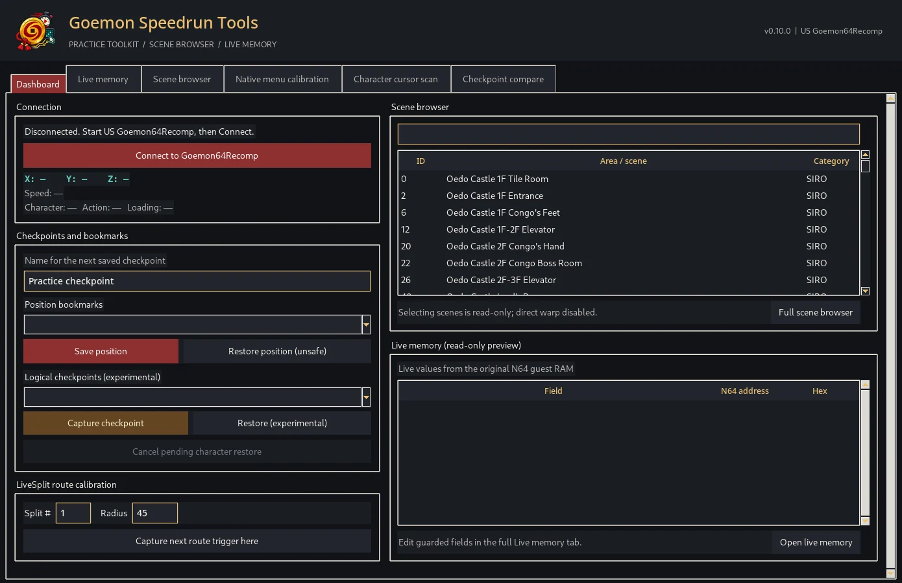

# Goemon Speedrun Tools v0.11.79 — Consolidated Address Catalogue

## v0.11.79 — reviewed cross-project address metadata, no decomp source merge

The toolkit address catalogue now includes the separately reviewed address metadata import from the newer 20 November branch. Its three JSON data files contain **549 catalogue entries** and **25 supplementary discoveries** (previous catalogue: 546 entries), with separate research-only metadata and source revision references. This does **not** promote provisional decomp code into the toolkit, change the original USA/Japan ROM images, or enable new unsafe memory writes. Toolkit v0.11.78's always-on Japanese dialogue search and character preview remain unchanged.

The historical metadata-sync branches are superseded by this consolidated update. The long-lived `chatgptweb/decomp` baseline remains independent from `main`.

## Run the practice toolkit from `main` (Windows and Linux)

**Use the `main` branch for the runnable practice toolkit.** The
`chatgptweb/decomp` branch is a separate matching-C development workspace;
its launcher and toolkit files may be older than the live `main` release. These
instructions use the actual `main` entry points and do not require an N64 ROM
to open the GUI. You need an independently running supported game/emulator to
connect to live game memory. Use a disposable save for memory-writing tools.

### Get the toolkit

```bash
git clone --branch main --single-branch https://github.com/Jake-Arnold/Goemon-64-Tools.git
cd Goemon-64-Tools
```

If you already have a **separate clean checkout** of the toolkit, update it
with `git switch main` and `git pull --ff-only origin main`. Do not switch
branches inside a working directory that contains uncommitted decomp changes.

### Windows

Install **Python 3.11 or newer**, including the Python launcher (`py`), then
open a terminal in the repository directory:

```powershell
py -m pip install -r requirements.txt
.\Run.bat
```

`Run.bat` checks Python and launches `py -m practice.toolkit --route route.json`;
it can also install dependencies if `psutil` is missing on first launch.
Alternatively run `py -m practice.toolkit` from the repository root. The app
uses Tkinter for its interface. Select the **USA** or **Japan** region in the
Dashboard after launch.

### Ubuntu / Linux (native Tk toolkit)

Use a desktop session with Tk support and a regular Python virtual environment:

```bash
sudo apt update
sudo apt install git python3-venv python3-tk
python3 -m venv .venv
source .venv/bin/activate
python -m pip install -r requirements.txt
bash Run-Linux.sh
```

`Run-Linux.sh` uses `.venv/bin/python` if it exists, otherwise `python3`, and
starts `python -m practice.toolkit`. It does **not** launch or install the game.
For a read-only connection, use `bash Run-Linux.sh --read-only` (Windows:
`py -m practice.toolkit --read-only`). Without `--read-only`, memory-writing
practice controls are enabled by default once a writable game connection is
established.

Connect through the **Connection** panel using automatic discovery or an
existing game PID. Linux process-memory permissions may prevent attaching to
independently started games. The toolkit offers an explicit authorization path
for `ptrace_scope` changes, which reduces same-user process isolation; read
[Linux setup, process permissions and limitations](docs/LINUX_TOOLKIT.md)
before enabling it. Keyboard injection is verified for X11 only, not Wayland.

### Keep toolkit and decomp development separate

For toolkit updates, run `git pull --ff-only origin main` from the **main**
checkout. The experimental C decompilation branch has separate original-ROM
build and verification requirements; the matching-C code and research are **not**
needed to run the toolkit. Neither branch distributes game ROMs or emulators.

---

# Goemon Speedrun Tools v0.11.78 — Japanese Dialogue Always Readable

## v0.11.78 — Japanese kana and romaji display is permanent

The Japanese Dialogue tab now **always** displays the complete kana mapping and provides Japanese-text and romaji search. The previous “Show kana hypothesis” checkbox has been removed. Source-order kana appear directly in the dialogue list and readable preview without requiring a toggle. The read-only character preview is visible whenever a Japanese record is selected, with **Copy character preview** available. All 160 kana remain directly editable as standard Unicode.

The original Japanese text index contains **5,039 source-referenced records and zero unidentified positive tokens**. The editor preserves byte-exact original IDs, including fullwidth exclamation aliases: token `11` stays `<token:11>` in editable source and visually displays as `！` in the preview, while ordinary typed `！` encodes to canonical token `212`. Control tokens, ROM identity checks, retail repacking restrictions and Japanese/USA separation are unchanged. The existing Japanese auto-wrap limitation remains separate from character decoding.

These updates replace the older opt-in / provisional preview behaviour described in dated historical release notes below.

# Goemon Speedrun Tools v0.11.77 — Japanese Token 11 Native Alias Proven

## v0.11.77 — original Japanese token 11 renders as fullwidth ！

The user supplied two Kai Highway Project64/native gameplay screenshots, including one explicitly labelled `jp-kai-token11-probe.z64`. Both one-character experimental ROMs visibly show `かい！う`. The isolated original-Japan ROM patches previously proved that `11` and canonical `212` are distinct original token IDs; **both render as the same visible fullwidth exclamation mark**. The previously unexplained original dialogue token sequence `16,303,59,11,-60` can be visually read `う〜ん！`, newline.

**Lossless handling:** `JP_NATIVE_RENDERED_ALIASES={11:'！'}` is separate from the bijective 242-entry canonical screenshot-backed map. Source/editor text keeps the raw alternate `<token:11>` so no-op saves reproduce original bytes; normal typed Unicode `！` still encodes to `212`. The read-only character preview displays the visibly equivalent `！`. No proprietary ROM data, probe ROMs or screenshots committed. The pinned 5,039-record original JP text index now has **0 unidentified positive IDs**. There are **243 screenshot-verified numeric token IDs** (242 unique canonical entries plus one noncanonical duplicate), **326 directly Unicode-editable glyph IDs** (including 84 source-order-inferred kana), and unobserved `183=７` remains a hypothesis. Visual equivalence does not prove identical font texture storage or semantics in every runtime context.

Full report: `docs/JAPAN_TOKEN_11_INVESTIGATION_20261120.md`. Regression tests include original record offset/bytes, native-alias preview, source roundtrip, canonical Unicode encoding, and empty original-index unknown set. Observe CI on the new commit before claiming passing tests.

# Goemon Speedrun Tools v0.11.76 — All Four Japanese Glyph Probe Pages Decoded

## v0.11.76 — 83 additional Project64-rendered Japanese glyphs

Three newly accessible Project64 screenshots show glyph probe pages 2–4, matched row-by-row to the original four-page token order reconstructed from the SHA-1-pinned original Japanese 32 MiB ROM. All **111 emitted test IDs** are now mapped, including kanji, `♪`, `卍`, `○`, and ten lowercase Latin letters. Visual and source-context checks distinguish `317=目` from `230=日`, `382=g` from a 号-like shape (original text **Going Now**), `372=艦` in 大戦艦, `368=桜` in 桜島, and `395=犯` in 現行犯.

**Confirmed glyphs: 159→242; editable glyph IDs: 243→326; unknown glyph IDs in the original 5,039-record static index: 84→1.** The sole remaining indexed unknown is suspicious ID `11` (one occurrence), deliberately excluded from the glyph probe; `183=７` also remains unobserved rather than directly writable. The **84 pattern-derived kana** retain their inferential status. Original ROM bytes, renderer, text controls, and repacking restrictions are unchanged. See `docs/JAPAN_GLYPH_PROBE_PAGES2_4_20261120.md` and `tests/test_dialogue_glyph_probe_pages234.py`. CI status must be checked on the new head commit.

# Goemon Speedrun Tools v0.11.75 — First Project64 Glyph Probe Page Decoded

## v0.11.75 — 28 glyphs read directly from native Japanese renderer

User-supplied screenshot of **JP glyph probe ROM page 1/4** at Kai Highway establishes 28 previously unknown positive token IDs, based on exact row/column positions from the original v0.11.74 JSON manifest. The newly readable/editable IDs are: digits `178–182,184–185` (２３４５６８９), punctuation `226=。`, `300/301=［］`, and 18 distinct kanji including `239=数`, `294=前`, `230=日`, `245=見`, `286=東`, `307=海`. **Verified ID count 131→159**, canonical editable ID count 215→243. The current original static dialogue index now has **84** unknown positive IDs remaining, including reserved suspect `11`. Unobserved fullwidth `７` at 183 remains an unverified hypothesis, not a directly accepted Unicode character.

The tool retains its source-original-only safeguards; all negative VM controls are preserved, and visual probe pages 2–4 are not yet counted as verified. Original Japanese text/ROMs/graphics are not committed. See `docs/JAPAN_GLYPH_PROBE_PAGE1_20261120.md` and `tests/test_dialogue_glyph_probe_page1.py`.


## v0.11.74 — Project64-rendered atlas probes for unknown Japanese character IDs

The Japanese Dialogue tab now provides **Generate Japanese glyph test ROMs**. The tool scans every verified-original Japanese dialogue candidate, counts all positive glyph IDs outside the **215 mapped Unicode glyphs**, and builds **independent 16 MiB retail probe ROMs** using the *game's real text renderer* at Kai Highway, **resource 82 +0x18**. Original negative VM controls, existing user edits, the original images and normal runtime code are untouched. Each probe shows seven numbered-position glyphs per row and four rows per screen; token identification is provided by a paired HTML position guide and machine-readable JSON manifest, not by putting potentially unsafe numeric labels inside the native dialogue window.

The 20 November user index audit identified **112 unresolved IDs / 1,632 occurrences**, not all independently uncertain. By default **token 11 is excluded** as an unusual low-value potential non-glyph control; **111 remaining IDs produce four .z64 ROMs** (7 columns × 4 rows, sorted token order). The actual number is recalculated against the imported SHA-1-pinned original ROM and current editor mappings at build time. The manifest includes page/line/column-to-token IDs, frequency counts, source hashes and individual output SHA-1s. Output filenames cannot overwrite any pre-existing file; builds stage in a temporary directory and refuse to write alongside originals.

**This is a native-rendered atlas probe, not a false offline font bitmap extraction.** The original JP texture atlas, palette, pixel format and token lookup have **not** been established. Project64 is needed to display the glyph images. The original two-line Kai Highway window does not grow: user gameplay tests show additional lines printed outside the painted box. Seven separated glyphs per row reduce overflow, but native presentation may still depend on the scene/background. The output is intended for screenshot-to-ID verification, not an English-translation production ROM.

No new third-party dependencies; retail output uses the existing pinned `lzkn64` dependency. The UI uses a background worker, reports build progress, and integrates with **Open built ROM directory**. The source-only planner, no-overwrite and mocked builder tests are in `tests/test_dialogue_glyph_probe.py`; research and workflow in `docs/JAPAN_ROM_GLYPH_PROBE_20261120.md`. CI results for this commit must be checked separately.


## v0.11.73 — Complete original Japanese kana block decoded and editable

All **160 contiguous Japanese kana glyph IDs (14–173)** are now decoded and
directly editable as Unicode, preserving original token IDs and VM controls.
This extends the previous 76 individually screenshot-confirmed kana with
84 systematically inferred positions. This was not blind extrapolation:
an original-Japan-ROM audit found **44,077 kana occurrences** across 5,039
static dialogue records, including **157/160 different kana positions**
in real source text. The remaining three positions (138=ヲ, 155=ヂ,
171=ゥ) are not used by the static text index and remain explicitly
pattern-derived rather than raster-verified. The +80 hiragana/katakana
parallel blocks and all **76 original screenshot anchors** agree.

The original 131 screenshot-confirmed character IDs remain a separate
provenance dictionary. The practical Japanese encoder now supports
**215 unique glyph IDs** in total, comprising 160 structurally decoded
kana plus other screenshot-backed kanji, punctuation and A–Z. An
unmapped kanji, unsupported small glyph, lowercase letter or unproved
digit remains `<token:N>`; no font art or ROM asset has changed.

New canonical map: `practice/dialogue_kana_table.py`. Source evidence
and corpus method: `docs/JAPAN_ALL_160_KANA_SOURCE_ORDER_20261119.md`.
`tests/test_dialogue_full_kana.py` adds token-identity tests for all
160 kana and an original-ROM-optional full 5,039-record round-trip gate.
The separate experimental panel still exposes provenance and optional
romaji/digit previews; the actual Japanese editor now displays and
accepts all kana even when the optional preview is OFF.

**Important:** 84 characters are structural inferences rather than
individually verified screenshots; source coherence is not glyph
raster validation. Japanese window geometry and automatic wrapping
remain unverified. This does not decode all kanji or every symbol.


## v0.11.72 — A–Z now directly editable, and Japan newlines proven in-game

The user's **second Project64 screenshot** of a modified Japan ROM displays all **26 English uppercase letters** across four manually inserted lines: `ABCDEFG`, `HIJKLMN`, `OPQRSTU`, `VWXYZ`. The second screenshot independently verifies the previously clipped **V–Z** numeric IDs (207–211); all **186–211=A–Z** are now confirmed and can be typed as ordinary uppercase English into Japanese Dialogue records. The verified glyph table increases from 126 to **131** IDs. Lowercase English characters remain unmapped.

The visible line breaks demonstrate that manual **Enter → -60** insertion from v0.11.71 works in Project64. However, the Kai area-name window has a fixed original height; extra rows visibly appear **below** the painted dialogue panel. This is evidence of clipping/overflow, *not* automatic window growth. Japan's Window profile dropdown and auto-wrap remain disabled until its native font advances and per-style geometry are verified. The inferred 160-kana map is still **76 individually verified / 84 provisional**; digits ２–９ are still provisional.

Tests for the exact A–Z encode/decode and four-line tokens were extended; no ROM assets, screenshot image bytes, third-party dependencies, ROM repacker or original USA code changed. Source evidence: `docs/JAPAN_KAI_ALPHABET_AND_NEWLINES_20261119.md`.


## v0.11.71 — Native uppercase A–U proven in modified Japanese gameplay

The user's **Project64 Japanese ROM screenshot** displays ordered letters **A–U** using the inferred numeric glyph sequence 186–206 in the original Kai Highway banner. This verifies **18 additional Latin ID assignments** beyond previously proven F/O/U, bringing the Japan screenshot-confirmed glyph table to **126**; all A–U can now be entered directly in the Japanese editor. V–Z remain inferred numeric IDs until visible in gameplay. The screenshot also shows that the 26-letter sequence extends past the right edge of the Kai window: native Japanese font width metrics and automatic wrapping are still unverified.

**Enter/manual JP line breaks now stage:** The editor encodes each inserted newline as `-60`; Japan validation permits *additional* manual -60 tokens while preserving the entire original sequence of other negative VM controls and retaining at least the original number of line breaks. This is manual editing only: `Window profile` and automatic wrapping remain disabled for Japan. Additional lines may not fit the original fixed-height artwork, particularly the two-line Kai heading/area-name box. The GUI explicitly warns when extra newlines are staged.

Source notes: `docs/JAPAN_KAI_ALPHABET_AND_NEWLINES_20261119.md`. Existing source ROMs, USA layout, user data storage and Japanese retail repacking remain unchanged. Tests added for direct English A–U, unsupported V–Z, manual line breaks, VM-control preservation and Japan UI staging; no new runtime dependencies. A modified Japanese ROM with *newly inserted manual line breaks* still requires in-game verification.


## v0.11.70 — Align 13 additional screenshots and expose experimental Latin font ordering

**13/13 user Japanese gameplay screenshots automatically aligned to the original pinned Japanese ROM** using original static text records: **29 distinct source records**, chiefly **resource 96** for Oedo town NPC dialogue and **resource 93** for the two-line 大江戸・はぐれ町 area banner. These include `UFOだって？`, Chappy's dog dialogue and laughter, a fortune-teller's recommendation, `にしへ行けば、ふじ山あり！`, and the directions involving `うらない屋`. Every glyph position matches the source; no fuzzy Unicode replacements or arbitrary unknown kanji assignments were necessary. Full per-screenshot offsets and transcriptions: `docs/JAPAN_OEDO_THIRTEEN_SCREEN_ALIGNMENT_20261119.md`.

**63 additional screenshot-backed token IDs** are now safely Unicode-editable in `practice/dialogue_japan.py`, bringing the original-ROM/screenshot-confirmed table to **108 unique glyph IDs**. These include many basic kana, katakana, small kana, `ー`, kanji `町/行/時/来/聞`, full-width question mark `？`, and **three Latin uppercase letters U/F/O**. All 29 source records preserve the identical complete signed-16-bit token stream (including original VM negative formatting/state commands) through encode/decode. The source input ROM, USA editor and ROM relocation/compression code are unchanged.

**A second systematic font-ordering hypothesis is supported:** `191=F`, `200=O`, `206=U` correspond to uppercase `A–Z` at token **186–211**. An original Japan ROM button instruction contains the same proposed pattern for `START` (`204,205,186,203,205`). The screenshot-proven digits `176=０`, `177=１` similarly suggest fullwidth `０–９` at **176–185**. The **unverified** remaining Latin/digit IDs are added only to the separate read-only experimental Japanese preview and search; the actual ROM encoder refuses them until independently verified. The earlier **160-position kana hypothesis** remains, now **76 screenshot-confirmed / 84 still unverified**; none of the 84 is automatically promoted.

**Validation 19 November 2026:** **59 focused original-ROM / Linux Xvfb Tk tests passed, zero skipped**, under portable Python 3.12.16, LZKN64 and the supplied pinned USA/Japan decompressed and 16 MiB retail ROMs. Includes all 29 screenshot/ROM record alignments, the 63 new mappings, original JP retail byte-for-byte unchanged repack, native token/control round trips and USA/Japan UI integration. No new Python dependencies are introduced. Full application Windows/Linux regressions, packaged TkDND distribution and modified Japanese retail ROM display in Project64 remain unverified.

The active PR #94 is draft against `main`; `chatgptweb/decomp` and any old branch cleanup state remain untouched. No original ROM bytes, screenshots, font images or licensed assets were committed.


## v0.11.69 — All candidate records visible, expanded screenshot-verified Japanese glyph map

**List cap removed:** Both USA and Japan Dialogue record lists now render **every** indexed matching record, not just the first 800. The region-aware GUI fills the remaining original USA rows after the base Dialogue view; in Japanese search mode, its table inserts all matches. Search and exact `resource:112` filters remain available. The original verified JP image contains **5,039** statically indexed candidate records; USA contains **5,186**. An actual Tk 8.6 Xvfb list of all 5,039 JP records rendered successfully (measured 0.07 s on the test host). Displaying all candidates does **not** establish VM reachability.

**Seven Plasma screenshots matched:** The user's seven consecutive Japanese Project64 screenshots align with **18 original records of resource 112**, offsets `+0x60` through `+0x328`. These cover `プラズマおやぢ`, `どぴょぴょ〜ん`, the `１０両` offer and choices, `うらなってしんぜよう`, repeated `ぷ`, the `プラズマぁ〜！` callout, `大江戸城` and directions using `出入口` / `ふじ山`. The correspondence is checked using original ROM token sequences, not guessed prose. The `docs/JAPAN_PLASMA_SEVEN_SCREEN_FONT_EVIDENCE_20261119.md` report records every paired resource offset and the **31 additional** user-screenshot-backed token IDs, yielding **45 verified Unicode glyph IDs**. Original font and text assets are not committed.

**Japanese font ordering strengthened:** The existing proposed 14–59 hiragana and 94–139 katakana blocks are supplemented with **60–63 small hiragana, 64–88 voiced/semi-voiced hiragana, 89–93 small vowels, 140–143 small katakana, 144–168 voiced/semi-voiced katakana, and 169–173 small vowels**. This yields **160 provisional kana positions**: new screenshot anchors include `64=が`, `70=じ`, `75=ぢ`, `77=で`, `85=ぴ`, `86=ぷ`, `151=ズ` and `166=プ`. Only screenshot-proven glyphs enter the editable Unicode table. Every other predicted character remains in the **read-only** kana/romaji preview, not ROM-writing code. The inferred positions cover 44,077 out of 64,217 nonnegative glyph occurrences across the static index; this is frequency coverage, not decoding accuracy.

**Verification (19 November 2026):** 54 focused Japanese ROM, persistence and Tk UI tests passed, **zero skips**, under Linux/Xvfb using the supplied original Japan and USA SHA-1-pinned ROMs and portable Python 3.12/LZKN64. Tests include source matching for all seven screenshots, full encode/decode round trips over resource 112, unverified-Unicode rejection, lists beyond 800 rows for both UI modes, and original Japanese compressed-ROM rebuild. A real 5,039-row Tk population was also timed independently. Full Windows/Linux application tests and live *modified* Japanese gameplay are still outstanding.

**Branch cleanup audit:** Five obsolete `toolkit/*` heads are safely classifiable from merged PRs or exact duplicate refs, while `toolkit/uniform-story-flag-buttons` still has a closed-unmerged PR and must not be discarded without explicit review. The connected GitHub toolset has **no remote branch-delete action**; therefore no branch was deleted automatically. The user's local cleanup shell script is external to this PR and is intentionally not included in app source.


## v0.11.68 — Search JP dialogue using romaji, and inspect a whole resource

The Japanese Dialogue tab's always-enabled kana and romaji search provides phonetic **romaji search** alongside kana and raw token ID matching. Search `pu`, `pura`, `purazuma`, or `purazumaa` to find Japanese Plasma records even though the game inserts display spaces between each character. Search `resource:112` to view the **whole** statically indexed Plasma resource, or `resource:112 pu` to narrow within it. A new **Show selected resource** button fills the exact resource filter. Search is case-insensitive; unverified glyphs are treated as barriers rather than invented phonetic readings. All inferred kana and romaji search remain read-only and opt-in; the patcher still encodes only screenshot-confirmed characters or explicit `<token:N>`.

**New screenshot-backed mapping:** The user's original Japanese Project64 screenshot shows **`プラズマぁ！！`**. Source resource **112 +0x0C** contains `166,132,151,124,89,212,212` interleaved with original spacing token `13` and negative style controls. This confirms `166=プ`, `132=ラ`, `151=ズ`, `124=マ`, `89=ぁ`, `212=！`; these six glyph IDs are now accepted as readable/editable Unicode. Other kana, kanji and Latin mappings remain unverified.

Scanning the pinned Japanese original yields **103** static candidate records containing `pu`, **65** containing `purazuma`, and **3** containing `purazumaa` under this limited search model. Most Plasma-name hits belong to resource **112**; these are candidate record matches, not proof of a fully executed dialogue chain. Source/ROM details: `docs/JAPAN_PLASMA_ROMAJI_SEARCH_20261119.md`.

**Verification 19 November 2026:** 37 focused dialogue-related tests passed, zero skips, under portable Python 3.12.16 with source-pinned Japan/USA decompressed and retail ROM paths, Xvfb and LZKN64. These include matching the exact original 112+0x0C token stream, unchanged encode/decode round trips with formatting controls, guarded Unicode, real-ROM romaji search, mixed-case search, resource filters, Xvfb Tk selection and original Japanese retail repacking. Python compileall passed. Full application regressions, live patched JP gameplay, and native standalone TkDND dependency packaging were not run. No copyrighted ROM data committed.


## v0.11.67 — Gojuon-order preview for Japanese dialogue verification

After the user's screenshot validated original Japanese script tokens `15=い` / `95=イ` and `19=か` / `99=カ`, the Toolkit now has a **read-only hypothesis preview** for the *Japan* Dialogue tab. The proposed standard 46-character hiragana sequence occupies token IDs `14..59` and katakana occupies `94..139` (+80). **Only the eight pre-existing screenshot-confirmed glyph IDs remain verified and editable as Unicode.** The new proposed characters are **not** added to the encoder or ROM patcher.

Choose the **Japan** region; the character preview and romaji search are automatically enabled. The list becomes searchable by tentative Japanese words and a separate read-only panel shows the selected record in the proposed text. It counts guessed characters and offers **Copy character preview** for direct comparison against gameplay screenshots. The actual editable record retains exact `<token:N>` IDs for all unverified glyphs, and its existing safety validation is unchanged. The toggle defaults OFF, and the panel hides when returning to USA.

**Plausibility from the pinned original Japanese ROM:** Source candidate resource 81 contains inferred fragments `しません` and `たいほする`, and resource 84 yields `ムサシ`. These agree with plausible Japanese text in context; **none is an independent in-game verification** of the predicted ordering. Among 5,039 original static candidate records, 4,935 contain at least one predicted-but-unconfirmed kana token. This is coverage, not accuracy.

**Tests 19 November 2026:** 26 Japanese ROM/Tk-focused tests passed, zero skipped, with pinned 32 MiB Japanese/USA decompressed and 16 MiB retail sources under portable Python 3.12/LZKN64/Xvfb. Tests verify the offset-80 pattern, exact original Kai records, safety separation of inferred preview from encoder, noneditable GUI preview, opt-in Japanese search and existing retail repack/storage behavior. No new third-party dependencies. **Full application Linux/Windows regressions, real native TkDND packaging and screenshot checks of unverified kana remain pending.**

Source notes: `docs/JAPAN_GOJUON_PREVIEW_RESEARCH_20261119.md`. The original ROMs and copyrighted assets are not committed.


## v0.11.66 — Japanese Kai Highway glyph mapping

A user-supplied Japanese Project64 screenshot was matched against two adjacent original Japan-0 ROM records in resource **82**, at offsets **+0x04** (header) and **+0x18** (subtitle). The verified ROM's signed halfwords now decode to readable **`【カイ】`** and **`かいどう`**, including indentation, orange title presentation via unchanged `-33/-32` controls and an original trailing `-60` newline. Eight screenshot-aligned token IDs are mapped for safe direct Unicode typing: `292=【`, `293=】`, `99=カ`, `95=イ`, `19=か`, `15=い`, `78=ど`, `16=う`. Existing token `13` remains a space/indent. All other Japanese glyphs stay as exact `<token:N>` placeholders.

The Japanese Unicode editor **only** accepts confirmed glyphs; unknown Unicode raises an error rather than guessing an SJIS or atlas order. All original negative control values retain their order. The two records round-trip to **byte-identical 16-bit token sequences** when unchanged. The extra glyphs are not an exhaustive character table, and Japanese layout/auto-wrap remain disabled until font widths and native window geometry are verified. No ROM bytes, font graphics or original script assets are committed.

**Verification on 19 November 2026:** 20 focused Japanese ROM and Tk UI tests passed under portable Python 3.12.16, Xvfb and LZKN64 0.2.0; this includes exact 82+0x04/+0x18 token-to-Unicode examples, edit validation, unchanged compressed JP retail repack, verified persistence and Japanese/USA tab controls. The mapping was confirmed against the original in-game screenshot; no modified Japanese Unicode replacement has yet been displayed in Project64.

The source-alignment evidence is in `docs/JAPAN_KAI_GLYPH_MAPPING_20261119.md`. This incremental update does **not** claim a complete Japanese font atlas or bundled TkDND native packages.


## v0.11.65 — Japan-0 original ROM support, one-time import, native file drop, built-ROM folder

The existing **Dialogue** tab now has a separate **USA / Japan** selector. It can import either the original 16 MiB retail image (including the byte-swapped Japan `.n64`) or a verified original 32 MiB decompressed image. On retail import it normalises Japan byte order, automatically decompresses the original files using the optional `lzkn64==0.2.0` runtime, verifies the exact decompressed SHA-1, and copies the retail and decompressed originals to a **persistent per-user ROM library** outside the repository. Saved images are re-hashed before reuse and load automatically on subsequent launches. Source ROMs are not modified; no original assets are committed.

**Persistent directory:** Linux `$XDG_DATA_HOME/GoemonSpeedrunTools/dialogue-roms` (default `~/.local/share/GoemonSpeedrunTools/dialogue-roms`), Windows `%LOCALAPPDATA%\GoemonSpeedrunTools\dialogue-roms`, macOS `~/Library/Application Support/GoemonSpeedrunTools/dialogue-roms`. The **Open built ROM directory** button opens the last successfully built output folder, or the default persistent `dialogue-roms/built/` folder. Builds default to that folder. Importing an unchanged original once is enough; original full-ROM hashes are still checked on every reload.

The Toolkit root uses the `tkinterdnd2` package for native file drag-and-drop on supported Linux/Windows/macOS Tk installations. A plain file-picker **Import original ROM** fallback always remains available. Install from `requirements.txt` (including `tkinterdnd2>=0.4.3`) to enable real drop handling. Dropping a ROM only imports while the Dialogue tab is active. Multiple dropped files are rejected rather than partially processed.

**Japan extraction:** The original Japan-0 file table at decompressed offset `0x58258` and its original `0x8010` same-resource script operands yield **5,039 candidate text records across 42 resources**, with 5,694 direct script references. Japan text is signed 16-bit tokens, not USA ASCII. **Japanese Unicode glyph mapping is not decoded yet**: the editor shows and edits safe numeric `<token:N>` IDs, preserves original negative controls and rejects unsupported Unicode to prevent corrupting the ROM. JP font-width auto-wrap and USA-native window sizing are intentionally disabled for Japanese dialogue. Same-size replacement and bounded variable-length record relocation are supported with verified source pointers, followed by 16 MiB big-endian Japanese retail `.z64` rebuilding. The untouched Japanese retail image repacks **byte-for-byte** to SHA-1 `9843ee979b5f6c80f5eda85df0baed9ae7c4e73b`; the original `.n64` bytes require adjacent-byte swapping before comparison. A modified Japanese record was repacked successfully, **not tested in Project64 gameplay**.

**Test evidence:** 18 focused new Python and Xvfb Tk tests passed on 19 November 2026, no skips, using both supplied original regional ROMs, portable Python 3.12 and LZKN64 0.2.0. These cover both automatic-decompression paths, persistent image validation, mixed byte order, JP token roundtrips and rejection, in-place and longer JP patches, original retail byte equality, file-manager dispatch and root fallback when TkDND is absent. Existing full Toolkit regressions and actual TkDND drops on an installed TkDND binary were not exercised. Source research: `docs/JAPAN_DIALOGUE_ROM_EDITOR_RESEARCH_20261119.md`.


## v0.11.64 — Native artwork width and conservative auto wrapping

The Dialogue tab now derives **horizontal bounds** from the original USA window CI4 textures and RGBA16 palettes, rather than treating each texture's **256-pixel stride** as its actual painted width. All twelve styles have source-backed visible artwork bounds: styles **2–5** paint **160 pixels**, while styles **0–1 and 6–11** paint **256 pixels**. Native text placement is **14 units** from the window origin (10-unit +0x50 inset and a 4-unit glyph-entry offset); glyph drawing rectangles are 10 units across. A 4-pixel decorative right border is reserved, along with the narrowest original font advance (3 units), yielding **conservative total-advance limits** of **135 units** for styles 2–5 and **231 units** for other styles.

The editor now defaults to **Native (auto when traced)** and reports the artwork width, conservative advance limit, actual line start and remaining complete native lines for statically identified style contexts. The manual entries are disabled in this mode, and no automatic width is inferred for untraced scripts. Manual limits remain available but **cannot override a known native conservative limit**. The Wrap action can use the conservative native limit for compatible multi-line records when at least two actual lines remain; single-line area names and unsupported control-code records are rejected. Existing ROM generation still requires an explicit Stage/Build action.

**Kai Highway, resource 82:** style 5 uses 160-pixel painted artwork with a 135-unit conservative advance cap. Its original indented area-name line measures **122 units**; the edited `Monster Monster Monster` measures **165**, exceeding the conservative cap. The heading consumes line one and only **one** complete native line remains for the area name. These findings are consistent with the user's Project64 screenshots, but do not establish all animated clipping and screen-scale cases.

The evidence, original MIPS addresses, texture/palette pointers, validation checks and known limits are documented in `docs/USA_DIALOGUE_HORIZONTAL_GEOMETRY_20261119.md`.

**Tests run 19 November 2026:** 51 focused dialogue/ROM/Tk GUI tests passed (0 skips) under portable Python 3.12.16 + Xvfb and LZKN64 0.2.0, with the original pinned USA decompressed SHA-1 `6ea0ed71032ce08fc2745f412d84936382197494` and retail SHA-1 `df8083a54296b8c151917c5333e1c85f014a2a66`. Retail compression tests still pass. Full application Linux/Windows regressions, JP support and live testing of the new native auto-wrap profile remain out of scope.


## v0.11.63 — Source-backed line capacity and improved control-code metadata

The Dialogue tab now recognises original USA window-style metadata from the native 12-entry style table at decompressed offset `0x633F0`. For direct script sequences it traces the last unbranched assignment to `0x801C7768`, verifies the following `0x8010` text commands and calculates which line of the window the selected record starts on. Using the original 12-pixel glyphs, 16-unit line spacing, 7-unit initial y inset and style backgrounds of 40/56/72 units, it reports a conservative native **2/3/4 complete-line capacity**. The reported capacity is for the original unscaled background geometry, not an exhaustive window-animation/clipping model.

**Kai Highway:** USA resource 82 writes window style 5 (40 units high) at script `+0x40`, prints the `[Kai]` heading with a native linebreak at `+0x58`, and prints the area name at `+0x60`. Consequently the area name begins on **line 2 of 2**, with **one complete line left**. The Toolkit warns when edits exceed this limit even if the manually entered `Max lines` is 20; explicit wrapping cannot add more lines than the native remaining capacity. The original area-name record starts with eight actual spaces consuming 72 native font units. Removing them shifts the text left, as confirmed by user screenshots.

**Horizontal max glyph width remains manual.** The source table's 256-unit field is a texture-related stride and is not verified as the maximum glyph text width; the renderer's coordinate conversion and inset must be traced before the Toolkit can choose the real box width. The editor makes this distinction explicit rather than silently filling a false width.

The control decoder also now documents original MIPS effects of `-57..-50`: setting/clearing window flags, a float32 window field and a halfword parameter. Their *visual* consequences remain unverified and the wrapper continues rejecting these opaque controls. A source-evidence report is in `docs/USA_DIALOGUE_WINDOW_GEOMETRY_20261119.md`.

On the verified USA ROM, bounded straight-line style inference resolves **963 of 5,186 statically indexed text records**; this is not a complete reachability analysis or indirect-pointer proof.

**Tests:** 42 focused Python/ROM/Xvfb-Tk tests passed (0 skips) using the pinned 32 MiB decompressed USA SHA-1 `6ea0ed71032ce08fc2745f412d84936382197494`, original retail USA SHA-1 `df8083a54296b8c151917c5333e1c85f014a2a66`, portable Python 3.12 and LZKN64. Full Toolkit Linux/Windows regressions and actual in-game auto-wrapping against multiple window styles remain outstanding.


## v0.11.62 — Exact glyph advances, layout warnings and guarded wrapping

The existing **Dialogue** tab reads the verified USA ROM glyph-width table at decompressed offset `0x5C710`. The original renderer advances the horizontal cursor by the token's width byte plus one; the editor now shows the original and edited maximum line widths, line count, peak renderer glyph-entry usage, and control-code summaries. It warns about unknown-width token IDs, opaque layout controls, more than 120 retained glyph entries between clears, and exceeding a manually supplied width/line limit.

The original 40-entry signed-control dispatch (`-71..-32`) is catalogued. Known actions (e.g. `-60` newline, `-63` clear, `-61/-62` state transitions) are distinguished from helper calls whose semantics remain unconfirmed. The diagnostic does **not** assume every control command's effects on window layout.

Window dimensions are *not* yet verified for each style. The editor therefore offers three profiles: **Measure only** (default); **Single-line (manual cap)** for overflow warnings; and **Multi-line (manual cap)**. Only the explicit multi-line profile with user-entered width and line limits enables **Wrap to manual limits**. The wrapper replaces separator spaces with `-60` when necessary, preserves original negative controls and an optional trailing `-61/-62`, refuses complex inline formatting, missing glyph widths, unsupported spacing and unbreakable words, and cannot exceed the user limit. This is an *opt-in* transform, not automatic in-game wrapping. The patcher remains fail-closed about added control tokens unless the record has been explicitly wrapped; the permission is carried through decompressed and retail builders.

ROM-verified width examples: `Kai Highway` is **79 font advance units**; `Monster Monster Monster` is **165**. These values are not claimed textbox dimensions. No window width is hardcoded.

**Verified 19 November 2026:** 34 focused tests passed with the SHA-1-pinned USA decompressed and original retail cartridges, portable Python 3.12 and LZKN64. This includes Xvfb GUI tests and a modified compressed-resource round trip after adding a `-60` line break. No skips. Full toolkit Linux/Windows regressions and live Project64 rendering of newly inserted wrapping were not tested.

Limitations: USA only; manual bounds, no source-backed style dimensions or clipping model yet. The existing static `0x8010` candidate scan is not a complete execution/indirect-pointer graph. Japan remains independently scoped. No ROM or original assets are committed.


## v0.11.61 — Relocate dialogue and build a 16 MiB USA cartridge

The existing **Dialogue** tab now accepts longer and shorter USA text records. When necessary, it appends replacement text at the end of the original script resource, rewrites detected `0x8010` script operands, enlarges that resource's virtual extent, shifts subsequent decompressed file-table offsets and preserves the original record as a fallback. The editor requires the negative control tokens to remain in their original order; it cannot automatically guarantee rendered line width, text wrapping or complete script-reference reachability.

To build a ROM: open the unchanged SHA-1-pinned **32 MiB decompressed USA .z64**, select the unchanged **16 MiB retail USA .z64**, stage one or more text edits, and choose **Build retail .z64**. This creates a separate 16 MiB compressed cartridge using the original file's compression flags and recalculates CIC-6102 header checksums. The operation runs in a worker thread, keeping the Toolkit responsive. **Build decompressed** remains available with corrected header CRCs when resource offsets change.

Retail rebuilding requires the optional Python dependency `lzkn64==0.2.0` (`python3 -m pip install lzkn64==0.2.0`). The base toolkit does not bundle this compiled extension.

**Verification (19 November 2026):** The unmodified USA retail image rebuilt byte-for-byte with SHA-1 `df8083a54296b8c151917c5333e1c85f014a2a66`. A longer-text retail cartridge was recompressed and decompressed again: resource content, moved script pointers and updated resource tables matched the modified image exactly (apart from recalculated header CRC bytes). Twenty dialogue/ROM/headless-Tk tests passed on the supplied pinned USA images. Live gameplay with length-changing edits was **not** tested.

**Limitations:** USA only, statically identified same-resource references only, 16 KiB maximum appended data per resource, no automatic dialogue wrapping, no guaranteed runtime reachability, no Japanese repacking or source ROM overwrite. No ROMs or extracted assets are committed.


## v0.11.60 — Dialogue browser and experimental in-place text editing

The new **Dialogue** tab in the existing Tkinter toolkit opens a SHA-1-verified, 32 MiB decompressed USA ROM without connecting to a running game. It indexes aligned same-resource script text commands (`0x8010`), decodes known USA glyphs and control tokens, and provides filtering, record references, JSON/CSV export, and conservative text replacement. No copyrighted ROM or extracted dialogue is included.

Edits must preserve token count, control-token placement and original source files; the editor validates and stages changes before writing a separate *decompressed* experimental 32 MiB image. It does **not** repack the retail 16 MiB ROM, support arbitrary-length edits, establish full event reachability or prove in-game rendering. The source must match the original USA decompressed SHA-1 `6ea0ed71032ce08fc2745f412d84936382197494`.

Tests run against the verified source image on 19 November 2026: 11 dialogue/installer tests passed locally; 9 source dialogue tests are included in the repository. Emulator gameplay and retail-ROM recompression remain unverified.


## v0.11.59 — Flag images and collapsed advanced controls

The Game switch now uses **two actual 48 × 32 raster flag pictures** drawn
using Tk PhotoImage, with no third-party dependencies or external images.
Only the USA/Japan flag pictures select the region. The adjacent current
region name is noninteractive, and the native selected radio state remains
visible on Windows and Linux even without country-flag emoji fonts.

The Dashboard starts with the game selector, Connect, live status/position,
and the emulator savestate slot and Save/Load controls. Emulator/backend
selection, optional PID, native Linux launcher, Linux ptrace permission
controls and the special Japanese RAM-base picker are tucked into
**Advanced connection**, closed by default. A Japanese RAM attachment that
detects multiple candidate bases automatically opens this section.

Emulator-owned named savestate slot controls remain available through
**Named state slots**, also collapsed by default. Neither disclosure changes
the selected game, deletes stored labels or recreates the Dashboard.
Changing USA/Japan preserves disclosure state and retains all existing
guest-memory safety, verified process/ROM handling and 0x0A/0x0C warp
logic. This is a presentation-only change.

Linux CI tests include the raster images, repeated flag switching,
disclosure preservation and named native-slot dispatch.


## v0.11.58 — Consolidated static ROM actor, geometry and skeleton research

The unified Scene Browser can load independently authenticated USA and
Japanese rev-0 actor placements, browse/search per-stage static ROM actor
records, and open bounded original-ROM F3DEX geometry, four-limb and
14-node/460-triangle unposed player skeleton research previews. A
Japanese actor 0x00FB original-debugger trace correlator is included as
read-only metadata analysis; it does **not** claim a verified actor-to-mesh
mapping or RT64 renderer equivalence.

This consolidates earlier stacked PRs #60, #62, #67 into a fresh
`main`-based feature branch. Porting touches only the current entrance
UI, preserving the full reviewed entrance atlas, v0.11.57 flag selector,
shared scene controls and original debug/reload protections. Existing
native game-memory writers, region mappings and matching-C decomp code
are unchanged. Actor extraction failure never replaces a valid existing
entrance atlas. Sources, tests and documentation retain exact tested
original research Git blobs.

Synthetic and Tk tests require full CI before production merge;
real retail-ROM visual verification and gameplay actor provenance
remain independent research tasks.


## v0.11.57 — Two flag controls, one fixed Dashboard

The game-version dropdown is replaced by a compact, accessible **USA /
Japan flag toggle**. Both controls update the same single Toolkit and
selected-ROM session. Switching safely disconnects old memory handles and
stops write workers, but retains the same Dashboard cards, GUI tree,
scroll position, window geometry and Scene Browser selection rather than
unpacking/repacking panels or rebuilding the scene list.

The old duplicate "Japanese guest RAM" Dashboard card is removed from the
visible page. The unified Live Memory tab exposes the correct fixed guest
address reader, per-region writes and freezes. The named Japanese emulator
state label controls occupy a fixed Dashboard position in both regions; their
actions remain disabled when USA is selected. The advanced Japanese RAM-base
picker appears **only** when process attachment reports multiple verified
candidates and needs manual disambiguation.

The main header stays the same on both ROMs. The Scene Browser has identical
instructions, character selector, entrance controls and original-debug
button labels; regional read/write validation still uses separate verified
addresses and permissions. Tk flag glyphs retain USA/Japan text fallbacks.

GUI regressions cover repeated USA↔Japan toggles, persistent Dashboard
widget identities/layout, disconnection guards and preserved scene selection.
No ROM/game-memory semantics were changed. Real emulator tests are distinct
from headless GUI validation.


## v0.11.56 — Remove submode allowlist from double-click scene reload

The shared native 0x0C Scene Browser reload guard no longer restricts
gameplay submode to 0–4. A verified USA or Japan session at engine mode 0x0D
may **attempt** a destination reload from submode 5 (as reported during
a Japanese Impact fight), or another u8 submode, without a valid ordinary
player/task pointer. A selected entrance and character are handled exactly
as in v0.11.55. The submode is diagnostic data, not an extra write permission.

The fixed-global protections remain: normal engine mode 0x0D, plausible
current scene, loading=0, exit=0 and known current character or explicitly
selected target. Game/ROM/PID/guest-RAM writer validation, destination
staging and delayed guarded post-load player placement remain unchanged.
The original debug-menu 0x0A button is still independent.

Synthetic USA and Japan regression cases now cover submode 5, including the
reported Japanese current-scene ID 0x223. No live emulator warp has been
verified and a forced Impact transition may hang or crash the game.
Keep this draft test change unmerged until tried with a disposable savestate.


## v0.11.55 — Pointer-independent 0x0C reload in USA and Japan

The shared Scene Browser now supports an experimental double-click area
reload from observed Impact battle submode 4, including when an ordinary
player/task pointer is missing. Both games use the same fixed-global source
check: engine state 0x0D, plausible current scene, loading and exit flags
clear, known gameplay submode 0..4, and a valid current character or explicit
Goemon/Ebisumaru/Sasuke/Yae target.

Both engines stage the selected known 12-byte entrance/XYZ record before
requesting the original 0x0C scene loader. Source actor pointers are not
fabricated. USA reacquires a destination actor before any separately guarded
post-load XYZ placement. Japan recomp still checks exact ROM/code signatures,
verified process identity and RAM mapping for its short-lived writable view,
without mistakenly requiring an ordinary game player during Impact.

This is distinct from opening the original debug menu (0x0A). Double-click
from active debug mode, title screens or other unverified engine states still
refuses without writes. Unknown current characters require selecting an
explicit target. No live Impact-to-room transition has yet been verified.

Synthetic USA/JP and GUI regression tests were added, but could not be run
in a complete repository checkout here. Use a disposable emulator savestate.


## v0.11.54 — USA/Japan scene/debug parity corrections

The original debug-menu command now does the **same one-byte action for
either ROM**: if necessary, write exactly `0x0A` at the selected game's
engine-mode address (USA `0x800C7A94`; Japan `0x800CD284`). An initialized
player pointer, task pointer, ordinary gameplay mode, selected scene, entrance
or character is not a prerequisite. In particular, the USA button no longer
blocks the native menu during Impact battle modes. It remains write-disabled
when the application is read-only or has no attached guest memory. Japanese
ROM/PID/code-signature validation still applies to writable attachment.

Both regions now use the same Scene Browser current-map display (decimal
and hex), read from an independently verified region-qualified u16 global
without consulting actor pointers. The scene value updates while the
Scene Browser tab is visible, instead of only while Live Memory is open.
The shared scene list and selector now expose the same room entries and
"Keep current character" default; the USA reload path translates an
explicit character selection only when requested. Legacy USA
"open debug for selected scene" handlers no longer stage a destination
or arm post-load player/XYZ writes.

**Original debug menu (`0x0A`) and experimental instant entrance reload
(`0x0C`) remain different operations.** Instant reloads still use
region-specific staged entrance/memory contracts and may reject unstable
combat states, including Impact. No unsupported memory overwrite was
introduced to force an instant warp.

See `docs/UNIFIED_TOOLKIT_ARCHITECTURE_AUDIT.md` for the remaining
region-parity discrepancies: custom watches, Story Progress edit coverage,
checkpoint semantics and player/task-based instant reloads. The debug
and scene changes have synthetic regression tests, but no live ROM/PJ64
session has been validated in this environment. This remains a draft PR.


## v0.11.53 — Bounded flag UI and shared selected-ROM memory session

The Unlocks → Story & event flags tab now uses one **virtualised scrolling
view** for both USA and Japan. Real Off/On ttk buttons are recycled as the
user scrolls, rather than building hundreds of GUI widgets and thousands of
wheel bindings. Every flag keeps its individual state and regional guest
address/mask; no inner scrollable table and no different control layout for
large folders. Expandable groups, type/subtype filtering, search, disabled
controls and the existing compare-before-write guards remain.

A new read-only RegionSession selects only the active game's guest-RAM
reader and backend. The common polling scheduler cannot accidentally run
both regional memory loops when stale reader handles coexist. Region-specific
ROM verification, attachment, inventory/scene semantics and checked writes
remain intentionally separate, and the application retains one Tk root,
notebook and flag view when switching USA/Japan. The detailed architecture
audit is in docs/UNIFIED_TOOLKIT_ARCHITECTURE_AUDIT.md.

Isolated Xvfb GUI tests passed for a 450-flag virtual list; a 2,000-row
microbenchmark used 16 pooled controls. Full application Tk integration
tests, live emulator confirmation and Ubuntu/Wine latency measurements
remain outstanding. This feature remains in a draft PR.


## v0.11.52 — One On / Off layout for all event flags

The **Unlocks → Story & event flags** page uses individual Off / On buttons
for every flag, including large Fortune Dolls, External annotations and
Other story folders. The 13+-flag special Treeview, inner scrollbar and
selected-row toolbar introduced in v0.11.51 are removed. Only the outer
flags-page scrollbar remains.

Small groups render immediately. Larger groups build four rows at a time,
yielding to Tk between batches. Collapsing cancels unfinished batches;
reopening reuses existing controls; filters reveal matching rows without
duplicates; switching USA/Japan discards region-specific widgets.
Address maps, stale-value checks, one-bit masked writes and write permissions
are unchanged. Added GUI regressions for large-folder rendering, safety,
search, collapse and region changes. Live Linux/Wine GUI performance has not
been measured and must be verified before release.


## v0.11.51 — One lightweight table for large flag folders

**Unlocks → Story & event flags** folders with more than 12 named
flags (Fortune Dolls: 45, External annotations: 35, Other story: 24)
now render as **one cached Treeview per folder**, rather than hundreds
of Tk frames, labels, inline buttons and mouse-wheel bindings. A large
folder no longer schedules dozens of synchronous geometry updates.
A bounded 14-row viewport scrolls within the expanded folder and keeps
the flag name, canonical regional address/mask and live On/Off state
visible. Click the **Off** or **On** cell on a named row to make the same
one-bit, stale-value-checked write as before. **Off selected** and
**On selected** buttons apply the identical action to the chosen flag.
Read-only and disconnected states show unavailable actions. Clicking
a name exposes the full mapping evidence.

Search filters reuse cached Treeview rows without rebuilding widgets;
collapsing and reopening retains the table; changing region removes it.
Smaller folders (12 bits or fewer) retain individual On/Off buttons.
No ROM crosswalk, bit evidence, writable permission, or emulator
attachment policy changes. v0.11.50's visible-tab connection/polling
optimisations are preserved. Synthetic GUI tests cover USA/Japan edits,
read-only guards, filters, folder reuse and region reset. Actual Ubuntu
desktop latency remains unmeasured.


## v0.11.50 — Shared connection and visible-tab refresh pipeline

USA and Japan use the **same Tk visibility scheduler**: only the selected
main tab is polled and its widgets updated; entering a tab requests a single
fresh sample. The active Live Memory page now **reuses Treeview rows**,
preserves selection, and only changes cells whose underlying observations
changed. Story Progress uses the same shared cached row-update policy,
avoiding repeated item reconstruction for all 142 logical flag names per
region. The Japan event-crosswalk reader also reads each distinct event
byte once per sample rather than issuing one Linux process-memory syscall
for each named bit. USA Unlocks no longer continuously rebuilds the hidden
Story Progress tab as a side effect of routine polling.

Japanese Auto and explicitly selected emulator backends now use the same
`connect_candidate_ram` path and **per-executable ROM-bound verified RAM
base/endian cache**. Cache hits still revalidate the independent original
ROM code probes, the live game context, RDRAM size, and cartridge-copy
exclusion; a changed or stale base triggers full discovery. The cache
optimizes repeat attachment, not first-time scanning, and does not bypass
any original ROM identity checks.

These optimizations apply to both regions' UI; regional memory layouts,
source evidence and backend verification remain deliberately separate
adapters. Tests enforce hidden-tab nonrefresh for USA and Japan, unchanged
Treeview and Story Progress rows, and shared Auto/manual attach behaviour.
No emulator frame-rate benchmark or real Wine/Ubuntu latency measurement
has been performed in GitHub Actions.


## v0.11.48 — Unblock read-only Japanese Memory Event Capture A/B/C

The Japanese Event Sessions recorder no longer requires the candidate
loading word at `0x80161DC4` to equal zero, engine mode 13,
a valid scene number or character 0–3 before a **read-only**
100-byte snapshot. Those assumptions were incorrectly being used
as proven gameplay readiness checks, although some are derived from
unverified USA/Japan address offsets. Reading the evidence must not
depend on guesses about which game states are permitted.

New Japanese captures preserve the **observed engine mode and full
candidate loading word** in optional runtime metadata. The recorder
still rejects incomplete guest-RAM reads or a context change *during*
the bounded capture. It continues to prevent mixing different emulator
connections between A/B/C; captures during dialogue and cutscenes
are allowed and can be contrasted with idle/control trials.

Prior session JSON remains loadable. USA event capture's separate
stable gameplay requirements remain unchanged. This feature reads
game bytes only; it does not press N64 A or write event bits.


## v0.11.47 — Remove stale Project64 Windows-only notices and host guards

The Japanese guest-RAM connection panel now labels Project64 as
**Windows or Wine/Linux**, not Windows only. Project64's previously
blocked Japanese XYZ edit, original debug-menu entry and verified
native scene-writer path can use the existing Linux process-memory
adapter when connected to a real Wine Project64 process.

The same backend identity, ROM code-probe, 4/8 MiB RDRAM-layout,
read/write consistency, scene/character restrictions, opt-in flags
and compare-before-write logic remain mandatory. No automatic writes
or unchecked GameShark/code changes are introduced. Windows-specific
Project64 keyboard injection remains Windows-only; X11 savestate input
continues to use its separate window/PID verification.

Synthetic Windows/Linux RAM and GUI regression tests are used; actual
Project64 under Wine is not covered by GitHub-hosted runtime tests.


## v0.11.46 — Japanese Project64 connection on Linux

The Japanese **Project64** connection target no longer rejects Linux
before attempting attachment. Project64 running under **Wine** is an
ordinary Linux PID for the toolkit's Linux process-memory adapter.
Both manually selected Project64 PIDs and Japan **Auto** discovery now
use the existing three original-Japanese-ROM code probes, verified
RDRAM layouts (including 4 MiB), and plausibility checks on Linux as
well as Windows. Wrong ROMs, ambiguous copies and inaccessible
processes remain rejected.

Native Windows-specific keyboard injection and experimental scene-write
features are **not** automatically enabled for Wine by this change.
Linux X11 savestate hotkeys remain separately guarded by visible
window/PID verification. An existing Wine process may require the
toolkit's Linux PID permission workflow; actual interactive Wine
attachment has not yet been independently reproduced by CI.


## v0.11.45 — Equal USA and Japan saved-event flag coverage

Every one of the **142 named USA saved-event bits** now has a paired
Japanese candidate address, with the same individual bit mask, resolved
from the canonical address registry. The 83 previously omitted JP bits
include 40 individual Fortune Dolls, 7 Mr. Arrow/Elly placements, and
36 external story flags. The Japanese Unlocks / Story & event flags page
now shows all 142 records, including all 45 Fortune Doll entries.

The candidates use the scoped fixed saved-event bank displacement
`JP = USA + 0x57F0`; they are **not** 83 new Japanese gameplay
confirmations. The registry retains evidence grades and existing masked
On/Off compare-before-write controls; no writes occur automatically.

`scripts.sync_address_catalogue` now rejects orphaned saved-event
mapping rows. The authoritative main-branch registry remains distinct
from the decomp production matching-C manifest; decomp guest-data
discoveries enter through the separate versioned metadata import flow.
Dynamic/overlay/code references must never receive fabricated address
translations. See `docs/ADDRESS_CATALOGUE_WORKFLOW.md`.


## v0.11.44 — Avoid repeated offline flag-UI redraws

When no game is connected, the toolkit previously forced a complete
34-item/flag refresh on **every 170 ms UI tick**. That collided with
incremental flag-folder rendering, needlessly reconfigured buttons and
could cause visible instability. The same path also fired with a
**connected Japanese game**, because it checked only the USA reader.

The idle loop now tracks the active regional memory-reader identity:
**one** forced refresh on initial disconnection, reader loss or region
change; **no repeated refresh** while remaining disconnected. Existing
connected USA/Japan polls retain their normal throttling. Offline
flags remain searchable and viewable, showing unknown values with
disabled On/Off controls; connecting restores live states and checked
writes. Tests cover repeated idle ticks, large offline folders,
disconnection transitions and the Japanese reader case.

Actual Ubuntu visual behaviour still requires validation.


## v0.11.43 — Incremental flag-folder rendering

Opening large **Unlocks → Story & event flags** folders now creates four
rows per Tk event-loop batch rather than constructing hundreds of labels and
On/Off buttons during the click handler. Small folders remain immediately
available; subsequent batches continue while the interface responds.
Collapse, search changes and game-region switches cancel obsolete work;
reopening a populated folder reuses the existing buttons. New controls read
the latest cached flag-bank snapshot, preserving disabled states and checked
single-bit writes without repeated memory reads. Filtering avoids redundant
Tk geometry changes.

Automated tests cover partial rendering, completion, collapse/reopen,
search cancellation, regional invalidation and existing write controls.
Real Ubuntu desktop and emulator latency remain to be measured.


## v0.11.42 — Event Sessions, Super Pass and unknown-origin research

Japan Event Sessions defaults to the offset-derived candidate bank
`0x80161DF8–0x80161E5B`, while USA remains at `0x8015C608`.
Arbitrary Japanese capture windows, the separate Sasuke battery research
preset and historical investigation addresses remain supported.

Unlocks → Story & event flags now includes the independently editable
Japanese **Super Pass receipt recorded** candidate `0x80161DF8 & 0x01`,
resolved through the canonical address registry. This does not grant the
inventory item (`0x80161EF3`), and Japanese event semantics are not yet
gameplay-confirmed. Benkei remains independently verified.

Memory Address Catalogue has a **Show unknown** option for unclassified
research references alongside the active game's fields. These references
cannot be live-read or edited, and the other ROM's entries remain hidden.

See [Event Sessions](docs/EVENT_SESSIONS.md) and
[Address Catalogue workflow](docs/ADDRESS_CATALOGUE_WORKFLOW.md).


## v0.11.41 — Items scroll repair, collapsed flag folders and live catalogue values

The **Items & equipment** mouse-wheel now controls its own scrollable canvas. Previously the handler captured a variable later reused by the Flags canvas; the code now keeps separate references and accepts X11 and touchpad events from nested controls.

Under **Story & event flags**, type/subtype folders are collapsed at startup. Opening a folder constructs just its On/Off controls; text searching expands matches while constructing only matched rows. All 142 USA and 58 mapped Japanese flags retain their experimental On/Off editors, including Japanese offset candidates.

The **Live Memory → Address catalogue** displays records for the active ROM region only. Its **Live value** column automatically reads supported on-screen rows in batches of up to 32 through the existing verified reader, off the Tk thread. Unsupported, disconnected, code-VMA and untyped entries remain unavailable. Switching the game disconnects and clears earlier region values.

Duplicate evidence entries with the same region, address, width and mask are now one canonical row, with every source alias and separate ROM/decomp, gameplay and candidate provenance retained. `usa_source` is authoritative evidence for the mapped original-code location where established, but it does not establish every proposed story interpretation. The registry remains the authoritative source of addresses and masks for existing Unlocks, Story Progress, Japanese fields, inspector watches and region crosswalk; unknown dynamic pointers are never promoted automatically.

All tests use simulated RAM and headless Tk; original-game behaviour remains to be verified.

## v0.11.40 — Canonical Memory Address Catalogue

**One versioned registry now owns memory addresses used by Unlocks, Story Progress, the USA/Japan crosswalk, Japanese fields and Live Memory:** [practice/data/address_catalogue_v1.json](practice/data/address_catalogue_v1.json). The runtime resolves registered guest addresses and event bit masks through `practice/address_registry.py` instead of maintaining separate write targets. Existing manual experimental Japanese Story & event flag On/Off controls remain editable regardless of candidate confidence.

**Live memory → Address catalogue** is available while disconnected. Search every indexed address, partial hex, flag ID, alias, source, category or note; automatically show the active USA/Japan region, filter by evidence, type or category; sort columns; read complete provenance and overlap metadata; copy addresses and masks; add a supported field to existing Live watches; inspect selected guest bytes using the connected region-correct backend; or navigate to its existing control. The catalogue does not continuously poll all fields or create new automatic writers.

**462 records across 305 distinct region/address combinations** are currently indexed, including 358 supported live-readable field descriptions, 104 research-only or unsupported records, 58 experimental Japanese crosswalk story flags, the 25 external leads, 11 expanded repeat-code warp slots, script-VM pointers and Ebisumaru transformation observations. The checked-in [audit](practice/data/address_catalogue_audit.json) distinguishes aliases, bit overlap, disputed fields and unknown data widths. The totals are *field records*, not unique game-memory bytes.

**Refresh Address Catalogue** retrieves the full canonical registry JSON from the official repository via a bounded, schema-validated read-only worker, caches it offline with timestamp/upstream revision, and overlays descriptive updates. Remote records cannot change any built-in writer's target, permissions or bit mask. The running toolkit can discover newly imported descriptions without a Python software update.

New discoveries are recorded in [practice/data/address_discoveries_v1.json](practice/data/address_discoveries_v1.json), or in the separate decomp [`decomp/address_discoveries_v1.json`](decomp/address_discoveries_v1.json) research branch. [Reproducible sync and schema documentation](docs/ADDRESS_CATALOGUE_WORKFLOW.md) explains how the scheduled GitHub workflow opens **metadata-only** import PRs rather than merging decomp code. Run `python3 -m scripts.sync_address_catalogue --check` to fail CI when sources/manifests are not reconciled.

This is registry, synthetic memory and Tk testing. New candidates are not automatically promoted to gameplay-verified fields; code VMAs and dynamic pointer targets are never casually dereferenced or written.

## v0.11.39 — Clearer Unlocks layout, automatic desktop sizing, editable flag subtypes

The toolkit opens in a **monitor-sized window** rather than a fixed 1220×790 viewport (up to 1480×950, with screen margins). The scrollable Dashboard and Unlocks pages remain usable on smaller screens. Unlocks no longer repeats inventory-specific descriptions and connection status above the Story & event flags subpage. Flag rows are compact, full-width dark cards with high-contrast names, visible addresses and masks, clear live On/Off state, and separate, more legible Off and On buttons, even while disabled. Type/subtype headings organize the list.

### Edit the flag organization as JSON

The editable manifest is [practice/unlock_flag_categories.json](practice/unlock_flag_categories.json). It lists **all 142 named flag keys**, including the **58 currently mapped for Japan**, with these attributes:

```json
{
  "key": "benkei_encounter",
  "label": "Benkei encounter recorded",
  "type": "Benkei & Kihachi",
  "subtype": "Unsorted",
  "regions": ["USA", "Japan"]
}
```

Change **type** and **subtype** freely to create chapters, regions, bosses, quests or any custom grouping. The read-only reference field **regions** identifies which 58 of the 142 flags also appear in Japan. Move entries in the JSON array to change display order. The UI's **Type** and **Subtype** dropdowns filter the named groups; text search also searches both labels and their full evidence. `Unsorted` is the initial placeholder until the organization is supplied. Changes take effect on toolkit restart.

**Do not change or remove `key`**: it is the immutable identifier that binds metadata to a game flag. `label` is descriptive reference text; `type` and `subtype` alone affect the UI layout. Addresses, masks, read/write support and regional crosswalk evidence are defined in code, never in this JSON. Unverified Japanese crosswalk bits remain directly On/Off editable after reorganization.

To validate an edited JSON file:

```bash
python3 -m unittest tests.test_unlock_flag_catalog -v
```

If the JSON file is missing or invalid, the toolkit starts with its original generic sections rather than suppressing live flag editing. The tests report schema errors. The JSON is tracked in Git: personal edits should be saved or submitted separately before an auto-update of the repository.

## v0.11.38 — Direct On / Off buttons for each story and event flag

Under **Unlocks → Story & event flags**, every mapped flag now has **its own On and Off buttons on the same row** as its name, address, bit mask, live state and research source. There is no need to select a table row and use shared buttons below the list. Clicking a flag's name displays its full provenance. Search filters the displayed controls, with independent scrolling for the long list. Rows are created only when the flags page is opened to avoid slowing startup.

The **USA named saved-event catalogue** and all **Japanese mapped curated / Plasma crosswalk flags**, including candidate offsets, have exactly the same On/Off interaction. Crosswalk evidence status does **not** block writes. The live state and highlighted button track the original game's current bit; disconnected entries display an unavailable state. Every click writes just the chosen masked bit, rechecks the currently displayed byte, and leaves adjacent bits untouched. The 34 separate menu-item controls remain unchanged on **Items & equipment**.

## Dashboard: version selection, update checks and one-click installs (v0.11.37)

The Dashboard updater offers a **Version** dropdown with **Stable · main**, **Test · toolkit/* branches** and available **Release tag · vX.Y.Z** entries. **Refresh versions** retrieves the current GitHub refs without changing any source files. **Check for updates** compares the selected version against the installed checkout. After checking, **Install update and restart** fast-forwards the current branch, or **Switch version and restart** switches explicitly to another chosen branch or release tag.

This works with canonical Git-cloned installs on **Ubuntu or Windows**. Only the selected version is installed; decompilation and research branches are not listed. Existing local branch histories are preserved when switching versions, and releases use detached-HEAD checkouts rather than modifying a local branch. To return to stable, select **Stable · main**. The updater refuses dirty tracked files, diverged destination branches, unknown remotes and changed remote commits between checking and installation. It never force-resets Git, discards local commits, or removes untracked files. Git itself blocks switching if an untracked file would be overwritten. ZIP downloads are not auto-updatable.

Git/network work takes place off the Tk UI thread. After installation the toolkit closes process handles, input injectors and freeze workers through normal shutdown before relaunching the selected code. Replaced code may depend on newer Python packages and release tags may contain older interfaces. Manual native-game testing is still required.

## Unlocks: Items & equipment and Story & event flags (experimental branch)

The existing **Unlocks** page now contains two internal sections: **Items & equipment** (all 34 original controls, including party members, upgrades, weapons, Start-menu items, fish counts and Miracle Items) and **Story & event flags** (searchable, live-read flag list with Set / On and Clear / Off actions). This is not a new top-level diagnostics tab.

USA flags reuse the same packed-bit addresses, masks and checked writer as Story Progress. Japan shows all 58 currently crosswalked curated and Plasma flag entries. **Every one of these Japanese crosswalk event bits is editable for testing**, including offsets labelled **JP offset candidate**; provenance labels describe evidence, not permission. An observed bit or successful write does not prove the associated story event semantics.

Each explicit click sets or clears only the selected bit, retains neighbouring bits, checks that the displayed byte is still current and routes the Japanese write through the active verified game connection. Bulk Unlock All affects items only; it never bulk-sets the story flags. Read-only mode, disconnection and stale-byte checks remain in place. This branch has not been validated on actual gameplay.

## Cross-region memory mapping in the existing tabs (merged: PRs #35 and #52)

Japan and USA use the same Live Memory, Unlocks and Story Progress pages. The reciprocal memory-data crosswalk lives in `practice/region_memory_crosswalk.py`, not a new Japanese diagnostics panel. Source-verified and user-observed static fields absent from the original Japanese live table appear in shared Live Memory; the 34 regional Unlocks continue using their existing explicitly sourced `practice/region_unlocks.py` mappings. Japanese saved-event/Plasma candidate addresses appear only as clearly labelled **read-only bit observations** in the existing Story Progress table. Guessed bits are not identified as completed events or made editable.

Agents can look up known mappings and scoped unknown candidates with `python3 scripts/crosswalk_address.py --source usa --address 0x8015C60C --mask 0x20`. This produces no gameplay-memory writes. The confirmed Snowflake +0x57F1 exception overrides arithmetic; suspected pause `0x800CD2D6` and Sasuke Battery 1 remain unverified. Dynamic player pointers, script VM and overlay/Impact addresses must not be inferred from +0x57F0. This implementation is merged into `main` through PRs #35 and #52. The redundant crosswalk panel in PR #43 was deliberately excluded and that PR is closed.


**Merged verification (17 November 2026):** [Linux CI](https://github.com/Jake-Arnold/Goemon-64-Tools/actions/runs/44106257328) passed 336 synthetic tests (335 passed, 1 skipped) and 139 Xvfb Tk GUI tests; [Windows portable CI](https://github.com/Jake-Arnold/Goemon-64-Tools/actions/runs/44106257521) passed 33 tests. Actual Japanese gameplay and full Windows Tk UI remain unverified.

## v0.11.36 — Remove duplicate JP diagnostics and comparison presets (16 November 2026)

**Final code verification:** [Linux CI 43948425965](https://github.com/Jake-Arnold/Goemon-64-Tools/actions/runs/43948425965) passed **313 synthetic non-GUI tests (312 passed, 1 skipped) and 139 Tk GUI tests**. [Windows CI 43948426011](https://github.com/Jake-Arnold/Goemon-64-Tools/actions/runs/43948426011) passed **33 portable tests**. Both tested code commit `aaa2b9ff5a71f7520cbff8d45c63b83d4f519dd0`; final documentation changes only. Real-game Linux and Windows Tk integration has not been exercised.

**Mainline:** the shared diagnostics simplification was merged through PR #35, followed by the cross-region mapping integration in PR #52. The older candidate-only UI PR #43 was closed without merging.

### Reduced navigation and controls

- The standalone **Japan Live (diagnostics)** top-level tab is no longer shown in either region. The old diagnostic widget/model is retained internally for compatibility with source-backed readings, guards and old saved Japanese custom watches. Continuous hidden-tab polling has been stopped. Use shared **Live Memory** for typed values, search-generated watches, renaming, freezes and live refresh.
- The **manual Japan Goemon XYZ editor** (a genuinely unique feature of that tab) now appears in the shared **Scene Browser** in Japanese mode, using the same X/Y/Z variables and original scene/character/PID/RAM verification and write-confirmation routine. The Scene Browser already supplies native debug-menu and room-warp actions, so no extra Japanese scene controller tab is visible.
- The separate **Verify ROM** button is removed from Dashboard. Clicking **Connect** in Japan mode now prompts for the original Japan-0 ROM only if no previously verified ROM is remembered. Correct 16 MiB retail-ROM SHA-1 validation, three independent 64-byte code-fingerprint probes and per-attachment RAM/backend verification are still mandatory. A cancelled or mismatched ROM never authorises a Japanese attachment. USA uses its existing process attach path.
- **Compare memory changes** no longer offers misleading fixed **Test** presets. Any experiment name is entered once via the shared **Report name** control. The only capture-range setting is **focused** versus **wide**; the meaning is explained in the tab. A report name never changes captured addresses or boosts rankings. Removed unused dropdown presets and the previous 5/30-point USA prefix-based candidate ranking bonuses.
- **Capture C: Optional** is now explicit: ordinary A/B/C comparison *filters to values that reverted to A*, therefore **skip C for irreversible/persistent state**; Japanese wide XYZ analysis instead requires C stationary at B, after moving from A to B.
- The shared **Results · read-only** toolbar (report name, Save report, selected watches, refresh cadence) is now placed **before the method-specific capture controls** in all four research tabs, removing duplicate local report names.

### Further source audit

The full row-by-row [redundancy and safety audit](docs/TOOLKIT_REDUNDANCY_AUDIT_2026-11-16.md) documents what was removed, moved and retained. Legacy raw JSON exports, specialised freezes, Story progress and Unlocks, and the quick raw-byte dashboard reader have possible overlap, but are not deleted without evidence of functional equivalence and compatibility. Old investigations and watch files are not modified.

### Tests and limits

The current Linux Tk smoke suite includes Japanese-hidden-tab/regional scene editor behaviour, automatic ROM picker safety, freeform comparison capture semantics, and existing USA/JP research/watch regressions. The Windows report workflow validates portable APIs. These checks use synthetic game memory; real native recomp gameplay on Linux/Windows and original guest MIPS read/write tracing remain unverified.

Ubuntu test checkout:

    cd ~/Desktop/Goemon-64-Tools-JP-Recomp
    git fetch origin
    git switch toolkit/unified-memory-discovery
    git pull --ff-only
    bash Run-Linux.sh

## v0.11.35 — Consistent discovery results, watching and live updating (16 November 2026)

**Final v0.11.35 branch-tip code verification:** [Linux 43943477576](https://github.com/Jake-Arnold/Goemon-64-Tools/actions/runs/43943477576) passed 313 non-GUI tests (312 passed, 1 skipped) and 135 GUI tests. [Windows 43943477681](https://github.com/Jake-Arnold/Goemon-64-Tools/actions/runs/43943477681) passed 33 portable tests. These verify synthetic RAM/Tk behaviours, not real USA/JP native-game memory tracing or Windows Tk gameplay.

**Experimental branch-only build** on toolkit/unified-memory-discovery. This is the shared UI layer following the v0.11.34 four-method navigation and common reporting implementation. Main is unchanged.

### Standard discovery results interface

All four Memory discovery methods (**Find a value**, **Compare memory changes**, **Investigate flags**, **Record damage**) now use the same **Results · read-only** bar. Its actions appear in the same order on every page:

- **Watch selected** — add multiple typed guest addresses directly into shared Live Memory, using the correct USA or Japan watch file; duplicates are skipped. If a Japanese XYZ triple is selected, add three individual float watches (X/Y/Z).
- **Select all listed** — select all candidates currently listed in the table; at most 128 typed watches can be saved. **Copy address** copies the first selected address.
- **Refresh now** — request an immediate read of displayed/selected candidate values. **Live update** and **Every (100/250/500/1000 ms)** continuously refresh while that method's tab is active, without overlapping workers.
- **Report name** and **Save report** — use the common report manager to save Markdown, CSV and full available JSON evidence in the same four-file schema.

All four tables start with **N64 address / Type / Live value / Live hex**. Remaining columns show only evidence specific to the method (previous values; captured A/B; mask and trial support; damage hit counts). Changing a value during gameplay updates the **Live** column without altering the original comparison evidence, trial rankings or saved snapshots.

For the three non-scanner workflows, live values are read in background threads and grouped into bounded 4 KiB guest-RAM ranges; the active tab samples selected and currently viewed rows. The numeric scanner retains its established asynchronous live/continuous scan engine but exposes the same controls. Actual update rates depend on the native recomp/emulator's process-memory read throughput.

### Compatibility and safety

- Live reads are *external value polls*, not original game MIPS instruction reader/writer traces. No research action writes guest RAM.
- Live Memory custom watches remain independently stored per region. Invalid/unknown-width text matches cannot be pinned to numeric Live Memory watches; candidate rows remain available in reports.
- Candidate regions and original captured evidence are not reinterpreted when switching USA/JP; pending live updates and old damage/flag rows are invalidated.
- Dedicated research evidence remains intact: A/B/C captures, repeated flag trials and automatic damage-event timelines continue to use the unified report format.
- Specialist exhaustive Japanese XYZ export remains available as an advanced option. Unsupported original-MIPS read/write tracing has not been implemented.

### Testing

[Linux CI](https://github.com/Jake-Arnold/Goemon-64-Tools/actions/workflows/toolkit-linux-regression.yml) now runs numeric live-preview, structured candidate consistency, all four Tk tabs, JP/USA batch watch isolation, XYZ triple expansion and GUI teardown tests. [Windows CI](https://github.com/Jake-Arnold/Goemon-64-Tools/actions/workflows/toolkit-windows-report.yml) runs portable live-read, watch and report tests. Both test synthetic game memory only; real-game USA/JP and Windows GUI interaction remain to be validated.

Run on Ubuntu:

    cd ~/Desktop/Goemon-64-Tools-JP-Recomp
    git fetch origin
    git switch toolkit/unified-memory-discovery
    git pull --ff-only
    bash Run-Linux.sh

## v0.11.34 — Guided Memory Discovery and unified reports (16 November 2026)

**Hosted tests for v0.11.34:** [Linux run 43938746400](https://github.com/Jake-Arnold/Goemon-64-Tools/actions/runs/43938746400) passed **307 non-GUI tests (306 passed, 1 skipped) and 131 Tk GUI tests**, with no Tk callback errors. [Windows run 43938746437](https://github.com/Jake-Arnold/Goemon-64-Tools/actions/runs/43938746437) passed **27 portable reporting, scanning and version tests**. Actual live USA/JP recomp processes and Windows Tk GUI have not been exercised in CI.

**Draft branch only.** Keep toolkit/unified-memory-discovery separate from main until user review and live game tests.

### What changed
- Memory discovery opens with a **Start here** page describing four direct methods: **Find a value**, **Compare memory changes**, **Investigate flags**, **Record damage**. No nested "Event sessions > Advanced RAM comparison". The existing underlying algorithms and saved investigation compatibility remain.
- A small connected-game status line at the top shows the actual attached USA/JP reader, PID and backend; **Open connection** returns to Dashboard. If a Japanese flag investigation has attached RAM but missing identity metadata, the error now says exactly which part is missing.
- All four methods have **Save report**, using one implementation and the same four files: summary.md, candidates.csv, session.json and manifest.json, grouped by region, readable investigation and timestamp. CSV stores all candidates supplied by each research engine; JSON preserves complete available trial/event/context evidence.
- Value search now exports up to **20,000** surviving candidates, not just 200 visible rows. Larger result sets are honestly marked partial; snapshots are observations, not guest-MIPS access traces.
- **Compare memory changes** saves derived candidates, context and captured-region lengths/SHA-256 provenance. The analyzer may limit ranked results; report counts disclose this. No raw 8 MiB guest RAM dumps are written.
- **Investigate flags** keeps complete 100-byte A/B/C captures, repeat/trial IDs, notes, roles, gameplay contexts and ranked bit evidence. Work-in-progress investigations autosave in Reports/.working/[USA|JP], outside the published Reports index. Old diagnostics JSON can still be opened.
- **Record damage** saves the full ranked candidate list produced by its recorder and available event metadata/timelines. Detailed timelines are capped to the strongest 300 candidate entries and the report discloses this limit.
- **Japanese Unlocks fix:** treat backend selector **auto** as valid when the connected, detected backend is Project64, Mupen64Plus or native recomp. Existing verified RAM, PID, read-only and backend mismatch guards remain in place. All 33 previously tested JP entries and one unverified Sasuke battery candidate retain their existing verification labels; no new addresses are invented.
- No native recomp original-MIPS-PC read/write tracing yet. No changes to decompilation branches or shipped game code.

### Testing

Synthetic unit, Linux Xvfb Tk and Windows portable checks are run on this branch. Results are recorded in PROGRESS.md. Neither host CI check establishes live-game compatibility.

## v0.11.33 — Memory search usability, continuous filtering and readable reports (16 November 2026)

**Automated test evidence for this build:** Ubuntu [run 43933889974](https://github.com/Jake-Arnold/Goemon-64-Tools/actions/runs/43933889974) passed **305 non-GUI tests (304 passed, 1 skipped)** and **128 Xvfb Tk GUI tests** with no Tk callback errors. Windows [run 43933890711](https://github.com/Jake-Arnold/Goemon-64-Tools/actions/runs/43933890711) passed **25 portable reporting, numeric/text scanner and version tests**. These are synthetic checks, not real USA/JP native recomp execution.

**Review build on toolkit/unified-memory-discovery; not merged into main.**

- **Starting value** is now separate from the **Filter value (Exact only)**, so an Exact filter never silently reuses the original number.
- **Compare with Previous or Initial:** choose the last filter snapshot or the first scan snapshot. The value table now shows **Initial / Previous / Live** separately.
- **Continuous filter:** under "Narrow current results", choose Exact, Unchanged, Increased, Decreased or Changed and a baseline, then click **Start continuous filter**. It repeats every 250/500/1000/2000 ms **after each completed pass**; no overlapping reads. Click **Stop continuous filter** at any time. It automatically stops at zero results, on error or when a game connection changes. Repeated passes *permanently narrow* candidates until a new scan begins. For stable values choose Unchanged against Initial; for an unchanged value relative to the previous pass choose Previous.
- **Live refresh:** enabled by default, with 100/250/500/1000 ms target intervals, using grouped RAM reads for visible rows. Actual update rate may be slower on a busy recomp process or many scattered addresses; continuous filtering supersedes separate live refresh while active.
- **Search types:** u8/s8/u16/s16/u32/s32, **f32, f64** and literal text patterns in **ASCII, Shift-JIS or UTF-8**. Text scanning searches encoded byte patterns, not language meaning or custom in-game text encodings. Variable-length text candidates cannot yet be added as fixed-width Live Memory watches.
- **Batch watch:** Ctrl/Shift-select multiple numeric candidates, or use Select all visible (at most 200), then Watch selected addresses. Save them together, respecting region-specific watch files and existing watch-capacity limits.
- **Readable report directory layout:** Reports/JP or USA/Experiment name/YYYY-MM-DD HH-MM-SS UTC/. Repeated trials group under the experiment name, with a numeric suffix only when a timestamp collides. The Reports table shows name, region, date, research type and candidate count instead of a long path. **Tidy folder name** migrates a selected older flat-format report only with an explicit confirmation; old files are not rewritten automatically. ZIP filenames now include the experiment name, and candidate reports include Initial/Previous.
- **Still pending:** native recomp original MIPS instruction read/write tracing, full guided Discovery wizard, full JP Live consolidation and live gameplay verification on both operating systems. The project remains draft PR #35.

Ubuntu: update the branch using git fetch / git switch toolkit/unified-memory-discovery / git pull --ff-only, then run bash Run-Linux.sh. The selected USA or JP region is retained.

## v0.11.32 — Memory Discovery + Reports TEST PROTOTYPE (16 November 2026)

**Prototype CI status:** [Ubuntu workflow](https://github.com/Jake-Arnold/Goemon-64-Tools/actions/runs/43927149682) PASS (297 non-GUI tests: 296 pass, 1 skipped; 119 Tk GUI tests pass). [Windows portable workflow](https://github.com/Jake-Arnold/Goemon-64-Tools/actions/runs/43927149804) PASS (8 report/version tests). No real native-game playthrough or Windows Tk integration has been verified.

**Isolated feature branch: toolkit/unified-memory-discovery; main remains unchanged.**
Read the [full plan](docs/UNIFIED_MEMORY_DISCOVERY_PLAN_2026-11-16.md)
and [redundancy audit](docs/TOOLKIT_REDUNDANCY_AUDIT_2026-11-16.md).

A single **Memory discovery** top-level tab now contains the existing Value search, Automatic events and Event sessions (including the Advanced RAM comparison). No current discovery algorithm is removed. The new **Reports** tab indexes the new format and historical diagnostic JSON; it supports opening report/folder, copying the selected path and exporting ZIP. After a Value search, name and **Save candidate report**. New reports are stored outside the source checkout, in Documents/Goemon Practice Toolkit/Reports/USA or JP. Reports include summary.md, candidates.csv, session.json, manifest.json; any truncated result set is explicitly disclosed. Linux uses xdg-open and Windows uses its native file opener.

**Not yet included:** original MIPS PC read/write tracing in native recomp; guided combined A/B/C sessions; full JP Live consolidation; live-game verification. This is a limited but functional research/reporting preview, not the complete roadmap.

To run the preview on Ubuntu:

    git fetch origin
    git switch toolkit/unified-memory-discovery
    git pull --ff-only
    bash scripts/test_japan_party.sh
    bash Run-Linux.sh


## v0.11.31 — Ubuntu regression suite passes (16 November 2026)

The automated Ubuntu 24.04 workflow passed on commit 3048921014af6f364a59b2769d0b9f7d49e74fb0: **292 non-GUI tests executed (291 passed, 1 skipped)**, and **116 Xvfb GUI tests passed**. The previously hanging entrance/checkpoint test completed successfully. Review the [successful CI run](https://github.com/Jake-Arnold/Goemon-64-Tools/actions/runs/43894609637). No original ROM, native-game launch or live Japanese process connection was involved. PR #33 remains draft pending actual-game PID/RDRAM and warp testing.

## v0.11.31 — CI-discovered GUI regression corrections

The first ROM-free Ubuntu GitHub Actions run on PR #33 reproduced **three GUI test failures** and one GUI runner CLI error, without hanging. The runner now accepts the existing unittest `-v` flag. Japanese raw hex editing remains intentionally enabled in the UI, while production writes still require verified process, ROM and memory; the outdated disabled-button assertion was corrected.

The entrance selector now invalidates stale automatic choices when the ROM atlas changes, the game region switches or the current scene source changes. An explicitly user-selected entrance remains selected within the same region, atlas and destination. This also prevents a removed atlas from leaving an outdated cached entrance active. Added regression coverage for current-origin changes and intentional manual selection. The subsequent Ubuntu CI run passed; live gameplay verification remains pending.


## v0.11.30 — GUI test isolation correction after Ubuntu 290-pass run

**16 November Ubuntu verification:** The separate Japanese native recomp stage-5 suite passed all **15** tests and compiled successfully; its recorded game launch exited with a clean timer-worker join (no native-game SIGSEGV in this sample). The toolkit's **290 non-GUI tests passed** on this branch. Its subsequent Xvfb GUI run exposed several unrelated USA-only test failures and stopped without a summary during `test_scene_request_blocks_overlapping_checkpoint_restore`, consistent with a hidden Tk confirmation prompt.

**Test-harness correction (no production gameplay changes):** GUI tests that require USA now explicitly choose USA regardless of saved launcher preferences. Japanese UI transition tests start in a defined USA state and mock preference persistence; the Linux runner uses a disposable XDG configuration directory. The checkpoint-overlap test now checks for an actual pending USA warp and replaces any unexpected modal confirmation with a fast assertion failure. The GUI phase is bounded to 120 seconds by default, so a future hidden-dialog hang cannot stall the terminal indefinitely.

**Status:** Corrections are committed to draft PR #33, but the full GUI suite has **not yet been rerun after this change**. See [Ubuntu failures report](docs/UBUNTU_TEST_FAILURES_2026-11-16.md). The 0x081 room crash remains an independent native recomp investigation.

## v0.11.30 — unrestricted original JP menu and automatic verified connection

**The original Japanese debug-menu button now sends only engine mode 0x0A to guest address `0x800CD284`**, from any current engine state. If the byte already equals 0x0A it does not write. The button no longer depends on selected scene, dialogue/cutscene/loading, gameplay character or a confirmation dialog. It never stages a map, entrance or character or simulates controller input. It *still requires* a connected region-verified Japanese process, independently validated PID, exact verified Japan ROM and three genuine RDRAM code signatures; explicit `--read-only` refuses the operation. This is deliberately separate from Scene Browser's native 0x0C warp.

**Connect now defaults to `auto`** for both the native recomp and Japanese emulators. For Japanese mode, Connect searches recomp/Mupen64Plus/Windows Project64 candidate processes, checks each candidate's PID/executable type and **three independent original-Japan-ROM 64-byte code signatures**, rejects cartridge copies, and checks plausible Japanese RAM engine/scene fields before choosing a unique candidate. Region and RAM verification—not the process name—determine selection. The RDRAM scanner and guest memory reader now support big-endian, 32-bit word-swapped and 16-bit byte-swapped memory. Connect reports multiple valid PIDs/layouts rather than choosing arbitrarily, and can automatically reattach when a previously verified Auto-connected game exits, restarts or has its PID reused. Process-creation identity is polled at most once every two seconds, with reconnection attempts separated by at least ten seconds while no game is available.

Successful settings are optionally cached per executable path, backend and verified ROM fingerprint in the user's private XDG/LocalAppData `japan-connection-hints.json`, outside Git. A cached address/order is never trusted by itself: its code signatures, RAM size and plausible game state are **revalidated each time**; invalid hints trigger a fresh scan. Manual target/PID/layout choices remain available for ambiguous sessions. The original verified Japan ROM must still have been selected once in the toolkit before the initial connection.

**Scene warp reliability:** after an immediate 0x0C reload, the toolkit distinguishes engine loading from stable scene + character state; checks all playable IDs (Goemon 0, Ebisumaru 1, Sasuke 2, Yae 3) and expects the current character unless the user explicitly changed the selector. Three consistent observations are required before reporting scene-ready. The character's **runtime actor/task pointers are not yet region-verified**; "scene ready" is not represented as independently verified playable actor initialization. The original-USA numeric entrance atlas remains shared. Unverified Japanese XYZ writes are forbidden for Ebisumaru/Sasuke/Yae and **for Goemon outside the verified Oedo Town South scene (0x161)**; those areas rely on the native entrance staging and report observed status without forcibly overwriting player memory. Only the existing guarded Goemon/Oedo single post-load XYZ correction is retained, never retried automatically.

The user has reported the **Gourmet Sub 2F Bazooka Room (0x081)** as independently crashing in the Japanese native recomp client. This is tracked in `docs/JAPAN_NATIVE_SCENE_081_CRASH.md` as a separate native-game investigation. The toolkit has no room-specific crash workaround and does not claim causation or repair.

Added regression tests for debug-mode idempotence and exact write isolation, 3-endian memory handling, automatic PID selection, cached hint invalidation, PID change/ASLR, ambiguous concurrent clients, four-character transition monitoring and no unverified XYZ writes. Test runners include the new modules. **GitHub connector commits these changes but has not executed the complete Ubuntu test suite or live gameplay; the PR remains draft.**

This feature branch derives from `main` v0.11.27; the separate older **v0.11.29 bugfix PR #30** remains open and should be integrated first, then this feature branch refreshed before merging to avoid README/PROGRESS/version overlap. Version numbering here is v0.11.30 so it does not collide with that pending bugfix release.

## Previous v0.11.27 — one unified toolkit development branch
## v0.11.27 — consolidate active USA/Japan toolkit development

The unified v0.11.27 USA/Japan toolkit has been **merged into `main` via PR #27**. The merge preserves the v0.11.26 Japanese-native-recomp toolkit and full 888-entrance atlas, with no feature-code reset or overwrite. It retains the current USA and Japan toolkit implementation, supported writes and process backends, Ubuntu dock launcher, 888-entry source-verified original-USA entrance atlas, unified Scene Browser, and live-memory/checkpoint tooling.

This consolidates **the active development target**, not the separate decompilation project. The older Japan toolkit, Mupen probe, native savestate, Linux prototype and earlier Japan integration branches are now **historical references**, not parallel locations for new toolkit work. Their earlier `practice/toolkit.py` and `practice/ui_extension.py` method inventories were compared with the v0.11.26 baseline; the latest toolkit contains all method names from both earlier consolidation/integration controllers, with later ROM-validation and native-recomp logic. Old code that was deliberately removed, such as the separate experimental speed controls, has not been reintroduced.

**All future toolkit changes should branch from `main` into short-lived `toolkit/*` branches, then merge reviewed PRs back into `main`.** The permanent decomp baseline stays at `chatgptweb/decomp`, with research branches off it. The previous toolkit feature branches remain historical only. Do not merge unrelated `decomp`, `file11`, Impact or ROM-research trees blindly.

Full branch map, scope, old-branch provenance and Ubuntu checkout commands: **[Toolkit branch policy](docs/TOOLKIT_BRANCH_POLICY.md)**.

This is a branch consolidation release; PR #27 merged into `main` on 16 November 2026. Its Ubuntu GUI regression suite and live USA/Japanese warp/write checks had not run at merge time, so runtime acceptance remains outstanding.

## Previous v0.11.26 — bundled complete USA/Japan warp entrance atlas
## v0.11.26 — extracted user-supplied coordinates committed to Git

The full user-extracted original-USA entrance atlas has been **validated and checked into `practice/data/entrance-coordinates.json`**. Both the USA and Japanese Scene Browser controllers now load the same numeric entrance data automatically from the repository, with no ROM selection or original ROM file needed. This fulfills the planned v0.11.25 repository-asset support; v0.11.25's statements that the data was missing are historical and are superseded by this release.

The supplied table contains **333 indexed scenes and 888 entrance records across 266 destination scenes**: 592 exits, 266 native default positions, 16 flute and 14 save entrance records. IDs and distinct entrances are preserved; one scene may have different door/source-specific XYZ coordinates, facing and mode. The table passed SHA256 checksum verification, original-USA ROM-identity verification against the extractor's pinned SHA-1 field, record-type/index/coordinate validation and unique-ID checks. **Only functional numeric metadata is committed, not the ROM.**

The file also **confirms Oedo Town South (scene 0x161 / 353)**: source-scene 351 entrance `15F:006` and native default `default:353` both place Goemon at `(-289, 0, -167)` with **heading 256 and mode 16**. The older no-ROM fallback now uses those source-verified values instead of experimental heading zero.

**To use:** pull this branch, start `bash Run-Linux.sh`, select USA or Japan, open Scene Browser, choose a destination and the desired entrance. All 888 entries are available immediately. The existing persistent user cache remains a fallback only if the repository file is absent or invalid. Destinations without a decoded entrance remain explicitly unsupported rather than receiving invented coordinates. Native Japanese Goemon's guarded one-shot post-load XYZ correction remains in place.

**Verification:** The uploaded JSON was inspected and its shape, 888 record constraints, distinct IDs and SHA256 checksum checked, then a fresh GitHub fetch confirmed the full JSON is committed without truncation. Added `tests.test_repository_entrance_atlas` and updated existing fallback tests in both Linux/Windows regression suites. The Python/Tk suite and live Japanese game warp have **not yet been run in the user's Ubuntu environment**; the PR remains draft. See `practice/data/README.md` for the exact dataset provenance and optional re-extraction command.

## Previous v0.11.25 — repository-owned entrance coordinate atlas
## v0.11.25 — bundle decoded entrance coordinates with the toolkit

The **complete verified original-USA scene/entrance coordinate table can now be committed to the repository** as `practice/data/entrance-coordinates.json`, and will become the default data source for **both USA and Japanese warps**. Once committed, everyone receives the data with `git pull` and does **not** need a ROM, a user-specific extracted atlas, or an entrance extraction step. It stores only functional numeric metadata and the existing validation checksum, **not** copyrighted ROM bytes, graphics, or audio.

**Data is not yet present in the branch.** One original USA ROM extraction must first be supplied as JSON. From the toolkit checkout:

```bash
python3 -m practice.entrances \
  --rom "/path/to/original-usa.z64" \
  --output "/tmp/goemon-entrance-coordinates.json"
```

The user can attach `/tmp/goemon-entrance-coordinates.json` to the conversation for verification and a follow-up commit to `practice/data/entrance-coordinates.json`. The ROM itself is not needed or wanted. See `practice/data/README.md`. The original extractor validates the ROM identity, checks scene/entrance structure and adds a digest.

**Lookup precedence** is now: (1) valid bundled `practice/data/entrance-coordinates.json` from Git; (2) verified per-user XDG/LocalAppData atlas; (3) validated legacy checkout cache; (4) source-backed individual observed XYZ fallbacks where no full table exists. A corrupt/invalid checked-in file cannot silently override a valid cached atlas. Multiple entrances to the same scene retain their separate IDs, source scenes, positions, headings and modes, and ambiguous choices continue to require explicit selection.

ROM-free tests cover bundle-first loading, invalid-bundle fallback, prior-cache migration, and no-ROM Oedo fallback, including the Tk GUI entrance selector; the Bash and PowerShell suites register them. The schema and full native game behaviour remain subject to tests. No false claim is made that the complete coordinate data is already checked in.

## Previous v0.11.24 — permanent scene-ID entrance coordinates
## v0.11.24 — remember fixed warp coordinates without reloading a ROM

**USA and Japanese games use the same destination/entrance lookup.** A scene ID identifies a room, but a room may have *more than one entrance and different XYZ*. The stored key therefore retains `scene ID + entrance ID` (including source map for exits) rather than collapsing all entrances to one coordinate.

The original-USA ROM extractor already cached its decoded entrance atlas, but only in the current repository checkout (`practice/entrances.json`). Now the toolkit loads validated **persistent user-level entrance coordinate data** from `~/.config/GoemonSpeedrunTools/entrance-coordinates.json` on Linux (or LocalAppData on Windows), independent of the checkout. If an earlier checkout already has a valid `practice/entrances.json`, it is automatically migrated into the persistent cache. On future launches **neither region needs the original ROM file** once a valid atlas is cached. A new one-time **Load original USA ROM** import stores the coordinate table permanently in the user directory rather than in the checkout.

The code also ships a tiny, source-labelled permanent coordinate registry, `practice/known_entrances.py`. It currently includes the only **observed in-game fixed XYZ** already confirmed in the project: **Oedo Town South, scene 0x161 / decimal 353, XYZ (-289, 0, -167)**. Its `heading=0` and `mode=0x10` are explicitly experimental, **not verified USA-ROM entrance fields**. Both USA and Japan can select this known point with **no ROM or cache at all**. Other scenes without a saved atlas remain unknown; the software refuses to invent their coordinates and instead offers the one-time extraction path.

The standard USA/Japan entrance selector gives validated ROM-extracted rows precedence over the single observed fallback, preserving every known entrance for the destination, source-specific route selection, native heading and entrance mode. A selected `Spawn` still stages the same 12-byte destination/mode/XYZ/heading in USA and Japan; Japanese Goemon also gets the guarded one-shot post-load XYZ verification/correction introduced in v0.11.23.

**Tests added:** bundled-known-point validity and missing-scene rejection; original USA and Japanese Scene Browser reuse of known coordinates without a ROM; migration of a validated old atlas to durable user configuration, then reload after deleting the old file. Tests included in Linux and Windows scripts. This PR is still draft. GitHub editing does not execute Python/Tk or the user's live recomp.

## Previous v0.11.23 — identical USA and Japan warp entrance coordinates
## v0.11.23 — shared original-USA entrance selector and XYZ for both regions

The Japanese Scene Browser now uses **the exact same original-USA ROM entrance atlas, dropdown selection, source-room prioritization, 12-byte pending entrance record and post-load XYZ goal as USA**. The user confirmed that their Japanese and USA warps should use identical destination coordinates; the toolkit no longer substitutes separately recorded Japanese positions for the selected USA entrance.

**Correction to v0.11.22's diagnosis:** the shared EntranceMixin *does* initialize the USA atlas via `init_entrances()` and reads cached `practice/entrances.json`. What was missing was **Japanese use of that shared atlas and entrance selector**. The Japan controller ignored `selected_scene_spawn()` and selected an independent Japanese capture/preset path. v0.11.23 routes Japan through **`selected_scene_spawn(destination)`**, just as USA does, with the same explicit entrance choice, heading, mode and `Spawn.pending_bytes()`. The shared entrance panel is visible on both regional Scene Browsers. Japan automatically prefers a unique entrance corresponding to the **current Japanese source scene** (read from `0x800CD2A2`), or the same USA/default fallback selection rules. When the selected entrance is unknown or ambiguous, the warp is blocked rather than staging only a scene ID.

**How to use:** open the unified toolkit, select **Japan** or **USA**, open **Scene Browser**, and in **Destination entrance** click **Load original USA ROM** if entrance data is not already cached. Select the desired map and the same entrance row for either region. Double-click or press Warp. Both stages use exactly the same decoded `(X, Y, Z)`, heading and mode values. A separately captured Japanese warp-point registry is kept only as optional historical research; it does not override this shared entrance choice.

**Post-load parity:** USA performs a guarded **one-shot player XYZ placement after scene loading**. Japan now also reads actual loaded Goemon XYZ and, if the float32 bytes differ from the chosen USA entrance, opens a fresh region-verified Japanese writable handle and writes **the exact same USA entrance XYZ** to `0x80151B10..0x80151B1B` **once**, after confirming stable Japanese gameplay, matching destination scene/Goemon, no loading and an unchanged pre-write vector. Every write includes readback and scene/character rechecks; no retries or stale-frame writes. The result reports requested and observed XYZ; a mismatch greater than eight world units remains visible. Japanese post-load placement is **Goemon-only** until player-coordinate pointers for the other characters are verified; their native 12-byte staging still uses the selected USA entrance.

**Verification boundary:** This fixes the *software path* mismatch and makes both regional warp requests use the same explicit entrance coordinates, but it has **not** been tested on the user's native Japanese recomp in live gameplay. Exact memory readback does not establish correct collision, camera orientation, cutscenes, or that a particular entrance is semantically equivalent across all regional maps. Regression tests for selected source/entrance parity, endian-correct stage/write, one-shot placement and rejection conditions were authored for both Linux/Windows suites. The draft PR remains unmerged until the Ubuntu suite and native in-game warps pass.

## Previous v0.11.22 — Japanese warp spawn coordinates
## v0.11.22 — stop silently warping without destination XYZ

**Root cause found:** The Japanese instant warp controller used `self.entrance_atlas` to find coordinates, but `self.entrance_atlas` was never initialized anywhere in the toolkit. Every uncaptured scene therefore staged a **2-byte map ID only**, not the 12-byte native entrance record `>HHhhhH` (destination, mode, X/Y/Z signed halfwords, heading). The previous code observed the new scene and finite player XYZ but never compared it with the intended destination position, so the UI could claim an apparently successful warp at the wrong coordinates.

The Japanese controller now **never imports guesses from a USA entrance atlas**. In the shared Scene Browser, use **Record CURRENT loaded Japanese room XYZ (not selected scene)** while playing as Goemon in normal gameplay. The button records the current scene's Japanese float32 XYZ and, only if a matching live 12-byte pending entrance record agrees with those coordinates, also captures its actual mode and heading. Otherwise the XYZ is saved with clearly labelled **unverified** heading/mode defaults (`heading=0`, `mode=0x10`). Each record is saved in the user's config at `~/.config/GoemonSpeedrunTools/japan-warp-spawns.json` on Linux and is reused on later launches. No game memory is written during capture.

When later warping **into a recorded scene**, the controller stages the **full 12-byte destination+XYZ+mode+heading block** before sending the Japanese `0x0C` scene reload. The previously user-observed Japanese Oedo South XYZ (`-289, 0, -167`) is offered as an explicitly experimental fallback for that scene; its heading/mode remain unverified. When the destination has **no Japanese warp point**, the controller still allows a scene-only experimental reload but states clearly that **no coordinates were staged**. It does not assert the location is correct.

Once the destination is loaded and stable, the toolkit reads the **actual Japanese XYZ** and compares it to the requested point. A displacement over 16 game units is reported prominently as **SPAWN MISMATCH**, including requested and observed coordinates. If no destination point exists, it reports **SCENE LOADED; NO DESTINATION XYZ WAS STAGED**, not successful positioning. A close XYZ reading is not proof of grounded collision or controllability. Any stale memory freezes are stopped before a validated scene warp request so an old room's frozen XYZ cannot overwrite the new room's position.

**Important limit:** This fixes the missing coordinate staging and false-success reporting, but it cannot guarantee every scene's correct native entrance, collider, facing or spawn from a USA map catalogue. Only user-captured Japanese locations are eligible for automatically staged XYZ; other rooms need live Japanese evidence. These changes are not yet tested against the user's running native Japanese recomp. Both Bash and PowerShell suites now include synthetic Japanese spawn capture and post-load mismatch tests.

## Previous v0.11.21 — Japanese native recomp write controls
## v0.11.21 — fix disabled Japanese recomp writes after successful connection

A successful Japan-0 native `recomp` attachment in v0.11.20 still left several buttons greyed out. Root cause: the connection backend admitted native `recomp`, but older Japanese UI access checks still accepted only `project64` and `mupen64plus`. This was **not** caused by `--read-only`, which remains disabled by default in the unified launcher.

All previously mapped Japanese operations now accept the same verified native recomp session, including the shared Unlocks buttons and bulk action, editable named Story Progress inventory values, bounded Goemon XYZ and original debug-menu controls, Live Memory right-click edit/freeze, and the Japanese raw-freeze worker. The shared Live Memory **Write raw hex** button now uses `write_japan_raw_bytes(..., expected=...)` for Japan, instead of being disabled as if it were a USA-only feature. Native writes continue to reopen a writable host process, verify the original Japanese retail-ROM signature and mapped 8 MiB RDRAM, and check write readback; USA layouts are not silently reused. On completing native attachment, the toolkit immediately refreshes Unlocks and Story Progress editor state.

**Still intentionally grey in Japan:** USA-specific task-pointer health/God Mode/enemy-pass-through freezes and full native emulator savestates. These features require independently mapped Japanese game objects or emulator support; simply forcing their GUI buttons on would apply the wrong ROM's semantics.

ROM-free Tk button-state and Japanese raw-editor dispatch regression tests have been added as `tests/test_japan_recomp_write_ui.py` to both Linux and Windows test suites. No local Linux native-game write was executed from the GitHub connector. The user should relaunch the updated toolkit to load the corrected UI logic.

## Previous v0.11.20 — corrected Ubuntu dock WM_CLASS
## v0.11.20 — Linux GNOME cog icon regression

Fixed the desktop/app identity mismatch responsible for the separate generic cog dock icon. Real Tk 8.6/X11 reports `WM_CLASS = "goemonPracticeToolkit", "Goemonpracticetoolkit"` for the previous `Tk(className="GoemonPracticeToolkit")`, but the v0.11.19 desktop launcher declared `StartupWMClass=GoemonPracticeToolkit`. The difference in capitalization means GNOME cannot reliably associate the running window with the installed desktop entry.

The application now starts with `Tk(className="goemon-practice-toolkit")`, whose real X11 `WM_CLASS` instance is **`goemon-practice-toolkit`**, matching both the desktop-file basename and the corrected `StartupWMClass`. Re-running `python3 scripts/install_linux_launcher.py` replaces the previous per-user launcher while preserving the original logo. Close any running toolkit first, launch **Goemon Practice Toolkit** from the Ubuntu application grid and replace an older pinned cog entry. A real Xvfb/Tk/xprop smoke probe verified the new WM_CLASS instance. Live GNOME Shell association on the user's machine remains to be checked; the new X11 identity regression test is included in the Linux test suite.

## Previous v0.11.19 — unified Linux launcher and dock identity
## v0.11.19 — one launcher, remembered region, Ubuntu dock icon

**Unified startup on Ubuntu:** `bash Run-Linux.sh` or `python -m practice.toolkit` opens the same USA/Japan application. Select the game region in the Dashboard; no `--game-version` option is required. The last selected region is remembered in the user's XDG configuration directory. The Japanese native recomp is the default target when the Dashboard is switched to Japan from auto selection; USA keeps its existing normal discovery. **Write-enabled practice controls remain the default** for both games; the explicit legacy `--read-only` override is preserved for compatibility but is not part of normal launch instructions.

**Real Ubuntu dock logo:** the existing checked-in `assets/goemon_tools_logo.png` is installed as an application icon (not a generated replacement). Run `python scripts/install_linux_launcher.py` from the checkout. It creates `~/.local/share/applications/goemon-practice-toolkit.desktop` and copies the logo into `~/.local/share/icons/` (respecting XDG_DATA_HOME); both point at `Run-Linux.sh` in this checkout. `tk.Tk(className="GoemonPracticeToolkit")` matches the desktop entry's `StartupWMClass`, so GNOME can group and display the correct icon instead of its generic cog. Open from Ubuntu's app grid and pin the application to the dock; old pinned generic/Python entries may need to be unpinned.

**Japanese native recomp:** the user confirmed that the experimental v0.11.18 connection to the running Japanese native recomp works, although process-memory discovery takes noticeable time. There is no claim that gameplay writers/warps or dock integration are independently live tested. Initial Japanese native RAM discovery still scans for verified original-ROM signatures; this release does not bypass or weaken those checks. Additional ROM-free installer/preference tests are in the cross-platform regression scripts.

## Previous v0.11.18 — Japanese native recomp support
## v0.11.18 — Japan-0 native Linux recomp attachment (experimental)

The shared USA/Japan Python/Tk toolkit now supports **Japan-0 Goemon64Recompiled** in addition to Japanese Mupen64Plus and Windows Project64. Select **Japan — Ganbare Goemon**, verify the original Japanese revision-0 retail ROM, select target **recomp**, and connect to the running Linux native Japanese game PID. Alternatively use **Launch native Linux recomp** to start a user-selected native executable.

The Japanese native reader requires three distinct original-ROM-verified guest code fingerprints, a valid 8 MiB guest RDRAM mapping, process identity and plausible Japanese game state. A USA recomp or copied cartridge buffer must never be interpreted as Japanese gameplay RAM. Native Japanese writes reverify the process and code mapping on fresh writable handles. Existing Japanese field, Story Progress, Unlocks, Live Memory and scene-reload logic is reused, but **live native Japanese gameplay has not yet been tested with this branch**. A native recomp does not support full emulator savestates; preserve separate backup save files before trying memory writes. Run `bash scripts/test_japan_party.sh` for synthetic regression tests.

The toolkit's displayed release is centralized in `practice/version.py`. Update that version, the README heading and PROGRESS.md for each future change. This avoids keeping an obsolete version in the title bar.

## Previous v0.11.17 — Plasma advice conditions

## Region-aware shared toolkit — 2026-11-15

The **same Scene Browser, Live Memory, Unlocks, Story Progress, Event Sessions, Value Search and damage-event UI** now select the appropriate address readers according to **USA** versus **Japan-0**. For Japan, source-backed inventory/scene/progress fields are read-only unless a specific user-tested one-shot write exists; USA event-bit and player-task addresses are never silently reused. Additional Japanese watch and stage evidence remains needed for complete semantics.

**Scene Browser is the only scene list.** USA double-click stages native pending entrance/map and writes engine state `0x0C` to reload immediately. Japan now does the **same**, using guest `0x800CD490` for pending destination and `0x800CD284 = 0x0C` for reload. **It no longer opens the debug menu or sends N64 A on double-click.** The original debug-menu button is a separate manual action (`0x0A`). Existing cached USA entrance data can be staged as a reference when unambiguous; otherwise Japan stages only the pending scene ID and warns about unverified spawn. **Full Japanese inter-scene loading remains to be verified in live Project64.** See [the native warp guide](docs/JAPAN_NATIVE_DEBUG_SCENE_WARP.md).

**Japan ROM verification is remembered:** after the first successful exact revision-0 verification, the canonical file path is stored under the user config directory and **the actual ROM is reverified at startup**. The live emulator code probes, PID, mapping and endian are still checked upon attachment and before guarded writes. Changing or removing the ROM invalidates the remembered selection.

New synthetic backend/Tk regressions are in `scripts/test_japan_party.ps1` and `scripts/test_japan_party.sh`. **They have not been run on the user's Windows installation after this consolidation.** The branch is experimental and PR #17 remains draft.

## Unified logical checkpoints

The Dashboard now has one **Logical checkpoints** panel: enter a name, choose **Capture logical checkpoint**, select from **Saved checkpoints**, or **Restore selected checkpoint**. A new full checkpoint already records XYZ position, rotation, character, map, health, lives, Ryo, inventory and saved progression flags. It is a logical snapshot, **not** an N64 savestate; actor state, camera, active scripts and physics are not captured. Cross-room restoration continues to use the guarded experimental stage reload and character-swap flow.

The older `bookmarks.json` is **read-only legacy input**, not silently converted into fabricated progression snapshots. Its entries appear at the end of the same selector as **legacy POSITION ONLY**; restoring one may write XYZ only in the original map with the original character, after a separate warning. Legacy bookmarks with unknown maps cannot be restored. Existing `bookmarks.json` and `checkpoints.json` are preserved; new captures save only to `checkpoints.json`. There is no separate Save position/Restore position UI.

## Experimental Japanese Project64 3.0 support on Windows

Japan-0 can now use the exact-ROM-verified memory attachment with **Project64.exe on Windows** or Mupen64Plus. Project64 RDRAM may be 4 MiB or 8 MiB. Read-only Japanese Live, custom watches, Value Search and Advanced A/B/C compare use the verified region reader; USA-specific field writers remain unavailable in Japanese mode. Japanese writes are now isolated, explicitly opted-in operations: verified Sasuke/Yae party flags; experimentally validated Goemon XYZ in Oedo Town South; and a **user-live-verified** entry into the game's native debug level selector. No Japanese generic raw hex editor, arbitrary freeze, or direct map-ID write is enabled. **The shared Scene Browser now implements a guarded experimental immediate `0x0C` reload for Japanese Project64, patterned after the USA reload; not yet validated end-to-end in the emulator.**

**Status (2026-11-15): user confirms Windows PowerShell tests, live Project64 Japanese read-only memory, Project64 savestate restoration and both Sasuke/Yae unlock writes work.** Screenshots separately verify Ryo Value Search, scene context and focused A/B/C. The user subsequently demonstrated position-controlling Japanese XYZ floats at `0x80151B10/14/18`, including moving Goemon to Oedo South's entrance and raising him by changing Y. A **separately opted-in, Goemon/Oedo South only** manual XYZ panel now exists. The new [native debug-menu entry and scene-warp research path](docs/JAPAN_NATIVE_DEBUG_SCENE_WARP.md) has now **successfully opened the original Japanese debug menu in live Windows Project64**, but the first Japanese Scene Browser double-click only opened that debug menu. The updated code now stages the pending destination and immediately requests `0x0C` area reload instead, like USA. **The resulting automatic cross-scene load remains unverified in live Project64.** Native Sasuke/Yae character-index 2/3 transitions remain separately outstanding. See [Project64 setup](docs/JAPAN_PROJECT64_WINDOWS.md) and [parity checklist](docs/USA_JAPAN_TOOLKIT_PARITY_CHECKLIST.md). The PR remains draft. The user-provided 2026-11-15 log showed 107 backend tests passing and GUI regressions (39 test-host setup errors, one blank savestate slot) that have been corrected in source; post-fix full Windows GUI validation is still pending.

## Current simplified toolkit layout

Dashboard contains **Connection** and **Logical checkpoints** side by side at its default 1220×790 window size, keeping both panels visible without scrolling. At narrower widths, the cards stack vertically and the scrollbar remains available. Scene Browser and Live Memory are separate dedicated tabs; the dashboard no longer duplicates their tables.

The rebuilt-recomp **Game speed** UI has been removed. Standalone speed research and preparation code remains in the repository but is not part of the toolkit interface.

**Event sessions** has two internal tabs: **Event flag sessions** for repeated 100-byte USA saved-event experiments or a user-selected 100-byte Japanese *research window* (not a known JP saved bank), and **Advanced RAM comparison** for the former State discovery A/B/C probes (including wide scope and no-player contexts). The redundant **Saved / shadow** UI has been removed.

**Story progress** has subject tabs (Fortune Dolls, Benkei/Kihachi, Ushiwaka/training, keys/locks, collectibles, external annotations, diagnostics) plus an **All** view. Fortune Doll pickup flags and the two known word counters are together. Live Memory no longer repeats all story flags or the low-byte alias of the full Fortune Doll progress word.

## Gameplay presets

**God Mode** is a session-only checkbox in **Value freezes**. It uses the existing 10 ms worker to maintain health at its known current maximum, 99 lives and 9,999 Ryo. It is independent of enemy-body pass-through and does not change inventory. Turning it off stops writes; already increased resources are not reverted.

**Unlock all mapped items, weapons and abilities** is a one-time button in **Unlocks**. It sets all 34 mapped party members, weapons, upgrades, known abilities, items, collectible flags and capped fish counts. It preserves unrelated bits in the shared battery field; it does **not** mark general story progression complete or modify unknown inventory slots. Changes are immediate, may partially apply if interrupted, and may require a menu or area reload to appear.

**Open original debug menu** in Scene browser no longer requires scene selection and does not stage a warp or character change. Double-click/reload still requires a destination.

## Experimental player-relative enemy pass-through

The **Value freezes** tab has a **Pass through enemies** checkbox. It continuously resolves the active player-task pointer at `0x801FC604` and targets its `+0x30` byte with value `6` while normal gameplay is active. The game's player task may move in guest RAM after transitions; never substitute a permanently frozen address such as `0x80169FD0`. The existing independent 10 ms freeze worker performs the pointer lookup and suppresses writes during pause, scripts and loading. On disconnection, permission failure or reconnect, the toggle stops; turning it off leaves state restoration to the game.

The value `6` was observed by the user to permit moving through enemies in one tested scene. This is **not** a verified no-damage or terrain-noclip mode and can be overwritten by the game between toolkit writes. Experimental gameplay use only.

## Active development branch and damage-event recorder

Use `main` as the integrated USA/Japan toolkit baseline after PR #22 (16 November 2026). Work on isolated feature branches and merge only after tests and live acceptance. Preserve the existing right-click freeze/rename controls, fast freeze engine and external Linux PID support. See [branch workflow](docs/BRANCH_WORKFLOW.md) before creating, deleting or merging research branches.

The **Automatic events** tab captures read-only memory samples around health-loss events, ranks transient candidate fields and exports JSON evidence. It is designed to investigate damage immunity and collision handling; candidate addresses are not yet verified collision controls. Recording stops on map, character, pointer or connection changes.

## Linux existing PID and write-enabled controls

Enter the PID of an already-running native Linux game, then choose **Connect to
game**. Where Linux Yama permissions block it, the Connection panel offers an
explicit polkit authorization to temporarily permit normal same-user external-PID
memory access; this **weakens system-wide same-user process isolation** until
restored. See [Linux access guidance](docs/LINUX_TOOLKIT.md).

Memory editing, scene reload and Live Memory context-menu freezing are available
without an additional unlock checkbox. Practice writes default on in Linux and
Windows; launch with `--read-only` to disable game writes and automated input.

## Experimental native Linux toolkit

The Python/Tk toolkit has an experimental native Linux process-memory backend, a native-game launch control, existing-PID connection with optional OS authorization, write-enabled practice controls by default, original-ROM-researched script diagnostics, **X11-only verified-target key injection**, and a **Linux speed channel for separately rebuilt patched hosts**. See [Linux setup and limitations](docs/LINUX_TOOLKIT.md). This is not a claim of Wayland input support, stock-recomp speed control or live gameplay verification.

The four normal Plasma locations share one advice event. Story progress now
includes all 39 bits checked or set by its traced advice path. Your two forced
bit tests confirm the first two checks are priority ordered. See
[Plasma advice conditions](docs/PLASMA_TRIGGERS.md) for the ordered path,
provenance, and limits. Later conditions remain unverified in gameplay.

## Oedo dialogue observations

Story progress includes the two observed alternating-dialogue bits for the
map 353 old man and the map 432 coffee-shop man. The existing Omitsu flag
entry now includes the user’s first-conversation observation. See
[Oedo dialogue observations](docs/OEDO_DIALOGUE_FLAGS.md).

## Archived speed-control research

The previous Dashboard speed controls were removed because they required a separately rebuilt recomp. Source preparation and experimental standalone speed-control modules remain for reference; see [speed research](docs/SPEED_CONTROL_RESEARCH.md).

## Connect without a player

The toolkit can connect when the game RAM is initialized but no player object
or task is available, including title screens. Discovery still validates the
system pointer, readable RAM and plausible engine state; ambiguous no-player
candidates are rejected. Live memory and Story progress remain available, while
player-dependent features wait for a player. The no-player path has been checked
read-only on the recomp title screen; Project64 has synthetic coverage only.

## Story progress editing

In **Story progress**, select an individual flag or ownership word, choose its
desired state from the dropdown, and select **Apply state**. The dropdown starts
at the observed state. Flag edits preserve other bits in the same byte; inventory
words have Absent/Present options. Aggregate bank summaries remain read-only.
Edits compare against the displayed sample and verify readback; the game can
still change memory concurrently. `--read-only` disables editing. Editing flags
does not execute associated rewards, dialogues, scene transitions or cutscenes.

## Fortune Doll progress visibility

Live memory now shows the full **Fortune Doll progress (quarters)** word at
`0x8015C704`, and the separately annotated total at `0x8015C708`. The former
boolean 1/4 control now supports quarter states. Individual world-pickup flags
remain separate in Story progress. Event sessions only captures the 100-byte
saved-event bank; use Story progress's Fortune Dolls section or Event sessions → Advanced RAM comparison for outside-bank counters. [Three pickups and code evidence](docs/SILVER_FORTUNE_DOLLS.md).

## Value freezes

Open **Value freezes** and select **Keep health at current maximum** to replenish
the live health word from the current maximum every 10 ms (best effort) during ordinary
gameplay. It follows maximum-health upgrades without changing the maximum itself.
This is periodic replenishment, not guaranteed invulnerability.

For other values, enter a guest address in hex, a width of 1/2/4/8 bytes, and the
exact target hex, then **Freeze raw hex**. Or select a Live memory watch and use
**Freeze selected Live memory watch at its current value**. Live memory's existing
raw fields also have a Freeze button and a link to manage locks. The list shows
all raw targets; use **Stop selected** or **Stop all freezes** to release them.
Values are N64 big-endian hex; a raw freeze holds every bit in its byte range.
Raw and health freezes are available in writable sessions without an unlock checkbox.
Explicit `--read-only` mode blocks all freeze entry points.

Freezes start inactive and run in a separate thread, not the GUI refresh loop.
They stay only in memory for this connection and stop on
reconnect/disconnect, revoked permission, invalid data or a write/readback failure.
They pause during loading, scripts, menus and pause screens. Only changed targets
are written, with compare-before-write/readback checks; a failure clears all locks
without retry. This polling reduces visible overwrites, but it cannot make the
lock frame-perfect when the game overwrites a value more frequently. Up to 32 non-overlapping raw ranges are supported. Raw actor addresses
can be reused across rooms; they remain fixed addresses rather than tracked actors.
No saved configuration can automatically enable a freeze on launch.

Ghost Toys entrance flags are also mapped: `0x8015C63B` mask `04` is the right
torch, `08` the left torch, and `10` the independent door-unlocked latch. The user's
decimal sequences and original-code tests agree. [Evidence](docs/GHOST_TOYS_ENTRANCE.md).

[Congo/Lord research follow-up](docs/CONGO_LORD_OBSERVATIONS.md): the original
Lord-event initializer requires `0x8015C62D & 0x20` set and
`0x8015C61A & 0x80` clear. Both gates now appear in Story progress. Both gate conditions are now user-confirmed by manual bit tests, matching the
static trace. No independent assistant replay or matching-C promotion is claimed.

## v0.11.10: cross-room event comparisons

Event sessions now allows map, character and player/task pointers to differ between A/B/C captures. Capture A before post-boss NPC dialogue, finish the transition, then capture B after normal gameplay resumes. Each individual read must remain stable; reconnecting still requires a fresh A. The UI preserves every capture context and counts context-changing trials. No game writes are involved and existing v1 sessions remain readable. [Capture guide](docs/EVENT_SESSIONS.md).

The Congo `0x8015C61C & 0x10` label now records the user's timing correction: **Miracle Moon collected after Congo**, rather than boss defeated. The `0x8015C62E & 0x04` encounter-state meaning remains tentative.

## v0.11.9: event capture feedback and room labels

The completed Native menu calibration, Character cursor scan and Checkpoint compare tabs have been removed. Existing calibration profiles still support native-menu warps; checkpoints remain available on Dashboard. Older scanner instructions below are historical.

Event sessions now shows a UI clock, time since Capture A, and the native game-loop counter. Capturing B immediately reports raw changed bytes/bits, regardless of trial role. **Record trial** updates the ranked list; idle/control trials supply noise evidence and do not create candidates. Identical A/B values are explicitly reported.

Event sessions deliberately captures only the 100 saved event bytes at `0x8015C608..0x8015C66B`. It excludes clocks, temporary Bank A/B flags and the shadow buffer. Use **Event sessions → Advanced RAM comparison**, focused scope, for the system clock and saved/shadow regions; use wide scope for temporary Bank A/B flags. The separate **Saved / shadow** tab was removed because it duplicated the research workflows.

The entrance atlas had exposed 153 valid rooms missing from the old name catalog. Another 125 now have descriptive labels from [mn64rando's pinned room index](https://github.com/abyssonym/mn64rando/blob/9c580d03fe89354f79c3c83ba2e1bcf192f32577/tables/room_indexes.txt). Existing names are retained; 28 atlas rooms still show “Unidentified room” with their native menu index. Labels do not establish safe spawn coordinates or make unused rooms playable.

The Scene browser now loads entrance coordinates from your original USA ROM,
stages XYZ/heading before experimental reloads and checks the loaded player before
one position correction. Unique source-room routes or native defaults are selected;
ambiguous entrances require a choice. Checkpoint reloads stage their saved position.

The local atlas contains 888 records for 266 destination stages. Missing points
block the request instead of using stale/zero coordinates. Read-only and position
restore settings are respected. [Usage, coverage and native evidence](docs/ENTRANCE_WARPS.md).
No live warp test was performed; collision/camera/script behavior remains unverified.
Restart source via Run.bat; no executable was rebuilt.

# Goemon Speedrun Tools v0.11.7 — externally annotated story flags

Story progress now includes **37 additional mappings from existing mn64rando
research**, covering boss, recruitment, magic, weapon, priest and travel states.
Filter **external** to view them; each is explicitly labelled as an external
annotation with numeric ROM-reference leads, not locally gameplay-verified meaning.
Current catalog: 58 named flags plus four bank/inventory watches.

218 tests passed, with a live read-only recomp sample and visual filter check.
[External catalog provenance and examples](docs/EXTERNAL_FLAG_CATALOG.md).
Existing write/default behavior is unchanged; no executable was rebuilt.

# Goemon Speedrun Tools v0.11.6 — live story progress

The new **Story progress** tab shows mapped Benkei/Ushiwaka/Kihachi milestones,
known flag masks, raw values and evidence. It distinguishes training success,
recorded reward and actual Mini-Ebisu ownership, with advisory flag/inventory
discrepancies. Raw Bank A/B views retain separate labels and unknown lifecycle.
Named story flag rows are now grouped in Story progress instead of being repeated in Live Memory; Unlocks still provides item controls.

215 tests passed, with a successful live read-only recomp sample and visual Tk
check. [Panel guide and limitations](docs/STORY_PROGRESS.md). Existing unsafe
defaults are unchanged. Restart from this checkout; existing executables require
a rebuild to include the new panel.

# Matching C reconstruction

The [decompilation track](decomp/README.md) now includes **74 matching functions / 5,564 function bytes**
across flag-bank, system/byte-memory, save/resource and VM helper, assignment, resource and control routines.
The VM unit intentionally retains 20 unresolved functions as assembly; its host
comparator model is not counted as matching C. Most of the game remains unreconstructed.
Fresh baseline and C-replacement builds both match the complete
original decompressed US ROM byte-for-byte. Reproducible verification, synthetic
C tests and per-function result metadata are included; game data stays local.
The [whole-build inventory](decomp/INVENTORY.md) identifies 7,376 function entries:
87 matching C entries including 13 already upstream, and 7,289 still in assembly.
The count includes SDK/runtime code and is not proof of complete function discovery.
The [batch pipeline](decomp/BATCH_PIPELINE.md) now automates draft generation,
parallel byte probes and bounded search, with cached baseline verification for
reviewed batches. Probe candidates are excluded from the verified count.
This remains a partial decompilation, not a new release.

# Read-only ROM flag analysis

[The Benkei/Kihachi follow-up](docs/BENKEI_KIHACHI_TRACE.md) locates the later
dialogue condition and Kihachi's native initialization gate, inventories existing
research, and explains why whole-byte `0x2E` writes alter unrelated reward flags.

[The ROM tracing report](docs/ROM_FLAG_TRACE.md) documents verified original US
event-flag helpers, Benkei/Ushiwaka script checks and writes, and separate
minigame success, failure and ability-granted state. A new read-only
`python -m practice.rom_flag_trace` command indexes reference candidates from a
verified local decompressed ROM. It does not bundle game data or change the GUI.
Unreviewed reference patterns and external labels are not confirmed semantics.

# Goemon Speedrun Tools v0.11.5 — repeated event sessions

**Event sessions** records labelled event, idle and control A/B trials from the
100-byte persistent event block. Repeat an event from your own pre-event save,
then compare individual bits with supporting, conflicting and noisy trial evidence.
Optional C records per-bit reversions. Sessions save locally and can be reopened;
analysis runs in the background. No candidate is automatically confirmed or written.

Read-only capture/save/reopen smoke tests passed against both running Project64
and Goemon64Recomp. No new quest flag has been confirmed. See the
[step-by-step capture guide](docs/EVENT_SESSIONS.md).

# Goemon Speedrun Tools v0.11.4 — historical write-access defaults

At v0.11.4, game-memory editing and practice controls were enabled at startup.
The extra write-unlock checkbox that existed in this older release was removed.
Connecting and polling game memory do not perform any writes by themselves.

`Run.bat`, `python -m practice.toolkit` and the packaged entry point share these
defaults. Existing `--enable-*` flags remain accepted. Use `Run.bat --read-only`,
`python -m practice.toolkit --read-only`, or the executable's `--read-only` option
to disable game writes and automated game input. Read-only takes precedence over
all enable flags; the edit controls remain disabled in read-only mode.
Read-only sessions still support watches, captures and local report exports.

The legacy direct-warp prototype remains disabled. Existing action confirmations,
write validation and experimental reload limitations still apply. Project64
writes and checkpoint restores remain unverified. Existing executables must be
rebuilt to receive this change.

# Project64 connection (2026-11-02)

On Dashboard select `project64`, `recomp`, or `auto`, then **Connect to game**.
Run the US game in normal gameplay with a visible player. Automatic selection
requires one matching process; if both hosts are running, select one explicitly.
Multiple instances of the same host require `--pid`.

Read-only testing on Project64 3.0.1.5664 confirmed the existing guest addresses
for system/player pointers, character, map, resources and changing XYZ. Its RAM
is word-swapped and split across readable regions with different protections;
the scanner now joins adjacent readable regions without crossing inaccessible gaps.
The host RAM base is discovered each time, not hardcoded. Dynamic player pointers
can change on scene loads even when the addresses storing those pointers agree.

Project64 writes, warps, checkpoint restores and every quest-bit interpretation
remain unverified. No new flag semantics are established by a successful connection.
The original 8 MiB readable-range check remains: 4 MiB configurations are not
supported by this change. Restart the toolkit from this checkout to use it;
already-running copies and packaged executables are not updated automatically.

# Goemon Speedrun Tools v0.11.3 — storyline probes and pre-load character experiment

The **Unlocks** tab now exposes **read-only** Sasuke battery 2 post-cutscene completion (`0x8015C609 & 0x40`) near the top, alongside Ushiwaka progression **candidates** (`0x8015C60D & 0x10` start, `& 0x08` blue-fish hand-in). The first Sasuke battery (`& 0x20`) remains the only write-verified battery unlock. Completing Ushiwaka's blue-fish hand-in also reduced blue fish count at `0x8015C723` from 3 to 0. These event bits do not execute a cutscene.

**Scene browser now has NO automatic C-Down presses.** When an experimental 0x0C reload is requested, the selected character ID (`0x8015C5DC`, u32) is staged **before loading**, then the game may spawn its model using its ordinary area-entry loader. Both global and player-task character IDs are checked after loading. **This behaviour is experimental and has not been validated in a running Windows game**; the loader may override the ID, cause an inconsistent actor, or use the wrong entrance coordinates. If verification fails the tool only reports failure and will not attempt to repair the actor through simulated input. The observed native debug-menu pointer `0x800C7E60` is not modified and is only meaningful during highlighted native-menu entries; the user observed it later reading 128.

Local simulated-memory and Linux/Xvfb GUI tests: **171 passed**. Use disposable saves for experimental reloads.

---

# Goemon Speedrun Tools v0.11.2 — post-warp character selection and second battery flag

The Scene browser character dropdown now applies to **experimental 0x0C reloads**: once the map is playable, the toolkit uses ordinary C-Down to request the selected character, if that character is available in the current party, and verifies both global and per-task character IDs. This changes character **after loading**, not through the original debug-menu actor spawn path; the initial spawn and coordinates may still be incorrect. It never writes global character IDs, task pointers, or the observed debug-menu pointer. A failed automatic input allows a manual C-Down, with a bounded timeout and explicit failure reporting.

**Native cursor scan:** eight forward/reverse highlights match `0x800C7E60 = 0x8007BAD0 + 12*selected_character` while the original debug menu is open. This is a native *menu-entry pointer*, not an ID and not writable for gameplay character switching without further validation.

**Battery:** The second Sasuke battery event sets `0x8015C609` bit `0x40` **after its cutscene completes**, giving `0x20 -> 0x60`. Live Memory shows this as an *observed cutscene-completed bit*, read-only; the event-script trigger remains unknown.

- **F1** selects the **Live Memory** debug/hex editor tab when this toolkit has keyboard focus. It is not a global hotkey over the game.
- The Live Memory item rows show **Star, Moon, Flower and Snowflake**, consistent with the existing Unlocks controls.
- **State discovery** includes **Storyline event / quest flag** and **Item ownership only** A/B probes. Comparisons export `event_flag_changes` with per-byte set and cleared bits in the primary persistent event-flag block `0x8015C608..0x8015C66B` to help isolate Benkei's first conversation from Ushiwaka fish completion and Achilles' Heel ownership. These flags are not yet mapped.
- The experimental movement/speed-pulse **buttons have been removed**: manual testing produced only minor nudges, not a reliable speed effect. The task-relative field remains observed but semantically unverified.
- Cross-area checkpoint restores still stage-load the checkpoint's map and **then** restore saved XYZ/rotation/progression once gameplay is stable. The **Connect** scan stays on a background worker to avoid freezing Tk. Both features are Windows game-integration experiments, not full native savestates.
- Validated with **163 Python/Tk synthetic-memory tests** on Linux/Xvfb, not in-game Windows testing.

---

# Goemon Speedrun Tools v0.11.0 — cross-area checkpoint restore and responsive Connect

**Checkpoint restore now supports saved positions across areas (experimental).** Capture a checkpoint in stable gameplay as before. Restoring from another room first requests the saved map using the observed `0x800C7CA0` destination / game-state `0x0C` sequence. The toolkit waits for the saved map, normal gameplay, and a stable player before restoring the saved **X/Y/Z, rotation, character, inventory, progression flags and resources**. If the character differs it uses the existing native C-Down character-switch workflow before restoring the checkpoint. Same-map restores remain immediate; Cancel can abort a pending cross-area attempt. **Do not use this as a real savestate:** transient actors, cutscenes, physics and the camera are not captured. The experimental reload may still softlock; gameplay may subsequently reposition the player. Save backups are recommended.

**Connect remains responsive:** expensive RAM discovery and process opening now run off Tkinter's UI thread. The button is disabled while connecting; the UI shows a status message and remains interactive. An actual slow scan still takes as long as it takes, but no longer locks the application window.

**Testing:** 161 synthetic-memory/Python/Tk tests passed with Xvfb; Windows Goemon64Recomp live integration was not run in this environment.

---

# Goemon Speedrun Tools v0.10.9 — first Sasuke battery confirmed

**Confirmed:** Unlocks → Sasuke battery 1 collected changes only bit `0x20` at `0x8015C609` and preserves other event bits. Verified in-game: writing this bit before collecting the battery removed the pickup upon reload and unlocked the second part of the chain. The second-battery flag remains unmapped.

---

# Goemon Speedrun Tools v0.10.8 — experimental stage reload and movement probes



This US Goemon64Recomp desktop toolkit now includes **explicit, experimental** controls for a manually observed stage-reload warp and the suspected PlayerTask movement field. Both operate on live game memory and have **not been verified in this build on Windows**. Existing Live Memory watches, checkpoint tools, inventory unlocks and diagnostics remain available.

## Experimental controls (v0.10.8)

**Experimental warp (historical):** The original button required extra steps and was unverified. Current builds reload from the dashboard or Scene Browser by double-clicking the destination, staging its selected ROM entrance without extra confirmations. The inactive exit-flag route remains blocked. Collision, scripts and camera must still be checked in-game.

**Movement offset test (historical):** Earlier builds exposed PlayerTask movement probes at `task_ptr + 0x68`. These probe buttons were later removed after they failed to establish a reliable speed modifier.

**Manual 4-byte float test:** `00000000` = 0.0, `3F800000` = +1.0, `40800000` = +4.0, `C0800000` = −4.0. Entering `192` in the hex editor does *not* mean decimal float 192. The absolute pointer found during an earlier capture (`0x8016A0F8`) may change every scene; only the offset `+0x68` is stable by struct definition. Avoid 8-byte writes (which overwrite `+0x6C`).

**Known fields:** Weapon index `0x8015C607` uses 1/2/3 for all characters; `0x8015C574` reports map visibility 00/01 but manual writes open the map instead of closing it. `0x800C7A73` was rejected as a magic flag. Dragon travel unlocks and true internal velocity remain unresolved.

**Testing:** Source and GUI tests pass in Linux/Xvfb with simulated N64 memory; real Windows warp and speedup behaviour are still to be measured. Run `build/Build-Windows.cmd` on Windows for the standalone `.exe` or `Run.bat` to launch from source.

---

## Earlier development notes (historical; superseded where contradicted above)

## Custom live-memory watches (v0.10.5)

The **Live memory** tab now has **Name**, **Address** and **Type** inputs above the table, plus **Add watch** and **Remove selected watch** buttons. Add any guest address such as `0x8015C574` with `u8`, `u16`, `u32`, signed variants, `f32`, `f64` or raw eight-byte hex. Custom rows refresh with the regular memory table, support filtering by name or address, and are visibly labelled **Custom** rather than misrepresented as confirmed mappings. Double-click their Hex cell to edit in a writable session (the default). Custom watches are saved to `practice/custom_watches.json` (source) or `%LOCALAPPDATA%\GoemonSpeedrunTools\custom_watches.json` (packaged app), separate from the built-in address map.

The **State discovery** tab also has **Watch selected address**, which adds the selected candidate to Live memory in one click. Dynamic task pointers may change after changing character or stage, so watch addresses inside player tasks can become stale across loads.

**Map test correction (2026-11-02):** `0x8015C574` is **read** as `00` while hidden and `01` while visible, but **writing** `00`, `01` or other tested bytes opens the map rather than closes it. Built-in live watch available; no on/off write toggle is claimed.

**Equipped weapon (confirmed):** `0x8015C607` is a one-byte index, `01`/`02`/`03` across all four characters. The Live Memory tab now watches it; Writable sessions permit arbitrary hex writes. Out-of-range values produce unintended next-character weapon assets. Magic-active and internal player velocity remain unconfirmed.

---

## State discovery — mapping remaining live flags (v0.10.4)

A new **State discovery** tab captures N64 guest memory at **A: Before**, **B: After** and optionally **C: Reverted**. It ranks changed bytes and one-bit flags for dragon-travel destination unlocks, the map overlay, selected item/weapon, magic-active state for each character, and player-task float candidates for real velocity. No candidate is automatically treated as a verified address. The dashboard and Live Memory also show a separately labelled **derived XYZ displacement velocity**, in game units per real second.

Detailed test sequences, scope limitations and source evidence: [State discovery guide](docs/STATE_DISCOVERY.md). Captures and comparison reports remain local, never in version control.

---

## Live unlocks and item sprites (v0.10.2)

Use the new **Unlocks** tab to click actual memory values for all 26 currently mapped character, weapon, ability, and key flags. Each control immediately reads the one-byte US N64 guest address, writes the selected exact byte (no pop-up confirmation), reads it back, and refreshes the UI. The tab samples live RAM repeatedly, so values changed by the game or other tools are reflected automatically. You must connect to the game first; source `Run.bat` and the packaged executable already opt into hex editing.

- Binary unlocks write `0x00` or `0x01`. The **Chain Pipe** acquired state is **`0x02`** (not `0x01`).
- Basic weapon upgrades offer three choices (`0x00` normal, `0x01` silver/double, `0x02` gold). This avoids mislabelling multi-level values as booleans.
- The control grid shows the guest address, raw live hex value, and selected state. `0xFF` or an unexpected value remains visible rather than being interpreted as owned. Clicking does not save a disk snapshot or force the game to redraw inventory instantly.
- These mappings follow the existing GameShark-derived `practice/inspector.py` list; **some item labels remain provisional until checked in-game**. No game is connected during automated tests, so actual UI behaviour and reload rules still need verification.

The separate **Sprites** tab is a clickable gallery of those same 26 flags. It can display **original-game PNG sprites imported from your own extraction or a legitimately obtained asset set**. Select **Import original PNGs from folder** and provide images named after their snake_case item names (e.g. `chain_pipe.png`, `goemon_pipe_upgrade.png`). Imported images are stored locally in `practice/sprites/` for source runs or `%LOCALAPPDATA%\GoemonSpeedrunTools\sprites/` for the Windows executable. Only recognised filenames are copied.

**Game sprites are not bundled in this public repository.** The tab shows labelled empty image slots until you import PNG exports. It does not pretend that art from another Goemon game is the original N64 sprite. See [sprite-import guide](docs/ORIGINAL_SPRITES.md) for the full naming map. You can use the clickable cards without importing any images.

## Windows desktop build

A single-file branded Windows executable can be built with `build/Build-Windows.cmd` (double-click it on **Windows**, with 64-bit Python 3.11+ installed). The script installs PyInstaller into an isolated `.build-venv` and writes `dist/GoemonSpeedrunTools.exe`. **Windows is required to build the Windows executable; this repository does not include a prebuilt .exe.**

The executable embeds `assets/goemon_tools_logo.ico` as the Windows Explorer/taskbar icon and includes the logo resources for Tkinter's window icon. The graphical app is launched with the same opt-in practice flags as `Run.bat`, but **direct scene warp remains disabled**. Use a disposable save.

- Existing source usage remains `Run.bat`; the source-run launcher keeps local state in `practice/`.
- The packaged executable writes bookmarks, checkpoints, debug-menu profile and exported diagnostics under `%LOCALAPPDATA%\GoemonSpeedrunTools` to avoid PyInstaller's temporary directory.
- Existing source-based bookmarks/checkpoints are *not migrated automatically*. Copy any wanted `practice/bookmarks.json`, `practice/checkpoints.json` and `practice/native_debug_fields.json` to the packaged app data directory manually.
- Only the Python unit tests have been run in this environment; the Windows packaging step and real Windows taskbar icon have not yet been verified on Windows.

## Visual assets

- `assets/goemon_tools_logo.png` — app logo artwork.
- `assets/goemon_tools_logo.ico` — multi-size Windows icon (embedded in `.exe`).
- `assets/goemon_tools_logo_small.png` — high-quality pre-rendered header icon.
- `docs/images/actual-dashboard.webp` — screenshot of the working application.
- `docs/images/readme-showcase.webp` — original concept-art reference, not a UI screenshot.

---

## v0.10.2 — Fish counts, missing items and unrestricted memory values

- **Fish counts:** red `0x8015C71B`, yellow `0x8015C71F`, blue `0x8015C723`. Use `Set hex count` to set `00..FF` (e.g. `08` for eight fish); the old 0/1 interpretation was incomplete.
- **Cucumber:** the byte previously called *Blue Sausage* at `0x8015C717` is now tentatively labelled Cucumber.
- **Four Miracle Items:** new buttons use `0x8015C85B`, `0x8015C85F`, `0x8015C863`, and `0x8015C866`. Individual icons/names are not yet mapped.
- **Achilles' Heel / Sasuke battery:** labelled **candidate** slots, not proven item identity; test against in-game status before treating them as definitive.
- **Live Memory:** enable `separate write-unlock` to write any width-appropriate hex value, bypass mapped limits, or explicitly enter a guest N64 address and 1/2/4/8-byte value. The write checks old memory and verifies the result; arbitrary values can crash or corrupt game state. This does not provide a working warp.
- **Original sprites:** Sprites tab includes a link to the [referenced original sheet](https://www.spriters-resource.com/nintendo_64/mysticalninjastarringgoemon/asset/123088/) and retains the local PNG import workflow. Original copyright art is not committed to the public repository.

---

## Verified normal door transition (MACHI 353 → 351)

Observed 307 samples over 9.36 seconds on 2026-11-01. At 2715 ms, the pending destination changed **353 → 351**. At 3112 ms, the current map changed **353 → 351**, previous map changed **465 → 353**, and stage offset changed **3 → 1**. The measured gap was approximately **397 ms**. During all reported observations, top state remained **13**, game phase **1**, exit request **0**, and loading flag **0**. This does not imply those values never change within unobserved frames. A write to pending destination alone has not been established to initiate a valid area transition. Do not use the disabled v0.9.7 exit-bit warp trick.

## Live Memory tab

The tab now includes confirmed stage offset, previous map, pending destination, exit request and native menu pointer, alongside context-sensitive native category/gameplay submode. It refreshes while the native debug menu is open. Some transition-related fields are meaningful only under specific states; the UI labels distinguish these contexts.

**Double-click the Hex CELL** (third data column, labelled Hex) to open an editor. For resources and explicitly mapped inventory entries, enter a hexadecimal value (with optional `0x` prefix), review a before/after dialog, and confirm. The app checks the old value immediately before writing and verifies readback. Changes are in **canonical original N64 byte order** and appear in the diagnostic event log. They are not persisted as a game save. A changed value or in-flight game transition can prevent a write.

Game-state, map, pending destination, exit request, character, loading and menu-pointer addresses are **locked by default**. To edit them, deliberately tick the `separate write-unlock: allow editing game-state/transition/pointer fields` checkbox, then confirm the individual write. These fields are unsafe and **manual writes do not implement direct warp**; they can cause a return to title, softlock or crash. The editor does not make unsupported fields (e.g. dynamic position floats) editable. The `Run.bat` launcher opts into hex-edit capability, but the separate dangerous-address toggle resets every launch. The GUI does not write anything on a simple row selection.

The version retains the v0.9.8 read-only real-door transition tracer and does not re-enable the broken direct-warp shortcut.

---

# Goemon Speedrun Tools v0.9.7 — direct scene warp experiment, no menu

**Double-click a scene in Scene browser while playing.** The first attempt asks for explicit consent because the transition is HIGH RISK and NOT validated on a live game. Once accepted, double-click attempts a scene transition without entering the original debug menu. A separate **Instead OPEN original debug menu** button remains available.

## What v0.9.7 actually does

1. Requires stable US Goemon64Recomp gameplay (state 13, phase 1, player available; no pause, script or transition).
2. Requires a known catalogued map and refuses a pending request.
3. Writes the proposed destination to `0x800C7CA0` (2-byte big-endian N64 guest value).
4. Writes `0x01` to `0x800C7A9F` (one-byte proposed exit request).
5. Monitors state, phase, map, loading, and character for eight seconds. **Only reports success after three consecutive observations of playable gameplay at the target map.** Writing a map ID or seeing a temporary match is not success.
6. Saves a JSON trace to `practice/diagnostics/direct_warp_*.json` at the moment of request and on observation completion.

**No native debug menu is opened.** The original N64 character selection highlight pointer is **not written**. Direct warp does not change the gameplay character; the separate character dropdown applies only to the original debug-menu path. The toolkit does not auto-repeat failed requests and does not attempt to revert game memory following a triggered transition, because another scene's state may already own those fields.

**Important:** The pending map/exit flag mechanism is **hypothetical**. The original engine normally runs cleanup before setting its exit request. This experiment may bypass that cleanup, fail, or corrupt live state. Do not assume it is a correct native warp procedure. Use disposable saves; back up the Goemon save directory before testing. Stop testing if the game behaves incorrectly. The actual engine transition routine still needs reverse engineering. Tests only validate Python guardrails and fake RAM; no live warp has been verified.

## Test

- Back up the game save, enter a stable non-cutscene stage, launch `Run.bat`, connect.
- Open **Scene browser**. **Double-click a different known stage** (e.g., SIRO 90 → SIRO 96). A warning appears on the first attempt; accepting sends the request immediately.
- Observe whether gameplay actually loads, not just whether the current map field changes. The status line will say either `loaded` or `NOT CONFIRMED` after eight seconds.
- Save the `direct_warp_*.json` diagnostic and describe what appeared on-screen (new room, unchanged, black screen, crash, etc.).

---

# Goemon Speedrun Tools v0.9.6 — live character-pointer verification

The character-cursor scan from November 1, 2026 returned 63 candidates. Its clearest match was the original-N64 **u32 pointer at 0x800C7E60**, which changed exactly as the original menu highlight was moved through the four characters, eight times:

| Highlight | Pointer value |
| --- | --- |
| Goemon | `0x8007BAD0` |
| Ebisumaru | `0x8007BADC` |
| Sasuke | `0x8007BAE8` |
| Yae | `0x8007BAF4` |

The pointer moves in **12-byte steps**. The one- and two-byte matches at `0x800C7E63`/`0x800C7E62` were overlapping portions of this same four-byte pointer. This is a strong *candidate* for the menu entry selection. **It has not been confirmed to be safe to write** and is not necessarily a writable character ID.

## One verification test

1. Extract this version, double-click `Run.bat`, connect to the game, and open the original game's character selection menu.
2. Open the toolkit's **Native menu calibration** tab. The LIVE read-only table now includes `Character menu entry pointer` at `0x800C7E60`.
3. Highlight **Goemon**, then **Ebisumaru**, **Sasuke**, **Yae** in the original game. Confirm the table's **Hex** column follows the four pointer values above; the status line also decodes the expected name.
4. Repeat after returning to gameplay and reopening the native debug menu in a different scene/category. The pointer must match again to be considered stable across menu entries.
5. Mark each highlight if useful, then **Export LIVE watch log**. The pointer is included in the exported log.

There are **no new memory writes** in v0.9.6. Do not select the previous **Use selected field** control for this address. A pointer to a menu record can be necessary but not sufficient for character selection and game/model loading. Direct warp/character application still requires identification of the native menu confirmation behaviour.

`Game phase (0x800C7A9E)` and `Exit request (0x800C7A9F)` can remain constant in stable gameplay; the 200 ms UI polling interval can miss momentary changes during a loading transition. Not observing changes does not prove those addresses are wrong.

---

# Goemon Speedrun Tools v0.9.5 — character cursor research

The new **Character cursor scan** tab is a read-only tool for identifying the original game's character-highlight cursor. It uses eight labelled highlights in forward and reverse order and scans original N64 guest memory from `0x80080000` to `0x80400000`, including the level-select overlay. The UI stays responsive during 300 ms paired captures and full comparison. No raw N64 RAM or ROM images are exported.

**Instructions:** Unzip and launch the single `Run.bat`, connect to the US Goemon64Recomp game, and open the original N64 debug menu with its **character selection list** visible. Open **Character cursor scan** in the toolkit. Highlight the named character in the **game's native menu** (not the toolkit dropdown), then click the matching `Record #` button. Leave the game cursor still until the toolkit reports the recording complete. Capture in this exact order:

1. Goemon
2. Ebisumaru
3. Sasuke
4. Yae
5. Yae again (stay on Yae; separate recording)
6. Sasuke
7. Ebisumaru
8. Goemon

Do not change the selected category, scene, or currently loaded game character; the scanner rejects inconsistent captures. Do not press A to enter a scene. Then click **Analyse character cursor** and **Export FULL character report**. The resulting `practice/diagnostics/native_character_cursor_*.json` contains all matching original N64 addresses, widths, and per-character values, without raw RAM. Upload that JSON for analysis. If the result has zero matches, the cursor may be outside this N64 memory region or represented by non-repeating state; this tool does not claim to find it in every build. No memory addresses are made writable by these results.

**Existing tools** from v0.9.4 remain available, including scene browser, checkpoint practice and live-watch diagnostics. The existing user-confirmed mappings for native menu category, stage offset, and absolute map were not changed. The old `Use selected field` experimental functionality remains separate and should not be used to configure the character cursor from unverified matches.

---


# v0.9.4 — complete original debug-menu ↔ gameplay watch log

v0.9.3 had a fundamental diagnostics bug: automatic log events were saved **only when state == 10**, and markers refused to record in gameplay (state 13). A marker labelled "loaded" therefore actually described another moment inside the debug menu, not the loaded gameplay state.

**v0.9.4 fixes both:** All observed changes are logged in every game state, including transitions to gameplay and intermediate loading states. The manual marker works in both native debug menu (state 10) and stable gameplay (state 13). Read-only diagnostic watches now also include game phase (0x800C7A9E), transition/exit request (0x800C7A9F), and pending scene (0x800C7CA0). User observations establish `0x800C7AA4` as native category index (in state 10), `0x800C7AB4` as stage offset, and `0x800C7AB2` as category base + offset (the absolute map ID). `0x800C7AAC` has not tracked the character highlighted in the debug menu; the original character cursor and confirm routine remain unidentified. These observations DO NOT authorise writes.

## One focused test

1. Use `Run.bat`, connect, and **Clear watch history**. While PLAYING SIRO 91 as Goemon, click **Mark current state** with label `PLAYING SIRO 91 GOEMON` (must show GAMEPLAY / state 13).
2. Open original debug menu (scene browser double-click is fine), navigate to Goemon / SIRO 90, and mark `MENU GOEMON SIRO 90` (DEBUG MENU / state 10).
3. Press the game's A button to load SIRO 90, and **without reopening the debug menu**, mark `PLAYING SIRO 90 GOEMON` once the character can move (GAMEPLAY / state 13).
4. Reopen native debug menu, highlight Ebisumaru / SIRO 96, mark `MENU EBISUMARU SIRO 96` (state 10). Press A to load, wait for player control, and mark `PLAYING SIRO 96 EBISUMARU` (state 13).
5. **Export LIVE watch log**. No 4 MB calibration scanning needed; never choose 'Use selected field' based on these probes.

The 0.2-second polling interval can miss extremely fast transitions; markers are anchored to observed stable states. All watched addresses are READ-ONLY.

---

# v0.9.3 — read-only native debug-menu watch

Use `Run.bat`; connect during gameplay, open original N64 debug menu, then go to **Native menu calibration**. The live watch reads `0x800C7AB4` (scene candidate), `0x800C7AAC` (character candidate), `0x800C7AA4` (submode), actual map `0x800C7AB2`, character `0x8015C5DC`, and game state `0x800C7A94`.

With the debug menu **open**, highlight Goemon + SIRO 90 and click **Mark highlighted selection**, change to Goemon + SIRO 96 and mark again, and change Goemon to Ebisumaru at SIRO 90 and mark a third time. Edit the manual marker before each mark. Click **Export LIVE watch log**, and share the generated `practice/diagnostics/native_watch_*.json`. No 4 MB scan required. All sampled addresses are read-only; do **not** use **Use selected field** yet.

Experimental scene warping remains unverified; v0.9.3 does not auto-apply any candidate address. All original experimental features still launch from `Run.bat`.

---

# Goemon Speedrun Tools v0.9.2 — corrected native menu calibration scanner

**v0.9.2 fixes a major limitation found in the 2026-11-01 calibration report:**
The older scanner stopped at N64 address `0x801CB460`, exactly where the original
Nintendo 64 overlay memory begins. It could miss the native menu cursor fields.
This version scans `0x80000000..0x803FFFFF` (the base 4 MiB) when in the N64
debug menu. It rejects misaligned 16/32-bit candidates and the known resident
executable region. The full candidate export remains untruncated.

The previous report had 1,864 candidates, but only four distinct scene addresses,
all found in single pair comparisons. **Do not use any of those addresses for
warping.** The older report contains no raw memory snapshots and cannot be
reanalysed with the fixed overlay scanner.

**To calibrate:** Restart the toolkit and record SIX menu highlights, keeping
the in-game selection and Toolkit character/scene labels synchronized:

1. Goemon / SIRO 90
2. Goemon / SIRO 96
3. Ebisumaru / SIRO 90
4. Goemon / MACHI 350
5. Goemon / SIRO 91
6. Ebisumaru / SIRO 96

This provides repeated scene/character comparisons. Press Find candidate memory
fields and Export FULL candidate report. Only candidates matching at least TWO
pair comparisons may be selected as experimental writable fields, and this
still does not prove they are the correct game cursor fields.


**v0.9.1 changes (retained):** Export candidate report now includes **every matched candidate**, with
no 400-entry cutoff and per-role/method totals. Only a balanced sample of at
most 400 is shown in the UI to avoid freezing while displaying thousands of
coincidental addresses; the full list is saved to a JSON file in
`practice/diagnostics/`. The analysis still depends on accurate labels for
the selected character and scene. Session observations are not persisted;
a fresh session requires fresh captures.

**Experimental practice software; Windows, US Goemon64Recomp, Python 3.11+.**

## Starting

Launch Goemon64Recomp into normal gameplay. Unzip this folder and double-click **`Run.bat`**, then connect. The launcher enables experimental tools by default. Keep a disposable save. Original `practice/checkpoints.json` and `practice/bookmarks.json` can be copied from earlier releases.

## What the source establishes

The **original Nintendo 64 debug menu** is a game state, *not* a direct write to the current map ID. The [original US debug-mode patch](https://github.com/abyssonym/mn64rando/blob/master/tables/patch_debug_menu_en.txt) switches top-level state `0x800C7A94` to 10. The [decomp's US segment map](https://github.com/klorfmorf/mnsg/blob/main/config/usa/splat.yaml) identifies the level-select assembly translation unit around ROM `0x21330`, but the C source and exact debug-menu cursor/commit function aren't publicly reconstructed there. The [recomp's `src/game/debug.cpp`](https://github.com/klorfmorf/Goemon64Recomp/blob/dev/src/game/debug.cpp) exposes a separate **host-side** `do_warp()`/pending-warp helper for its settings UI; this does not establish the original N64 menu's selection routine. Writing `0x800C7CA0` + the exit flag (as v0.7 tried) is NOT equivalent to making the selection in the original menu.

Therefore **v0.9.2 does not ship fictional character/stage cursor offsets or claim direct warping works immediately**. Instead it can learn actual native menu values from the running game, then use the learned original-game fields to stage menu selection and press the original N64 A control. The selection fields and resulting game warp still require *live verification*. The auto-warp remains disabled until calibrated.

## Character picker, double-click, and one-time calibration

The **Scene browser** tab now has a **Character for warp** picker above the list (0 Goemon, 1 Ebisumaru, 2 Sasuke and 3 Yae; the last two names remain inferred). Single-click a scene to select it.

Initially, double-click still opens the native debug menu for manual navigation, with its `SIRO` / `DOUCHU` / `MACHI` / `SHOP` index displayed. This is intentional until the cursor addresses are verified. To make double-click *actually* select and confirm a scene:

1. From gameplay open the **native debug menu** using Scene browser. In the game, highlight one scene and character but **do not press A to launch it**.
2. In the toolkit, pick **exactly the scene and character currently highlighted in the game**, then open **Native menu calibration** and click **Record highlighted native selection**. The toolkit reads two snapshots 300 ms apart, excluding memory bytes changing on their own.
3. In the original game menu, change to a different scene *in the same category*, leaving the character unchanged. Select its corresponding row in the toolkit and record again.
4. Change the original menu to the initial scene but with a different character. Update the toolkit picker to match, then record again. Also record at least one different scene **category** (`SIRO`, `DOUCHU`, `MACHI`, `SHOP`), and ideally repeat your first selections for confidence.
5. Click **Find candidate memory fields**. The list shows original N64 addresses whose values track either the complete scene ID (`map_id`), within-category stage number (`stage_index`), character number (`character_id`), or category ordinal (`category_index`). **Candidate ≠ confirmed field**; copies and counters can mimic the selection.
6. Inspect candidate addresses/widths. Highlight the genuine **scene** and **character** fields, one at a time, and click **Use selected field**. If the scene uses a stage number rather than the whole ID, also set a **category** field. The profile is saved locally as `practice/native_debug_fields.json`.
7. **Only when profile is complete** does a scene double-click enter the original menu, set the selected character/scene in its learned fields, verify they remain set on a later poll, and press the recomp's default N64 **A = Space** key. It monitors the game for the requested scene and character. A mismatched result is not reported as success. Customized game controls may require manual A confirmation.

The user needs to demonstrate several actual menu choices *once*, because the native menu's RAM layout has not been decompiled. This is not a native-ROM mod yet. If candidate fields aren't stable or aren't found, auto-warp stays disabled rather than writing unverified state.

### Diagnostics

The calibration tab's **Export FULL candidate report** writes an untruncated JSON file under `practice/diagnostics/` with addresses and labels, not ROM data or raw RAM snapshots. Only the field profile is persisted; observations are held in memory for the current toolkit session. Keep this export for later debugging.

### Safety and platform portability

All learned addresses refer to **original N64 guest RAM**, so the semantic knowledge is portable to a future custom N64 ROM. External Windows process access and simulated keystrokes are PC adapters only. A reliable future native ROM implementation should hook the real game's debug selector and execute the same scene-commit function in its own safe game-loop phase, not blindly copy PC memory.

- Auto-warp is opt-in after explicit field selection; it requires menu state 10.
- It refuses writes to known gameplay map ID, global character/inventory, and live-resource regions.
- It checks the selected bytes stayed written before sending A, and waits for both map and character to match after the transition.
- It **does not** provide fully proven scene warp or a true savestate. Game crashes/softlocks are possible in experimental mode.
- Checkpoint and inspector functionality remains, including experimental cross-map restore (not a native savestate).

## Testing

```powershell
py -m unittest discover -s tests -v
```

The automated suite uses simulated N64 memory; it cannot validate the native debug-menu field hypotheses against a running game. Source and tests are provided and no ROM assets are included.
