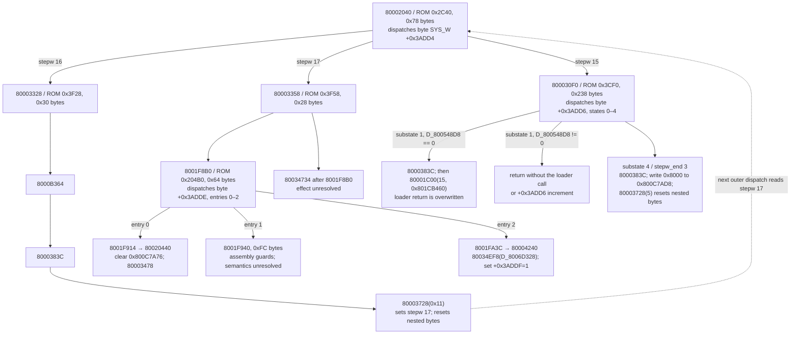

# Native map transition research targets

Date: 2026-11-03. Evidence is from the pinned US baseline at commit
`7e2029c5c7beca705e7ded2c8fa85a5a21d1c3ee`, whose decompressed ROM SHA-1 is
`6ea0ed71032ce08fc2745f412d84936382197494`. Addresses below are original guest
addresses and ROM offsets. These functions are assembly unless noted; none has
been established as the complete scene loader or unload routine.

## Isolated pieces and call links

| Function | ROM offset / size | Evidence | Status |
| --- | --- | --- | --- |
| `func_80215330_5D0800` | `0x5D0800` / `0x1C0` | Exit actor path reads its packed fields, writes destination/entry parameters through the system pointer, and can alter a special destination based on saved flag `0x17`. Called at `0x5D07B8` and `0x5D07DC`. See [entrance trace](../docs/ENTRANCE_WARPS.md). | ASM; scene/overlay context matters. |
| `func_800214E4_220E4` | `0x220E4` / `0xE4` | Reads 10-byte default entry records at ROM `0x6C380`; copies coordinate and mode fields to saved entry fields, or zeros them if all three coordinates are zero. Called at `0x220AC` and `0xBFB0`. | Matching C in `default_entrance.c`; the original unchecked table index remains. |
| `func_80021444_22044` | `0x22044` / `0xA0` | When a guard is not `0xFF`, copies map/entry context, calls `800214E4`, then `8000B864`; all paths call `80003728(0x0B)`. | Matching C in `default_entrance.c`; broader state meaning needs tracing. |
| `func_80003728_4328` | `0x4328` / `0x64` | Stores its argument to system offset `0x3ADD4`, zeros `0x3ADD5`, sets `0x3ADCA` to 2, then calls `80003628(0)`. Static initial system base `0x8008CCC0` makes the first two bytes `0x800C7A94` and `0x800C7A95`. | Matching C in `transition_state.c`; state setter, not a complete loader. |
| `func_80003628_4228` | `0x4228` / `0x50` | Writes its argument to system `+0x3ADD6`, zeros `+0x3ADD7`, and calls `80003528(0)`. `80003528` similarly writes `+0x3ADD8`, clears `+0x3ADD9`, calls `80003428(0)`. | Both matching C in `transition_state.c`; do not assume these are room cleanup. |
| `func_80002718_3318` | `0x3318` / `0x220` | Dispatches using system byte `+0x3ADD6`; one path reads `0x800C7A95` and calls `80003728` with different states, including 8 and 15. | ASM; state-machine lead, no complete lifecycle proof. |
| `func_801CB5D0_5874E0` | `0x5874E0` / `0x1D8` | Reads signed pending coordinates for player creation; native stores downstream are documented in the entrance trace. | ASM; relevant to placement after a transition. |
| `func_80037060_37C60`, `80037070_37C70`, `80037080_37C80` | `0x37C60..0x37C90` | Write 2, 1, 3 respectively to `0x800C7A95`. | Already fully matching C in `warp_state.c`; not proof of a complete warp. |

`func_80021444` is evidence of a chain leading to state `0x0B`, not evidence
that calling this function is safe or sufficient to unload/reload a map. The
previous door trace in [recovery baseline](../docs/RECOVERY_BASELINE.md) is a
sampled runtime observation, not a native call trace. A separate in-game replay
was not conducted for this analysis.

## Work performed and next step

The existing batch's minimal-context attempts for `800214E4` and `80003728`
reported missing types. An initial `80003728` C draft reproduced the observed
field updates and one-argument `80003628(0)` call, but IDO produced 88 bytes
versus the original 100; variants using the first inferred two-argument call
were also mismatches. The second register is overwritten by the callee and must
not be treated as a confirmed argument. Drafts and logs are in private Linux
research directories `/root/goemon64-scene-state-probe-v1`, `-v2`, and `-v3`.
They are not matching C and are excluded from the manifest and count.

Next, recover actual `SYS_W` field declarations and compile with reviewed SDK
context, then compare relocated instructions for `80003728` and `80003628`.
Trace the dispatch path from `80002718` to resource allocation, release and
actor creation; distinguish file/overlay loading from room teardown. Promote only
after semantic host checks, unchanged inventory and complete-ROM equality. No
raw scene-request write, automatic warp, or claim of safe unloading follows from
this trace.

## State setter reconstruction

`func_80003728_4328` is now fully matching C (100 bytes). Existing upstream
`SYS_W` calls the three affected fields `stepw`, `stepw_end` and
`retraces_per_game_step`. Using a narrowed argument produces an exact match;
both unsigned 8-bit and unsigned 16-bit source forms match, so the original
parameter width is not uniquely established. The implementation uses `u8`
because the value is stored as a byte. The synthetic host test verifies writes
occur before the `80003628(0)` call. This does not establish scene load or
unload safety.

The called helpers `func_80003628_4228` and `func_80003528_4128` now also
match as C (80 bytes each). Their combined synthetic test checks the full chain
through the stubbed `80003428(0)`, including all intermediate byte resets.
The state bytes and downstream function remain incompletely characterized.

`func_80003428_4028` also matches as C (80 bytes). It sets system
`+0x3ADDE`, clears `+0x3ADDF`, and calls `80003380(0)`. The combined host
test now exercises the four matching setters up to a stub of that next call.
These are state-machine primitives, not identified room unload operations.

`func_80003380_3F80` now matches as C (48 bytes), setting system
`+0x3ADE0` and clearing `+0x3ADE1`. This completes the characterized
five-helper state reset chain; it does not identify the room loader/unloader.

## Next-level dispatcher

`func_8001F8B0_204B0` copies three addresses from ROM `0x6C330` and dispatches
using system `+0x3ADDE`. The three targets are `8001F914_20514`,
`8001F940_20540`, and `8001FA3C_2063C`. The first and third now match as C
(44 and 68 bytes); the middle remains assembly. The first calls `80020440`,
clears `0x800C7A76`, then calls `80003478`; the third calls `80004240`, passes
a global word to `80034EF8`, then sets system `+0x3ADDF` to one. The latter
helpers and actual room loading/unloading effects remain under investigation.

`func_80034EF8_35AF8` now matches as C (40 bytes): it passes its word
argument to `80034F44_35B44`, then to `80035044_35C44`. The argument's
underlying type and the called routines' resource effects remain unresolved.

`func_80035044_35C44` now matches as C (32 bytes): it forwards its argument
to `800350C4_35CC4`. The first callee `80034F44_35B44` dereferences the
shared argument and traverses linked objects, so it is pointer-like in this
path; the specific structure and resource semantics remain unknown. The
matching wrappers use an opaque 32-bit value pending interface recovery.

`func_80035194_35D94` now matches as C (32 bytes). It is installed as a
callback by `800350C4` on one branch and forwards its first argument back to
that function. The caller uses linked-object pointers and callback fields, but
their relationship to room resources or actors is still unproven. The unused
second parameter has multiple matching source types; its original type is
not established.

`func_80035064_35C64` now matches as C (48 bytes). It passes the current
object to `800362DC`, reloads the global object, and passes the new value to
`80035044`. Its neighbor `80035094` remains assembly: a first draft compiled
to the correct length but differed in two instruction words.

`func_800362DC_36EDC` now matches as C (44 bytes). It traverses the linked
list at object offset `+0x18`, sets bit `0x80` in each node's byte at native
node offset `+4`, and returns null after traversal. The meaning of that flag
and whether those nodes are map resources remain unknown. Host pointer widths
differ from the N64; native field layout is established by the ROM match.

Two main-loop wrappers now match as C: `80003328_3F28` calls `8000B364`,
then `8000383C`, then sets main state `0x11`; `80003358_3F58` calls the
three-way dispatcher `8001F8B0` and then `80034734`. Their external effects
remain incompletely characterized; neither is asserted to load a room.

`func_8000383C_443C` now matches as C (68 bytes). It calls `80003880`,
then calls the already-upstream C `800148C0` with the audio-memory descriptor
at system `+0xC7FA4`, buffer `0x802F7000`, and size `0xA000`. That upstream
function clears the buffer and initializes the descriptor. This identifies
an audio-memory initialization step, not a complete room loader.

`func_80003880_4480` now matches as C (100 bytes). It calls a sequence
of engine initializers, sets `0x800C7AE4` to 20, calls `80013940`, and calls
`osViBlack(0)`. Its callees need individual tracing before claiming which
ones load or unload rooms.

`func_800038E4_44E4` now matches as C (104 bytes). It always calls
`80034734`; if the byte at `0x800C7A95` is nonzero, it passes the current
object to `800369F0`, increments system state byte `+0x3ADD6`, then calls
`80038BC8(7)`. The external callees and lifecycle meaning remain under study.

`func_800214E4_220E4` now matches as C (228 bytes). Its intended-room ID
indexes 10-byte records. Any nonzero coordinate causes coordinates, heading
and mode to be copied; an all-zero coordinate triplet zeros all five saved
fields even when the record's heading or mode is nonzero. This is an entrance
selection primitive, not a complete transition or safe generic warp.

`func_80021444_22044` now matches as C (160 bytes). When its guard differs
from `0xFF` it records intended room/group, updates the active word, selects
the default entrance and calls `8000B864`. Both guard paths request state
`0x0B`. A matching state request is not proof of a complete safe map transition.

Ten neighboring state helpers now match as C (824 bytes total). They increment
or decrement one of five byte-sized state levels, clear its associated end byte,
and, except for the innermost pair, reset the next nested level. The byte
arithmetic wraps; these primitives do not themselves establish room loading.

The transition dispatcher `800030F0_3CF0` calls `80001C00_2800` on one path
with file ID `0x0F` and destination `801CB460`. `80001C00` is in the native
data-loading section and processes file-table records; complete loader and
decompression behavior remains assembly. Nearby `80001D68_2968` now matches
as C (44 bytes), indexing a table with an unsigned 16-bit index and masking
the top bit. Its index is unchecked; the high bit's full meaning is not yet
proven by this helper alone.

## G64-061 — Verified state-dispatch graph

This graph comes from the pinned USA build's original linked ELF, SHA-256
`83eda0f1df831d997f9e505c92a8a7fdb55728d3ad28b30d224f5e1ae975a038`, built
from `mnsg` commit `7e2029c5c7beca705e7ded2c8fa85a5a21d1c3ee` against the
decompressed-ROM SHA-1 recorded above. `mips-linux-gnu-nm -S` supplied exact
symbol extents; `mips-linux-gnu-objdump -dr` inspected instructions at their
original VMAs. Table bytes were read from the same linked ELF, and resource
identity was checked against its pinned Splat config.

`80002040` copies the 18-word dispatch table at ROM `0x59508` (`D_80058908`)
to its stack frame, reads `SYS_W.stepw`, and calls the indexed pointer. The
table entries at indices 15, 16 and 17 are `800030F0`, `80003328` and
`80003358`. The function has no visible range check before indexing the copied
table; this records instruction behavior and does not establish which values
are valid at runtime. This is the dispatch-mediated relationship: `800030F0`
and `8001F8B0` are not direct callers of one another.

`80003358` calls `8001F8B0` and then `80034734`. `8001F8B0` copies three
pointers from ROM `0x6C330` (`8001F914`, `8001F940`, `8001FA3C`), indexes them
with `SYS_W +0x3ADDE`, and uses `jalr` without a visible range check. The
already-matched entry-0 and entry-2 functions have the effects shown above;
entry 1 remains assembly-owned and inspects multiple guards. The numeric entry
values are preserved here without assigning them “load” or “unload” names.

Within `800030F0`, the unsigned `sltiu` check accepts substate
indices 0–4 before the five-entry table at ROM `0x7B48C`; larger values return.
States 0–3 update the visible substate or globals and advance `+0x3ADD6`.
State 4 branches on `stepw_end` 0–3: value 0 calls `80034734`; values 1 and 2
call `8000383C`, write 3 or 1 to `SYS_W +0x3ADF4`, clear `stepw_end`, and call
`8003488C(0x801CCB7C)`; value 3 calls `8000383C`, writes `0x8000` to
`0x800C7AD8`, and calls `80003728(5)`. Other end-byte values return without
those actions. The called routines' broader effects are not inferred from
their names.

In state-15 substate 1, `80003148` reads `D_800548D8`. A nonzero value takes a
branch-likely path whose delay slot restores `$ra`, returning before either
`8000383C` or `80001C00` and before the substate increment. A zero value calls
`8000383C`, then calls `80001C00` with ID `15` in `$a0` and destination
`0x801CB460` in `$a1`; the call's return is replaced before the later
substate increment. Pinned Splat maps ID 15 to overlay `file_15`, decompressed-
reference image interval `0x65E310..0x667B90` (not retail cartridge DMA
offsets), VMA `0x801CB460`, RAM ID `static_overlay_1`. Files 13,
14, 15 and 16 share that VMA/RAM ID as mutually exclusive overlays, so the
destination address alone does not identify a resource. This path proves a
file-15 loader request, not successful activation, prior-overlay release,
room teardown, actor creation, or a safe room transition.

The name and full meaning of `D_800548D8` are unresolved. Static original
references show a clear at `0x80000924`, a set at `0x80000A24` after a
pointer-sized store to a structure field at `0x80000A18`, and another clear at
`0x8000110C` after calls to `80001328` and `8000098C`. These accesses support
only this falsifiable hypothesis: the nonzero flag gates the state-15
file-15 request while some frame/display work is active. The static prediction
is that a nonzero read at `0x80003148` returns without advancing substate 1,
while a zero read makes the loader request and then advances. No live capture
was available here to validate the flag's runtime meaning; keep that meaning
hypothetical. Both `800030F0` and `8001F8B0` remain assembly-owned, and no
scene-warp or unload shortcut follows from this graph.

## G64-062 — Verified file/resource loading boundary

Evidence uses the pinned USA retail image (SHA-1
`df8083a54296b8c151917c5333e1c85f014a2a66`), its 32 MiB decompressed reference
(SHA-1 `6ea0ed71032ce08fc2745f412d84936382197494`), and pinned `mnsg` commit
`7e2029c5c7beca705e7ded2c8fa85a5a21d1c3ee`. The retail and reference MIPS
instruction slices for `80001C00` and `800030F0` are byte-identical. Linked
symbol sizes are from the pinned baseline ELF; function starts, ends and
callers were cross-checked against `asm/usa/2800.s`, `2C40.s`, `5E20.s`,
`6500.s`, `main.s`, and `587370.s`.

`func_80001C00_2800` is 360 bytes at VMA `0x80001C00` / ROM offset `0x2800` and
remains `GLOBAL_ASM`. Its first argument is a file-table ID and its second is a
caller-supplied RAM destination. It returns zero for ID 0 or IDs at least
`0x520`; otherwise it returns the destination plus the range stored for that
ID in `D_80054ACC`. The loader does not allocate or free that destination.

The current/next file-boundary words are read from `D_800573D4` at ROM offset
`0x57FD4`. `80001D68` reads the current entry and clears bit 31;
`80001D94` does the same for the next entry. In `80001C00`, the compression
branch tests the **current start word**. The next word's high bit marks the
following file and must not be used to classify the current one.

For ID `0x0F`, the retail table gives current start `0x0061D5DE` and next word
`0x80626E5E`. The current start is unflagged, so the loader takes the
uncompressed path. Masking the next word gives an end of `0x00626E5E`, for a
`0x9880`-byte transfer. ID 16 begins at `0x80626E5E`, so its start is flagged
for the compressed path. The decompressed reference table instead gives ID 15
the interval `[0x65E310, 0x667B90)`, exactly the Splat `file_15` interval. The
retail bytes at `[0x61D5DE, 0x626E5E)` exactly equal those reference bytes.

The ID-15 row in `D_80054ACC` (ROM offset `0x556CC`, row `ID - 1`) is
`[0x801CB460, 0x801E9980)`. The transition caller supplies `0x801CB460`, and
Splat marks `file_15` at that VMA with BSS size `0x14CA0`. After the `0x9880`
bytes are loaded, `80001C00` zero-fills the remaining `0x14CA0` bytes, writes
back the full `0x1E520`-byte destination range, and returns `0x801E9980`.
`file_15` is an overlay in `static_overlay_1`; Splat also places files 11 and
13–16 at `0x801CB460`. The shared address identifies a reusable overlay RAM
window, not which overlay is active.

### Loader call edges and data classes

| Original call edge | Data and RAM ownership | Verified effect | Still unknown |
| --- | --- | --- | --- |
| `800030F0` at `0x80003164` → `80001C00(15, 0x801CB460)` | File-table ID 15; fixed `static_overlay_1` destination. | Reached only from substate 1 when `D_800548D8 == 0`; calls `8000383C` first. The caller overwrites the loader return with `0xFFFF`, waits in a bounded loop, then increments `SYS_W +0x3ADD6`. | Whether the newly copied overlay becomes active, what the guard means, and whether an old overlay is released or room objects are torn down. |
| `80001C00` → `80001640` → `osPiStartDma` / `osRecvMesg` | ROM address and caller's RAM pointer. | Invalidates data/instruction caches, starts PI DMA, waits on the message queue, then the loader zero-fills and writes back its range. This is the ID-15 path. | No allocation, ownership transfer, or scene transition is performed by this edge. |
| `80001C00` → `80005394` → `80005984` / `80005900` → `80001640` | Compressed file data to the same caller-supplied destination. | The current start word's high bit selects the decoder; the decoder refills its input through chunked DMA. | This compressed branch is not used for ID 15; the complete decoder format/asset semantics are outside this trace. |
| `801D46F8` → `800148F0(0xA0)` → `80001C00(7, returned_pointer)` → `80014B74` | A temporary 0xA0-byte pool allocation and its returned RAM pointer. | The caller allocates the buffer, passes it to the loader, uses the loaded records, and frees it itself. This demonstrates caller-owned allocation and release, separate from `80001C00`. | The loaded record table's higher-level purpose is not established here. |
| `80005A64` → `80001C00(dynamic_id, request_entry+4)` | An eight-byte file-load request entry supplies an ID/flags word and destination pointer. | The caller masks flag bits from the ID and passes the pointer stored at `+4`; it iterates or clears request entries after loading. | These are file-load request records, not evidence of an object list or room teardown. |
| `801DC9C8` → `80001C00(halfword_id, table_destination)` | A file ID comes from a halfword table; destination comes from a separate pointer table. | The caller supplies both values directly and performs no allocation at this call site. | The surrounding table's resource naming and lifecycle are not fully recovered. |

The loader's direct calls are `80001640`, `80005394`, and
`osWritebackDCache`; it has no allocator, free, overlay-activation, or room
teardown call. `D_8015C5D4` is saved, set to one during the load, and restored;
its broader meaning remains unknown. The matched `80001D68` helper is only a
masked table lookup; `80001D94`, `80001C00`, and the decoder remain assembly.

The numeric file ID passed to `80001C00` is a different call path from the
Script VM's current resource ID at `0x801C78E8`, which `8003D468` resolves using
`800141C4` and `80013B14`. This trace does not map VM resource IDs 96/97 to
file ID 15 or to the `static_overlay_1` load.

No original call edge here establishes successful scene activation, prior
overlay release, room teardown, actor/object-list rebuilding, or safe warp
semantics. Those remain separate trace targets; no runtime feature or memory
write was changed. The execution record is
[`plans/execution/2026-11-14-g64-062-loader-boundary.json`](plans/execution/2026-11-14-g64-062-loader-boundary.json).

## G64-063 — Middle transition dispatcher and VM cursor gate

The pinned USA `func_8001F940_20540` occupies ROM `[0x20540, 0x2063C)` and is
252 bytes (63 words). Its raw retail and decompressed-reference bytes match;
the slice SHA-256 is
`025dd045f4347ed791523672b3779a1d7e9e78d093ee2e33e846cfa78b12a497`. The
source disassembly is `asm/usa/204B0.s`. Neighboring C-owned entries are
`8001F914` (44 bytes) and `8001FA3C` (68 bytes). Dispatcher `8001F8B0` selects
this function from entry 1 of the three-pointer table at ROM `0x6C330`, using
`SYS_W +0x3ADDE`, then calls the selected pointer with `jalr` and ignores its
return. `8001F940` reads no incoming argument and produces no return value, so
`void func_8001F940(void)` is the caller-facing signature inferred from MIPS,
not a recovered original declaration.

### Verified order and raw field accesses

The routine calls `8000B7E4` first on every path. The already-matching helper
performs its confirmed tick rule: when its 16-bit counter is at least 60, it
subtracts 60 and increments save-data word `+0x264`. The dispatcher then reads
these addresses; field names remain unknown unless separately established:

| Address | Width / operation | Branch effect |
| --- | --- | --- |
| `0x800C7AE6` | halfword read | Nonzero delegates to `8001FA80` and returns before all other gates. |
| `0x800C7D3C` | halfword masked with `0x1000` | A clear bit returns. |
| `0x800C7AE9` | byte read, then read again after the cursor predicate | Either nonzero value returns; the second read is a real reload. |
| `0x800C7AA4` | unsigned byte | Value 3 and values at least 4 return; only 0, 1, or 2 continue. The architecture report identifies this address as a gameplay submode byte, distinct from VM state at `0x801C77E0`. |
| `0x80077858` | read inside `8003F1D8` | The helper returns 1 iff this word is nonzero. A nonzero VM program pointer makes this dispatcher return. Neither helper nor dispatcher advances or clears it. |
| `0x8015C562` | byte read | Nonzero returns after the cursor predicate. |
| `0x8015C54D` | byte read | Nonzero returns after the second `0x800C7AE9` read. |
| `0x800C7AD6` | halfword read | Nonzero returns. |
| `0x800C7AE6` | halfword write of 1 | Written only after every preceding guard passes. |
| `0x800C7AA0`, `0x800C7AA1` | byte writes of 0 | Both precede the final helper; the second store is the `jal` delay slot. |

The `0x800C7AE9` reread follows the call to `8003F1D8`; the host harness uses an
artificial mutation of that byte to check reload/order behavior. No evidence
shows that the cursor helper mutates the byte during retail execution. The
`0x80077858` relation is narrower and directly verified: `8003F1D8` loads the
word and returns a boolean for nonzero. The separate VM report establishes
that word as the relocated program cursor; this call site does not use it as a
text-character cursor or alter it.

When all gates pass, `8001F940` writes halfword 1 at `0x800C7AE6`, clears bytes
`0x800C7AA0` and `0x800C7AA1`, then calls `80038BC8(3)`. That 48-byte wrapper
masks its argument to 16 bits and forwards it to `80038C30(3, 0, 0)`. The
dispatcher itself has no direct file-loader, allocator, free, overlay or room
teardown call. Its other path delegates to the still-assembly-owned
`8001FA80` (0x888 bytes); that routine's broader effects are not assigned to
this wrapper. Thus neither the status write nor helper call proves scene
activation or unloading.

The focused host reference covers the busy-halfword delegate, bit gate,
`0x800C7AE9` early gate, selector boundaries 0–2 versus 3/4+, nonzero cursor,
each post-cursor guard, and successful store-before-call order. A mutant that
removed the second byte read failed the artificial reload probe as expected.
This model is a behavior fixture; production `rotation_angles.c` retains the
original `GLOBAL_ASM` placeholder.

Two isolated IDO source shapes compiled and linked at `0x8001F940`, but both
first differed at `+0x10`: original word `0x3C03800C`, candidate destination
register `a0` in V1 and `t6` in V2. V1 emitted a 236-byte symbol; V2 emitted
264 bytes. The first mismatch did not move, so codegen stopped after V2 and no
candidate was integrated. No fresh full-ROM G2 was run; the manifest and
stored proof remain unchanged. See
[`plans/execution/2026-11-14-g64-063-middle-transition-dispatch.json`](plans/execution/2026-11-14-g64-063-middle-transition-dispatch.json).

## G64-064 — Transition loop gate at `8000394C`

Pinned `func_8000394C_454C` is 29 words (116 bytes) at VMA
`0x8000394C`, ROM `[0x454C,0x45C0)`. Its disassembly is in
`mnsg-pinned/asm/usa/2C40.s`; raw bytes equal both pinned USA retail and
decompressed-reference slices. The slice SHA-256 is
`1cc9c4dd44c8e502915ab8c38af2bf9b79e7c79401a30749d73d8d447f638109`. The
function allocates `0x18` stack bytes and saves `$ra` at `sp+0x14`. It reads no
incoming argument. Five call sites in the same original assembly unit use
`jal` with a `nop` delay slot and discard the return, so `void
func_8000394C(void)` is an inferred caller-facing signature rather than a
recovered original declaration. Despite the task name, this function has no
internal loop or back edge; it is invoked from five transition call sites.

### Verified call and branch order

| Order | Original action | Result |
| --- | --- | --- |
| 1 | Call `80034734` | Unconditional. This routine walks callback-bearing entries; its broader callback effects are outside this target. |
| 2 | Call `80036908` with word `D_8006D328` loaded into `$a0` in the `jal` delay slot | The call's `$v0` controls the sole branch. |
| 3a | If `$v0 != 0`, branch to the epilogue | No direct writes to `0x800C7CDD`, `0x800C7A76`, or `SYS_W+0x3ADD6` occur in this path. |
| 3b | If `$v0 == 0`, store byte `5` at `0x800C7CDD` | The branch delay slot sets the value to 5. |
| 4 | Call `80003880` | Its `jal` delay slot first stores halfword `1` at `0x800C7A76`. The wrapper calls the existing reset/initialization chain; this edge alone does not prove scene teardown or activation. |
| 5 | Reload `D_8015C5C8`, read byte at offset `0x3ADD6`, add one, and store it back | This is an 8-bit increment of `SYS_W.unk_3add6` after the helper call; it wraps modulo 256. `stepw` at `+0x3ADD4` and `stepw_end` at `+0x3ADD5` are not directly written here. |

The two raw transition stores are based on `D_800BCCC0 + 0x7FFF`; effective
addresses were calculated from the original `lui`/`addiu` sequences. No field
names are assigned to `0x800C7CDD` or `0x800C7A76` without separate evidence.

The called gate is a 32-byte wrapper at `80036908` that calls the 140-byte
`80036928` with `$a1=0x10`. `80036928` reads the pointer at
`SYS_W+0x3B014`. A null pointer returns zero. Otherwise it reads the byte at
pointer `+0x10`: byte `0xFF` calls `osViBlack(1)` and returns zero; other values
advance by 16, saturating to `0xFF` (and calling `osViBlack(1)` when
saturating), then return one. Thus the target's zero branch is reachable when
that pointer is null or its byte is already `0xFF`; it returns early while the
byte is still advancing. The target passes `D_8006D328`, but the helper only
stores `$a0` in its stack argument area and does not reload it in this body;
no effect from that argument is established here.

The target's only condition is the helper's nonzero test. On the zero path,
the host reference checks that both raw stores precede `80003880`, then checks
the post-call pointer reload by rebinding the synthetic `D_8015C5C8` pointer
inside the helper stub. That rebinding is an artificial alias/order probe, not
a claim that retail `80003880` changes this pointer. Sentinels cover `stepw`,
`stepw_end`, neighboring state bytes and the counter's `0xFF -> 0` wrap.

The helper calls may have their own callback or system side effects. The
`8000394C` body itself has no direct file-load, free, overlay activation or
room-warp call, and this call chain is not evidence that a safe scene
transition completed. Production `transition_state.c` keeps the target as
`GLOBAL_ASM`; no compiler variant or fresh full-ROM G2 was run because this
was a pure trace/host-reference task and no new C hypothesis was justified.
See [`plans/execution/2026-11-14-g64-064-transition-loop-gate.json`](plans/execution/2026-11-14-g64-064-transition-loop-gate.json).
