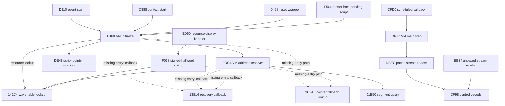

# VM resource and stream call graph

**G64-021 research checkpoint — 2026-11-11.** This note records observed
call/argument behavior before changing shared VM types. Direct instruction facts
are marked **verified**; interpretations of opaque IDs and external engine
helpers are marked **inferred** or **unknown**. It is not a matching-C claim.

## Evidence source

- Branch base: `chatgptweb/decomp` at `907e86bc04e3abccb902c742813eb2e5406b2cd9`.
- Pinned upstream: `mnsg` commit `7e2029c5c7beca705e7ded2c8fa85a5a21d1c3ee`.
- Private reference: local ignored
  [`usa-decompressed.z64`](../practice/diagnostics/decomp-100-inputs/usa-decompressed.z64),
  USA SHA-1 `6ea0ed71032ce08fc2745f412d84936382197494`, 33,554,432 bytes.
- Original-code extraction: Splat 0.36.3 / spimdisasm 1.39.0, run from the
  pinned upstream checkout with
  `uv run splat split config/usa/splat.yaml --modes code --disassemble-all`.
  The generated, ignored local listing is
  [`3DBA0.s`](../practice/diagnostics/decomp-100-inputs/mnsg-pinned/asm/usa/3DBA0.s).
  These links resolve only in a workspace with the private inputs; neither file
  is stored in the repository.
- For each function below, all listing word comments were checked against the
  corresponding big-endian ROM slice at `VMA - 0x7FFFF400`. Start, extent and
  SHA-256 are therefore tied to this private reference, rather than reassembled
  text.

| Function | ROM offset | VMA | Bytes | Original-byte SHA-256 |
| --- | ---: | ---: | ---: | --- |
| `func_8003D468_3E068` | `0x3E068` | `0x8003D468` | 548 | `ece95b38f4dbaf5268d308e09aea54a02d32d1615664137de03ecd46a0c262d7` |
| `func_8003D68C_3E28C` | `0x3E28C` | `0x8003D68C` | 812 | `e49ad551d97f2f8cac887ee126e99dfdb29924901a4ff69f0792898207bf3da5` |
| `func_8003DDC4_3E9C4` | `0x3E9C4` | `0x8003DDC4` | 132 | `f7dab493df8553cae7eb55ce5bbaec5a2cd576e0454dc557dbbadad74a7a101a` |
| `func_8003DF98_3EB98` | `0x3EB98` | `0x8003DF98` | 528 | `76285ca92a7f611916d867d9938f93fcb3df32ebfa2962120083f2471a501631` |
| `func_8003F038_3FC38` | `0x3FC38` | `0x8003F038` | 196 | `7a258b9eae36120d3971f1997070c2a988fb9636cbd4c96f1f52ea888e7b9719` |

## Observed edges

Solid edges are direct call instructions in the ROM-derived listing, or calls
in matching C source at this pinned revision. Dashed edges are conditional
calls observed at the stated missing-entry branch. The graph does not imply
that the external recovery routine mutates the VM resource ID.

## ABI, global access and side effects

| Function | Verified ABI and direct effects | Limits / current declarations |
| --- | --- | --- |
| `D468` VM initializer | `$a0` is the script/address word and `$a1` the resource-ID word. It returns 0 when `D_80077860_78460` is null, otherwise 1 after setup. It writes the resource ID at `D_801C78E8_1C84E8`; derives the resource segment and relocation delta; resets VM fields; stores the script cursor in `D_80077858_78458`; and clears owner bytes `0x5C` and `0x5D`. It calls `141C4`, conditionally `13B14`, `3CFA0`, `141C4` again, `01E50`, `DDC4`, `DE48`, and `24088(0x82)`. | Current `script_vm.h` declares `void D468(s32,s32)`, although the ROM returns 0/1. All observed callers ignore that result. `D_801C78E8` as a “current resource ID” is an interpretation supported by its use and the matching C resolver, not an engine-level name. |
| `D68C` VM step | No explicit input arguments are read. It returns small status values (0, 1, or 2 along observed exits). It reads the current cursor `D_80077858_78458`, pause byte `D_801C78FC_1C84FC`, and VM state `D_801C77E0_1C83E0`; it dispatches stream, choice, input, wait, comparison, state and relocation helpers. It can invoke the function pointer in `$a2` with `jalr`. | `script_vm.h` declares `s32 D68C(void)`. The only C caller `CFD0` ignores the result. The `$a2` target and its effects depend on VM state; detailed CFG work is G64-027. |
| `DDC4` address resolver | Two word arguments: address in `$a0`, entry resource ID in `$a1`; returns the resolved address in `$v0`. It queries `141C4(entry ID)`. If missing, it passes the low halfword at `D_801C78E8+2` to `13B14`, then reads the current full word at `D_801C78E8` for `3CFA0` and reads it again for the retry lookup. The final `01E50` call receives the original entry ID from its saved argument. It clears bit 30 of the returned base and combines that with the address and segment. | Matching C in `script_vm.c` agrees with the visible operations. The meaning and indirect effects of `13B14` are not recovered here. `DDC4` itself does not store to `D_801C78E8`. |
| `F038` halfword-table lookup | `$a0` supplies the signed index/value; its 32-bit result is used by `ED60` as a zero/nonzero test and then as a display-list word. `0x100` returns zero immediately. Otherwise it forms a signed half-index with negative values rounded toward zero, reads a signed halfword from `D_80077894_78494`, and calls `141C4`. On `-1`, it calls `13B14` with the low 16 bits of the saved table value and retries using that saved value. A second miss returns zero; successful values below index 4 receive the computed address adjustment. | Both observed call sites pass `$a1=0`; the body writes that value to the caller home area but does not read it afterward. Do not infer a meaningful second parameter or rename the table without further evidence. The function remains `GLOBAL_ASM`. |
| `DF98` stream control decoder | Two word arguments are passed by callers: a VM owner/value in `$a0` and a signed-halfword stream cursor in `$a1`; `$v0` is consumed as the next cursor by both callers (`DE80` and `EB34`). | The current header declares `s16 *DF98(s32,s16 *)`. Opcode families and cursor rules remain for G64-028. |

### D468 stack frame and saved-register lifetimes (G64-026)

The original prologue subtracts `0x20` from `$sp`, then saves `$ra` at
`sp+0x1C`, `$s1` at `sp+0x18`, and `$s0` at `sp+0x14`. The delay slot at
`0x8003D484` stores incoming `$a0` at `sp+0x20`; the entry resource ID is
stored at `sp+0x24` at `0x8003D4AC` for the later `DDC4` call. `$s1` is formed
as the resource-context address at `0x8003D490/494` and `$s0` as the VM-work
address at `0x8003D4B0/4B4` on the normal path or `0x8003D538/53C` on the
clear path. These saved base pointers remain live across nested calls and the
shared reset tail. The epilogue restores `$ra`, `$s0`, and `$s1` from those
slots, returns, and releases the 32-byte frame in the return delay slot.
`test_vm_loader_original.py` now guards the prologue, argument spill, base
construction, saved-register restores, and return sequence (36 original-address
guards total). The 556-byte isolated C probe instead allocates 24 bytes and
saves only `$ra`; its first difference is the frame-size instruction at `+0x8`.
The probe remains research-only and the production function remains assembly.

### Resource lookup and recovery boundary

- At the pinned source, `func_800141C4_14DC4(unsigned int)` is C in
  `src/wave_uty.c`: it scans the 48-entry `D_80167FC0_168BC0` table, returning
  zero for ID zero, the matching entry's data word, or `-1`. This is a read-only
  lookup in that C body.
- `func_80013B14_14714` is declared `int(int)` in `src/wave_uty.c` but retained
  assembly. Its result is ignored by all three VM call paths above. The exact
  callback side effects are **unknown** from this call graph.
- `func_8003CFA0_3DBA0` is matching C and selects an entry from
  `D_80077550_78150` or the fallback `D_8007CCA4_7D8A4`; these VM calls discard
  its return value. No mutation is present in that C body.
- `func_80001E50_2A50` is declared `int(unsigned int)` in `src/wave_uty.c` and
  called with the original resource argument by `D468`/`DDC4`. Its full
  implementation is not inferred from the call sites.
- The recovery tests deliberately mutate the modeled current VM ID between
  callbacks. That is a conservative negative control, **not** evidence that the
  retail callback writes `D_801C78E8`. Preserve the original reloads until the
  callee effects are established.

## Next narrow work

G64-022 records the observed ID word and offset-only +4/+8 words in
`vm_resource_types.h`; the entry resource argument remains separate from the
mutable global word. Its loader candidate did not match native IDO and remains
unpromoted. G64-023 reproduced the 196-byte F038 baseline; G64-024 tested
three additional source hypotheses without improvement. G64-025 confirmed the
entry-ID/current-ID distinction under synthetic mutation. G64-026 pinned the
original 32-byte loader frame and saved-register lifetimes, but the 24-byte
candidate still differs. G64-027/028 own D68C/DF98 control flow. No function in
this graph is newly promoted by this note.
