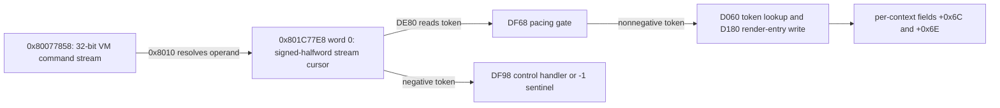

# Script VM runtime cursor and text path

**Research snapshot:** 2026-11-13
**Scope:** Resolve the meaning of `0x80077858`, connect the active resource ID to its loaded bytes, and distinguish script execution from text emission.
**Evidence basis:** Pinned USA disassembly/source at `mnsg` commit `7e2029c5c7beca705e7ded2c8fa85a5a21d1c3ee`; local decompressed ROM SHA-1 `6ea0ed71032ce08fc2745f412d84936382197494`; runtime observations in the consolidated handoff supplied 2026-11-13.

## Result

The value stored at **`0x80077858` is the relocated VM program counter**: it points into the active resource's 32-bit command/operand stream. It is not the cursor that advances through text tokens or through visible characters. The VM has a separate halfword stream cursor at **`0x801C77E8`** (the first word of the context there). The text walker reads signed 16-bit values through that pointer and returns its updated value to the context. A nonnegative value is passed to a renderer path; negative values are control tokens or the `-1` end marker.

This explains the reported stable `0x80077858` while multiple characters appear: after the VM reaches a text command, the high-level program counter can sit at the next command while the independent text cursor and per-window renderer fields change. The MIPS establishes that separation. It does **not** yet decode the observed English lines to exact token bytes, because no same-frame text cursor, resource base, and memory bytes were included with the video samples.

## Evidence classes

- **Verified MIPS/source:** instruction behavior below is from the pinned original; labels such as “program counter,” “text cursor,” “pacing,” and “renderer” describe observed use, not recovered source variable names.
- **Runtime observation:** state/cursor/resource associations and visible dialogue are from the user's consolidated handoff. They are not treated as instruction-level proof.
- **Unresolved:** a value or meaning requiring an additional same-frame capture or a deeper callback trace is called out explicitly.

The attached toolkit/runtime note also distinguishes gameplay submode byte
`0x800C7AA4` from VM state word `0x801C77E0`. They are separate fields; the
reported submode values are gameplay observations and are not part of the VM
state numbering below. Its toolkit fix is on a different branch and is not
included in this decompilation change.

## Program counter, resource ID, and relocation

`func_8003D468` (VMA `0x8003D468`) receives the initial segmented address and resource ID. It stores the ID in `0x801C78E8`, looks it up with `func_800141C4`, and stores the returned resource data pointer in `0x801C77FC` (context offset `+0x14`). On a cache miss it calls `func_80013B14` to load/register the ID, then looks it up again. It obtains the segment value with `func_80001E50`, resolves the initial address with `func_8003DDC4`, saves the relocation delta in `0x801C78F0`, calls `func_8003DE48`, and stores that returned address at `0x80077858`.

`func_8003DDC4` computes the resolved address from the loaded data base and segmented address: it clears bit 30 of the resource data pointer, subtracts `(segment_value << 24)` from the input address, and adds the result to that base. `func_8003DE48` applies the saved delta to nonnegative addresses unless the segment value is `-1`. Thus the ID selects the loaded resource context used to resolve the program counter; the PC itself is a relocated RAM pointer.

`func_8003D68C` then dereferences the PC as a 32-bit VM word and dispatches tokens `0x8004`–`0x8022`. Its common path advances the PC by four bytes in a branch delay slot before the command handler consumes operands. Other handlers skip several words, relocate an address, install a branch target, or call an indirect callback and reload the global. For example, token `0x8010` relocates a word from the program stream and places it in `0x801C77E8` before calling the text loop. Therefore a sampled PC need not be at the start of a visible line or even at an opcode boundary; it may already be at an operand or the following command.

The main PC writers are consistent with this interpretation: `D468` installs the initial resolved address; `D68C` advances and branches through the program stream; the input handlers `E3EC`/`E4C0` can install a relocated restart address; `E81C` installs the chosen branch address from the selected choice record; and the context restart helpers `F23C`/`F2D4` rebuild and store it. `D68C` reads the value before dispatch and reloads it after callbacks. These are program-flow operations, not per-character increments.

## Resource IDs 96 and 97: what maps, and what remains missing

The loader proves these IDs select one-based file-table rows: `func_80001C00` bounds-checks the ID, uses `id - 1`, reads the source interval and output extent, then transfers the file to the supplied destination. `func_80013B14` passes the same low-16-bit ID into this loader and registers the destination in the resource cache; `func_800141C4` returns the cached `.data` pointer for a matching ID.

| Runtime resource ID | Table row | Source-bound words | ROM source interval | File-table virtual range (size) |
| --- | ---: | --- | --- | --- |
| 96 (`0x60`) | 95 | `0x58154 / 0x58158` | `[0x74ECE0, 0x759DF0)` | `[0x08000000, 0x0800B110)` (`0xB110`; bounds at `0x559C4/0x559C8`) |
| 97 (`0x61`) | 96 | `0x58158 / 0x5815C` | `[0x759DF0, 0x767640)` | `[0x08000000, 0x0800D850)` (`0xD850`; bounds at `0x559CC/0x559D0`) |

The source-bound words are read from `D_800573C8 + (id - 1) * 4 + 0x10/+0x14`; the virtual bounds come from `D_80054ACC + (id - 1) * 8`. For both rows, source and output sizes match. The table's source-start values are positive, so the original loader takes its DMA path; `func_80001640` passes the ROM source offset, destination, and length to `osPiStartDma`. These two resources are copied directly from those ROM intervals, so once the runtime data base `B` is captured, the mapping is:

```text
resource_offset = cursor_value - (D_801C77FC & 0xBFFFFFFF)
ROM_offset      = resource_ROM_start + resource_offset
```

Accept this result only when `0 <= resource_offset <` the row's declared size.

Use the base from the **same sample** as the cursor. The user-supplied old-man examples (`0x803AB4F4`, `0x803AB51C`, resource 96) and Zazen Gate examples (`0x803AED90`, `0x803AEDA8`, resource 97) do not include `0x801C77FC`; their exact resource-relative and ROM offsets therefore cannot yet be stated. A previous proposed resource-96 base, `0x803A289C`, was derived by subtracting a candidate offset from one of the same cursor observations. That is circular and is **not** accepted as a verified base.

The resource/file relationship is verified; the missing fact is the dynamic RAM base for each recorded interaction. A capture of `0x80077858`, `0x801C78E8`, `0x801C77FC`, `0x801C78EC`, and `0x801C78F0` at the same instant will map a sample PC to its exact resource and ROM offset. Capturing the bytes at the mapped address will then show whether that location contains a command, an operand, or another record.

## Text emission is a separate path



The exact instruction chain is:

1. `D68C` handles token `0x8010`, relocates its operand with `DE48`, stores that result in `0x801C77E8`, then calls `DBEC`.
2. `DBEC` loads the first word at `0x801C77E8`, calls `DE80`, and stores the returned pointer back to that word.
3. `DE80` reads signed halfwords. For a nonnegative token it passes the token to `D060` and advances its local stream pointer by two bytes. `DF68` checks/decrements `0x801C77A0` to pace emissions. A negative token is sent to `DF98`, except `-1`, which terminates the stream.
4. `D060` uses the context selected through `D_80167C48`, looks up token-dependent renderer data, and calls `D180`, which writes an active render entry. Afterward `D060` increments context field `+0x6C` by one and advances `+0x6E` by `D_8005BB10[token] + 1`.

Those per-context fields are the closest verified character-reveal/progress measures found here; their semantic names and token encoding are not recovered. One nonnegative halfword causes a renderer-entry operation, but it is not yet proven that every token corresponds to one English character. The screen transcript cannot be translated back to exact resource bytes until a live stream pointer and same-frame resource base are recorded.

## State observations and proven dispatch behavior

The user observations below supersede earlier interpretations that restricted state 7 to area names. MIPS proves dispatch and writes; the user handoff supplies the UI associations.

| State | Runtime observation | What the original MIPS proves | Remaining limit |
| ---: | --- | --- | --- |
| 0 | Usually idle after closing; can be transient during visible dialogue | Written during VM initialization/reset and after the state-7 countdown; null-cursor handling also clears it | Not a reliable visibility test |
| 1 | Progressive text rendering | `D68C` dispatches to `DBEC`; state 5/6 pollers can return to 1 | “Rendering” is an observed association, not the only possible use |
| 2 | Shop/save/story choices | `E6C0` builds choice data and writes state 2; `E81C` handles the choice and installs a selected branch cursor | Choice-index semantics and callbacks need a focused trace |
| 3 | Ordinary dialogue page complete; A can continue | `D68C` dispatches to `E3EC`; `E1A8` writes 3 after updating associated presentation data | Not shown to be exclusive to page completion |
| 4 | Final page complete; A can close | `DF98` token `-62` writes 4; `D68C` dispatches to `E4C0` | Not shown to be exclusive to final dialogue pages |
| 5 | Briefly precedes 7 in one area-name recording | Token `-70` calls `E548`, which calls `C260` and writes 5; `E5EC` polls `C314`, writing 1 when it returns zero | Exact work represented by `C260`/`C314` remains unknown |
| 6 | Briefly reported; frame/resource/cursor pairing absent | Token `-71` calls `E5B8`, which calls `C3A0` and writes 6; `E620` polls the same `C314` and writes 1 when it returns zero | The state-6 task and trigger in the supplied recording remain unidentified |
| 7 | Area notifications and scripted Goemon/Yae dialogue under resource 97 | `F460` copies `0x801C7740` to `0x801C77F8` and writes 7; `E654` decrements `0x801C77F8` and clears state when it reaches zero | The caller/trigger for `F460`, timer units, and why it is used in each scene are unresolved |

State 7's dispatch path is therefore countdown-handled, and its observed use is not area-title-only. The cross-context runtime observations independently refute the area-title-only label. The screenshots' one-second cadence cannot establish whether state 7 remained continuously set during a pointer jump or whether another state occurred between samples.

## Smallest useful next trace

Use a bounded ring buffer or write watch, not unbounded logging. For each change, capture frame/timestamp, map, writer PC, old/new value, and:

- `0x80077858` (program PC);
- `0x801C78E8` (resource ID), `0x801C77FC` (loaded base), `0x801C78EC`/`0x801C78F0` (segment and relocation fields);
- `0x801C77E0` (state), `0x801C78FC` (pause byte), `0x801C77F8` (state-7 countdown);
- `0x801C77E8` word 0 (text stream cursor), plus a bounded 16–32 bytes at both the PC and text cursor;
- for state 2 only, `0x801C7800` and the selected record's `+0x10` branch target.

The `0x80077858` write watch should identify the instruction responsible for each PC jump. A `0x801C77E8` write watch and the per-context `+0x6C/+0x6E` values will separate VM control movement from token emission. This capture also supplies the missing sample-to-ROM calculation for both resources and will preserve transient state 6.

## Work split

**Luna Max can implement directly:** keep this static crosswalk authoritative; add a small ROM-table/trace decoder that accepts captured field values and computes the verified ID → table row → ROM interval → resource-relative offset mapping; and add a bounded event-capture helper if the current diagnostic environment supports writer watches. Do not spend compiler variants on this question or promote production C based on the trace.

**Deeper Sol investigation is justified for:** tracing indirect callers of `F460` and the state-7 entry path; identifying the exact callback/task semantics behind `C260`, `C3A0`, and `C314`; obtaining/correlating the runtime base and bytes for the cited videos; and decoding the actual token values to the visible text. Those questions require callback/control-flow or live runtime evidence, not more IDO source-shape trials.

## References

- [`VM_MAIN_STEP_TRACE.md`](VM_MAIN_STEP_TRACE.md): D68C state and token dispatch.
- [`VM_TEXT_LOOP_TRACE.md`](VM_TEXT_LOOP_TRACE.md): DBEC cursor handling and callback-visible globals.
- [`VM_STREAM_MATCHING.md`](VM_STREAM_MATCHING.md): signed VM stream-control tokens.
- [`VM_RESOURCE_CALLGRAPH.md`](VM_RESOURCE_CALLGRAPH.md): resource resolver and current field-confidence labels.
- [`CONTINUE.md`](CONTINUE.md): current task continuation and local proof gates.

No ROM, video, raw RAM dump, compiler output, or production C change is included in this report.
