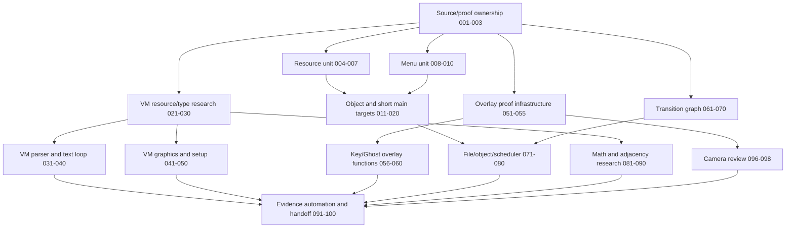

# Goemon 64 — 100-step matching-C architecture roadmap

**Status:** Architecture/design only. This plan does not claim implementation, new original-ROM checks, environment execution, publication, or function promotions.

**Reference:** `Jake-Arnold/Goemon-64-Tools`, branch `chatgptweb/decomp`, checked head `a68881da4b10e2553e7a89b7129d09d64b427435` (2026-11-10 23:13 UTC). Refresh before execution.

**Architectural objective:** Increase faithfully reconstructed original C while retaining bit-for-bit identity of the 32 MiB decompressed USA ROM. Preserve legacy toolkit features and main-branch history; work only on matching C and safe research within the development branch.

## Snapshot and constraints

- Verified: **142** newly matching functions, **10,652** function bytes; **155** combined C entries (includes 13 upstream), **7,221** ASM entries of 7,376 identified. `decomp/results/combined.json` reports `formal_verifier_run_completed=true` and 33,554,432-byte whole-ROM identity. Existing proof is not evidence for any subsequent candidate.
- Starting research: two resource wrappers (36+36 B) and three menu functions (84+80+84 B) produce exact combined research translation units; object dispatch (48 B) matched alone but has a swapped `lui` / `$ra` spill in the combined unit at ROM `0x35C9C` and `0x35CA0`. All six remain ASM in the live manifest.
- Unmatched follow-up: four short main-segment candidates (28/36/44/52 B); VM large research candidates; overlay `file_43` reference guard; camera upstream research is not production-matching C.
- Pin original inputs: upstream `klorfmorf/mnsg` SHA `7e2029c5c7beca705e7ded2c8fa85a5a21d1c3ee`, native IDO 5.3, Splat 0.36.3 and pinned MIPS toolchain; retail USA ROM SHA-1 `df8083a54296b8c151917c5333e1c85f014a2a66`; decompressed ROM SHA-1 `6ea0ed71032ce08fc2745f412d84936382197494`. No game assets, ROMs, generated assembly, saved games, raw memory, binary toolchains or personal diagnostics in Git.
- **Branch isolation:** Never modify or merge `main` as part of this roadmap. Preserve unrelated branches/worktrees and do not force-push. `AGENTS.md`, `decomp/CONTINUE.md` and the live proof are authoritative over historical checkpoint prose.
- **Architecture constraint:** Preserve original engine semantics, including unchecked original-index behavior; do not reinterpret decompilation as authorization for live memory writes, new warp shortcuts or replacing existing toolkit controls.

## Proof gates (mandatory common acceptance contract)

| Gate | Purpose | Minimum evidence | May increase matching count? |
|---|---|---|---|
| G0 — provenance | Correct source and target | Current branch SHA, manifest owner, original-ROM SHA, tool pins, function size and ROM/VMA boundary | No |
| G1 — research | Source plausibility and isolated exactness | Reviewed signatures, behavioral host test/mutants, native pinned IDO object, linked original-address bytes and relocations | No |
| G2 — production | Exact full-build replacement | Correct original translation-unit codegen, all previously matched function bytes, original ELF/symbol/section properties, complete linked build (2,331 objects at current baseline), 33,554,432-byte whole-ROM identity and inventory | **Yes**, only after G2 passes |
| G3 — publication | Traceable accepted change | Atomic manifest/source/proof/inventory/PROGRESS.md update, tested commit on `chatgptweb/decomp`, non-force push and remote SHA confirmation | Only reports accepted G2 claims |

**A matching *size*, hash of reference bytes, permuter zero score, synthetic test pass, or isolated original-address match is not G2.** A failing or incomplete G2 leaves the function as ASM. Reports must distinguish tests that actually ran from tests specified by this plan.

## Architectural dependency map



The numbered steps are a **priority catalogue** rather than a single unbroken serial path. Independent research lanes may run in parallel after their listed prerequisites. No long-running VM research should delay independent exact resource/menu promotions. No overlay promotion can precede G2-capable overlay verification.

## Conditional promotion arithmetic

| After passing G2 | Newly matching functions | Exact function bytes | Combined C entries | Remaining ASM entries |
|---|---:|---:|---:|---:|
| Current proven state | 142 | 10,652 | 155 | 7,221 |
| Two resource wrappers (+72 B) | 144 | 10,724 | 157 | 7,219 |
| Three menu functions (+248 B) | 147 | 10,972 | 160 | 7,216 |
| Object dispatcher (+48 B) | 148 | 11,020 | 161 | 7,215 |
| Four short main functions (+160 B) | 152 | 11,180 | 165 | 7,211 |

These are **conditional ceilings for the named batch, not forecasts**. If G2 fails, the count remains at its last proven level. Other promoted functions elsewhere would change the arithmetic and trigger step 099 reconciliation.

## 100 architecture steps

Each row is an executor-ready work package. The acceptance column states the discriminating check for that specific step; any matching-C promotion additionally requires G0–G3 as specified above.

### Phase A: Evidence and five near-ready promotions — steps 001–010

*Critical path; integrates existing exact research without reopening solved work.*

**001. Freeze live authority**  
**Dependencies:** HEAD/manifest/proof.  
**Design:** Record chatgptweb/decomp HEAD, AGENTS.md, CONTINUE.md, manifest, combined/inventory hashes and six ASM placeholder identities; segregate dated historical notes.  
**Acceptance test:** A machine-readable checkpoint has 142 claimed functions, 10,652 matched bytes, 155 C entries, 7,221 ASM entries, and no promoted candidate among the six.

**002. Validate claim ownership**  
**Dependencies:** 001.  
**Design:** Define one-to-one mapping of ROM offset/VMA, function name, translation unit, C owner or retained ASM; guard existing-source patch and no-padding exceptions.  
**Acceptance test:** Reject duplicates, missing ASM ownership, overlapping extents, changed patch hashes and false promotions in synthetic manifest fixtures.

**003. Specify proof tiers**  
**Dependencies:** 001-002.  
**Design:** Document G0 source/ROM provenance, G1 semantic + isolated codegen, G2 full translation-unit and complete-ROM verification, G3 inventory/regression/publication.  
**Acceptance test:** A candidate with only G1 evidence cannot alter manifest counts; failed G2 leaves original assembly and prior published proof intact.

**004. Review resource ABI**  
**Dependencies:** 002.  
**Design:** Inspect resource_dispatch.c, two candidate wrappers, called symbols 80034EF8/80034F44/80035044 and actual original ABI; preserve function order.  
**Acceptance test:** Typed declarations, first-call argument, delay-slot loading and 0x18 stack-frame requirements are supported by original instructions rather than guesses.

**005. Design resource ED4 replacement**  
**Dependencies:** 004.  
**Design:** Replace only func_80034ED4_35AD4 pragma in a staging checkout; preserve already matching func_80034EF8_35AF8 and C unit layout.  
**Acceptance test:** Native IDO emits 36 exact bytes at 0x80034ED4 with correct relocation, and existing middle function remains exact.

**006. Design resource F20 replacement**  
**Dependencies:** 005.  
**Design:** Replace func_80034F20_35B20 pragma in the same translation unit; retain distinct callee and original source order.  
**Acceptance test:** Both 36-byte wrappers plus existing 40-byte middle function reproduce 112/112 unit bytes; callback mock checks correct call targets.

**007. Gate resource promotion**  
**Dependencies:** 006,003.  
**Design:** Update staging manifest ownership for ED4/F20 and run the standard 2,331-object full-ROM gate plus inventory and resource host tests.  
**Acceptance test:** Only 33,554,432-byte identity, previous 142 exact functions and inventory preservation permit the conditional 144/10,724 milestone.

**008. Review menu ABI model**  
**Dependencies:** 002.  
**Design:** Derive shared MenuPanel/MenuOptions/MenuBit layout from empty_menu_hook.c, menu candidates and original +0x22/+0x64/+4/+0x18 accesses.  
**Acceptance test:** Compile-time layout guards and host cases preserve null checks, bit widths, pointer nesting and unchanged 8-byte hook.

**009. Design all three menu replacements**  
**Dependencies:** 008.  
**Design:** In original unit order replace 80011B60, 80011BB4, 80011C04; retain explicit 0xFF7F AND mask and non-cached nested dereference shape.  
**Acceptance test:** IDO native combined source matches all 256/256 bytes (8-byte hook + 84/80/84 functions); 90,000-case synthetic harness remains valid.

**010. Gate menu promotion**  
**Dependencies:** 007,009.  
**Design:** Verify menu changes in an actual project link; capture source hashes and before/after inventory, then update evidence atomically.  
**Acceptance test:** Only full-ROM and original-address proof of all five added functions permits the conditional 147/10,972 milestone; otherwise promote only independently passing units.


### Phase B: Object codegen and remaining short main-segment functions — steps 011–020

*Compilers and full-unit ownership determine eligibility, not isolated length.*

**011. Classify object mismatch**  
**Dependencies:** 001,003.  
**Design:** Compare original object_dispatch.c pair with integrated_object_dispatch_probe.c; annotate exact swapped instructions at 0x35C9C/0x35CA0.  
**Acceptance test:** Mismatch worksheet identifies original $ra spill vs lui ordering and demonstrates existing func_80035064_35C64 is unaffected.

**012. Recover object ABI and liveness**  
**Dependencies:** 011.  
**Design:** Trace func_80035094_35C94 parameter retention across first call, global reload and call to func_800350C4_35CC4; review signed/pointer types.  
**Acceptance test:** A register/liveness table specifies callee preservation, spill sites, function order and symbol bindings; no speculative semantic renames.

**013. Bound IDO variants for object dispatch**  
**Dependencies:** 012.  
**Design:** Try one supported C-expression/alias/lifetime variation per native IDO build, not opcode patching; retain all failed candidates and diffs.  
**Acceptance test:** An exact 96-byte combined unit becomes a G1 candidate; otherwise stop after a stated non-improvement budget and keep ASM.

**014. Gate object promotion**  
**Dependencies:** 010,013.  
**Design:** Stage object C only if true combined-unit matching; then full verifier, relocations, symbol inventory and host callback cases.  
**Acceptance test:** Conditional +48-byte promotion to 148/11,020 only with complete-ROM equality; known 8-byte discrepancy must never be waived.

**015. Revisit engine reset**  
**Dependencies:** 002.  
**Design:** Investigate func_8003A1E8_3ADE8 (28 bytes) and original u16/s8 adjacent globals, two stores, address construction and delay slot.  
**Acceptance test:** Host sentinels detect adjacent-field damage; native unit emits 28 exact bytes before G2 eligibility.

**016. Revisit state writer**  
**Dependencies:** 002.  
**Design:** Investigate func_80006274_6E74 (36 bytes), original halfword/word writes, base adjustment and stack/argument spill.  
**Acceptance test:** Store widths/offsets and delay-slot word store match original; host checks guard bytes, then G2.

**017. Revisit file-table second lookup**  
**Dependencies:** 002.  
**Design:** Investigate func_80001D94_2994 (44 bytes) adjacent to matching 80001D68, preserving different table base and 0x7FFFFFFF masks.  
**Acceptance test:** Test low-16-bit indexing, high-bit masking and original register schedule; exact 44-byte unit codegen precedes G2.

**018. Revisit file-size reader**  
**Dependencies:** 017.  
**Design:** Investigate func_80001DC0_29C0 (52 bytes), unsigned entry subtraction, zero-input branch, delayed return scheduling.  
**Acceptance test:** Host cases cover zero index, boundary unsigned subtraction and original branch behavior; original 52 bytes then G2.

**019. Integrate independently passing short functions**  
**Dependencies:** 015-018.  
**Design:** Batch compatible source neighbors without mixing unrelated ASM; allow partial integration if only a subset matches.  
**Acceptance test:** Every newly counted function passes exact current translation unit, original-address instructions, complete-ROM comparison and unchanged inventory.

**020. Record hard-stop decisions**  
**Dependencies:** 014,019.  
**Design:** Publish per-target disposition: promoted, exact isolated but unpromoted, mismatch, or blocked by proof; retain comparison diffs privately.  
**Acceptance test:** No prospective total is reported as achieved; PROGRESS.md and CONTINUE.md reconcile actual manifest/proof counts.


### Phase C: VM loader and resource interfaces — steps 021–030

*Recover real data contracts before expensive IDO permutation.*

**021. Map resource call graph**  
**Dependencies:** 002.  
**Design:** Trace script_vm.c unresolved 8003D468, 8003D68C, 8003F038 and matched 8003DDC4, plus resource table callees and callback side effects.  
**Acceptance test:** A call graph labels verified vs inferred signatures, global reads, side effects, and private ROM evidence links.

**022. Define narrow VM resource types**  
**Dependencies:** 021.  
**Design:** Propose confirmed-only structures and scalar widths in script_vm.h/support context; encode low-half big-endian resource-ID semantics.  
**Acceptance test:** Offset/static assertions and host-width/endian tests pass; no invented field can silently propagate into matching functions.

**023. Reproduce lookup candidate baseline**  
**Dependencies:** 022.  
**Design:** Replay volatile signed-half-index 8003F038_3FC38 (196 bytes, historically 25/42 comparable positions); identify register and relocation mismatches.  
**Acceptance test:** Native object is compared with original ROM, not reassembled text; every mismatch classified and baseline measurement reproducible.

**024. Refine lookup code generation**  
**Dependencies:** 023.  
**Design:** Focus original $v1 index, stack slot, signed truncation, 0x100 bypass, callback recovery and shift/wrap effects; vary one factor per attempt.  
**Acceptance test:** Exact original 196 bytes or an explicit failed bounded result; 3,000 synthetic cases and relocation checks remain mandatory.

**025. Model loader entry-versus-current ID**  
**Dependencies:** 021-022.  
**Design:** For 8003D468_3E068 preserve entry ID sent to 8003DDC4, while resource globals may mutate on two callbacks.  
**Acceptance test:** 1,024-case mutation harness catches stale cached reads, and low-half accessor tests match N64 big-endian semantics.

**026. Resolve loader ABI and frame**  
**Dependencies:** 025.  
**Design:** Recover original 548-byte 8003D468 stack layout ($s0/$s1) and 32-byte frame; test typed prefix and aliased global loads.  
**Acceptance test:** Pinned native output reproduces each identified load/call/order; a 548-byte length alone does not count as a match.

**027. Trace VM main-step 8003D68C**  
**Dependencies:** 021.  
**Design:** Recover CFG, live state and authoritative declarations for unresolved func_8003D68C_3E28C before writing C; identify callbacks and exit paths.  
**Acceptance test:** Document complete instruction/branch map, input/output contract, and a host-model test matrix; no speculative matching claim.

**028. Trace VM control decoder 8003DF98**  
**Dependencies:** 027.  
**Design:** Recover command delegation and cursor rules for func_8003DF98_3EB98, as called by existing stream walker.  
**Acceptance test:** For every negative-token family, static evidence defines cursor movement, return value and external side effects; unsafe inputs remain undefined.

**029. Guard already matching resource decoder**  
**Dependencies:** 025,028.  
**Design:** Add regression coverage for 8003DDC4_3E9C4's retry behavior and resource-ID mutation before changing shared types.  
**Acceptance test:** Existing matching machine code/hash unchanged; mutation tests intentionally fail when global ID is incorrectly cached.

**030. VM resource checkpoint**  
**Dependencies:** 024,026-029.  
**Design:** Stage only exact candidates in the original script_vm.c context; leave unresolved VM helpers as ASM.  
**Acceptance test:** Each selected function passes original guest address, full-ROM identity and inventory; otherwise close as research-only with precise next blocker.


### Phase D: VM parser, text loop and command execution — steps 031–040

*Prioritize register lifetime, branch-likely semantics and callback observability.*

**031. Construct text-loop control-flow graph**  
**Dependencies:** 021.  
**Design:** Decompose func_8003DBEC_3E7EC's outer/inner counters, six branch-likely delay slots, callbacks and script-pointer aliases.  
**Acceptance test:** Annotated 472-byte original graph covers every branch and delay slot, with data-liveness trace tied to original instructions.

**032. Resolve text-loop 0x48 frame**  
**Dependencies:** 031.  
**Design:** Investigate why research candidate has 0x50 frame despite 472-byte symbol; isolate saved-register, volatile global and script argument lifetimes.  
**Acceptance test:** A native IDO variant matches original 0x48 frame and branch layout without changing behavior, or records exact remaining words.

**033. Strengthen text-loop differential model**  
**Dependencies:** 031-032.  
**Design:** Retain original-MIPS versus host-C test harness for controller halfwords, +0xA work value, dynamic bounds and early return.  
**Acceptance test:** At least existing 10,000 deterministic synthetic scenarios pass; targeted mutants for signedness, stale bounds and aliasing are killed.

**034. Recover command-walker CFG**  
**Dependencies:** 028.  
**Design:** For 8003DE80_3EA80 retain signed halfword behavior and post-callback reread, negative-token handling and repeat suppression.  
**Acceptance test:** CFG explicitly models -1, other negative words, nonnegative words and callback-mutated current word; host tests exercise all paths.

**035. Fix command-walker delay slots**  
**Dependencies:** 034.  
**Design:** Use original 232-byte native codegen target, bltzl delay slot and $s0-$s3 allocation; compare bounded C control-flow shapes.  
**Acceptance test:** Exact original branch placement and 232 bytes before promotion; never accept a mere size-only variant or comparator score.

**036. Prove command-walker semantics**  
**Dependencies:** 034-035.  
**Design:** Run sentinels for state marker, output suppression, changed cursor/word after external calls and zero/nonzero repetition.  
**Acceptance test:** Original behavior differential passes for all modeled branches, including null delegate return; no unknown external effect is invented.

**037. Characterize 8003ED60 handler**  
**Dependencies:** 021.  
**Design:** Map currently retained-ASM func_8003ED60_3F960, identifying interpreter inputs, memory writes, callees and genuine CFG boundaries.  
**Acceptance test:** Reviewable original instruction map and narrow C signature precede a bounded exact-IDO candidate; no role inferred from address alone.

**038. Resolve 8003F6E8 extent**  
**Dependencies:** 002.  
**Design:** For func_8003F6E8_402E8 preserve original 48-byte extent, including trailing jr $ra/nop absent from 40-byte natural C prefix.  
**Acceptance test:** Original-function extent tests reject 40/56-byte confusion; full 48-byte codegen is required before G2.

**039. Build VM parser behavioral matrix**  
**Dependencies:** 033,036-038.  
**Design:** Compose semantic tests for parser loop, decoder and wrapper interactions without claiming a playable VM emulator.  
**Acceptance test:** All identified paths have expected state/cursor/callback traces; test mocks explicitly separate modeled from unknown effects.

**040. VM parser production gate**  
**Dependencies:** 032-039.  
**Design:** Integrate only fully matching text/parser/wrapper units using current translation-unit source with separate verified checkpoints.  
**Acceptance test:** Preserve all 142+ prior exact functions; whole ROM, 7,376-entry inventory and updated source hashes pass for every promotion.


### Phase E: VM graphics emitters, setup and formatting — steps 041–050

*Data layout, float ABI and instruction scheduling are main research risks.*

**041. Recover first display-list emitter**  
**Dependencies:** 002.  
**Design:** Inspect 8003E234_3EE34's 440 original bytes and 11 graphics-command emissions; type cursor, source arrays and ordered word stores.  
**Acceptance test:** Original MIPS/ROM word map and write-by-write register contract established before generating new source variants.

**042. Test first emitter memory model**  
**Dependencies:** 041.  
**Design:** Host-test mock destination capacity, first/last graphics words, cursor advancement, aliasing and unchanged guard regions.  
**Acceptance test:** All modeled 11 command writes match static original expectations; sanitizer guards catch out-of-bounds or skipped writes.

**043. Recover second display-list emitter**  
**Dependencies:** 041.  
**Design:** Independently reconstruct 8003EBAC_3F7AC (436 bytes), preserving distinct resource pointers, opcodes and store order.  
**Acceptance test:** A second command-word trace demonstrates where emitters differ; no unsupported shared macro changes compiler scheduling.

**044. Compare first/second compiler layouts**  
**Dependencies:** 042-043.  
**Design:** Revisit previous 516/500-byte candidates and volatile cursor variants; isolate exact register/pointer declarations.  
**Acceptance test:** Each targeted native codegen probe reports first differing instruction/relocation and whether original size is met; no size-only acceptance.

**045. Recover VM setup callback ABI**  
**Dependencies:** 021.  
**Design:** Analyze 8003F37C_3FF7C's 192 bytes, float argument staging, 0x50 stack frame, three calls and callback values.  
**Acceptance test:** Host test verifies call order, float storage bits and untouched memory; original FPU/register arrangement required for G1.

**046. Recover callback setup path**  
**Dependencies:** 045.  
**Design:** Analyze 8003E6C0_3F2C0 (348 bytes) against 400-byte research candidate, its branches and callback-modified globals.  
**Acceptance test:** All branches represented in tests; original layout and 348-byte native codegen proven before promotion.

**047. Resolve number formatter**  
**Dependencies:** 021.  
**Design:** Analyze func_8003F480_40080 (164 bytes), sprintf argument preparation, destination halfword stream and bnel delay slot.  
**Acceptance test:** Exact native branch/argument code shape, original 164 bytes and formatting edge-case host cases required; avoid host printf locale assumptions.

**048. Test VM graphics integration boundary**  
**Dependencies:** 041-047.  
**Design:** Compose sandbox tests confirming display-list emitters and setup code do not corrupt VM state or neighboring buffers.  
**Acceptance test:** Deterministic mock traces and guard regions pass with ASan/UBSan; static/host results identified as non-game evidence.

**049. Stage qualifying VM graphics routines**  
**Dependencies:** 044-048.  
**Design:** Replace only G1-exact functions in original script_vm.c order, retaining assembly for other large VM targets.  
**Acceptance test:** Production translation-unit and full-ROM G2 passes; no translator drift in previously promoted VM helpers.

**050. Close VM candidate inventory**  
**Dependencies:** 030,040,049.  
**Design:** Reconcile all 13 original unpromoted VM entries against current manifest and new proofs; label every blocked function.  
**Acceptance test:** Machine-readable residual VM list has verified state, original extent, current source and concrete mismatch, not a guessed percent-complete metric.


### Phase F: Overlay verification and two concrete game-overlay targets — steps 051–060

*Overlay ROM offsets and load addresses require a different, strict proof model.*

**051. Specify overlay manifest schema**  
**Dependencies:** 003.  
**Design:** Model segment ID, ROM ranges, VMA, text/rodata boundaries, relocation provenance and source ownership distinct from main-segment linear map.  
**Acceptance test:** Schema rejects main VMA formula on overlays, duplicate overlays/functions, negative ranges and cross-segment overlap.

**052. Promote file_43 reference guard to input contract**  
**Dependencies:** 051.  
**Design:** Reuse overlay_file43.py's pinned 0x6F34E0..0x6FB200 layout and original section SHA-256 evidence.  
**Acceptance test:** Tests reject changed Splat segment order, 0x08000000 VMA, section hashes, wrong ROM length or wrong source SHA-1.

**053. Add overlay linked-ELF provenance**  
**Dependencies:** 051-052.  
**Design:** Design section/symbol extraction from original and candidate overlay ELF, explicitly binding each function to ROM and original load address.  
**Acceptance test:** A shifted VMA, mismatched relocation target, missing symbol or wrong section size fails before any function claim.

**054. Expand fail-closed overlay tests**  
**Dependencies:** 052-053.  
**Design:** Create mutation fixtures for text/rodata padding, aliases, duplicate function bounds, symbol-size lies and altered undefined relocations.  
**Acceptance test:** Each intentionally corrupted fixture fails, while untouched main-segment verifier continues passing its existing regression suite.

**055. Define overlay integration adapter**  
**Dependencies:** 053-054.  
**Design:** Stage overlay Splat split and C replacement as a guarded capability in verify.py, leaving existing main-path behavior unchanged.  
**Acceptance test:** Exact overlay object placement and generated assembly ownership established; complete ROM comparison cannot be bypassed.

**056. Prepare key initializer replacement**  
**Dependencies:** 055.  
**Design:** Review func_080001BC_6F369C (96 bytes), task +0xD4, saved key flag, callback and unknown external symbols in the real overlay.  
**Acceptance test:** Existing isolated 96-byte match reproduces in original overlay context; recovered signature/field widths have instruction evidence.

**057. Prove key initializer semantics**  
**Dependencies:** 056.  
**Design:** Test key-collected and not-collected host callback flow, task-state update and unchanged sentinel fields.  
**Acceptance test:** Key cases and control-flow guards pass, and no key spawn or game-memory edit is introduced into toolkit features.

**058. Resolve Ghost Toys entrance spill**  
**Dependencies:** 055.  
**Design:** For func_08006490_6F9970 (140 bytes), isolate sp+0x1C original vs sp+0x18 candidate store/reload; preserve pointer lifetime.  
**Acceptance test:** Exact original 35 words and both spill operands arise from reviewed native IDO source, not manual opcode patching.

**059. Prove Ghost event logic**  
**Dependencies:** 058.  
**Design:** Model flags 0x19A/0x19B gate, writing 0x19C, task +0x60 bit, helper argument 0x224 and callback replacement.  
**Acceptance test:** Both precondition branches and callback sequence pass host tests; missing/unknown field assumptions recorded explicitly.

**060. Gate overlay promotions**  
**Dependencies:** 055-059.  
**Design:** Rebuild complete ROM with individual or combined overlay C candidates; compare original-address bytes, full image and total symbol inventory.  
**Acceptance test:** Only functions with exact overlay provenance and whole-ROM identity gain matching counts; no claim if overlay adapter or linker fails.


### Phase G: Engine state and room transition dependencies — steps 061–070

*Static native reconstruction only; no new warp, unload or memory-write controls.*

**061. Draw native transition state graph**  
**Dependencies:** 002.  
**Design:** Connect matching 80003728/80003628/80003528/80003428/80003380 helpers to dispatcher 8001F8B0 and pending 800030F0.  
**Acceptance test:** Graph labels observed function effects separately from unproven room loading/unloading semantics.

**062. Trace file/resource loading boundary**  
**Dependencies:** 061.  
**Design:** Follow 80001C00_2800 and table paths toward resource allocation, room scene activation and releases without changing runtime features.  
**Acceptance test:** Call-edge table identifies which data are files, RAM pointers, overlays or object lists and what remains unknown.

**063. Analyze middle transition dispatcher**  
**Dependencies:** 061.  
**Design:** Recover func_8001F940_20540 between already matched 8001F914 and 8001FA3C; inspect all global changes/calls.  
**Acceptance test:** CFG and typed signature have original evidence; host test distinguishes state branches before G1/G2.

**064. Analyze transition loop 8000394C**  
**Dependencies:** 061-063.  
**Design:** Map func_8000394C_454C original stack, step dispatch and state byte updates inside transition_state.c.  
**Acceptance test:** All branches accounted for and sentinel state tests pass; no claim that this alone implements safe scene transition.

**065. Revisit engine state 80039F84**  
**Dependencies:** 061.  
**Design:** Study earliest unresolved engine_state.c function and interactions with D_801C09CE/CF and nearby matched helpers.  
**Acceptance test:** Original C-call/field-width contract plus host state-table tests precedes native compiler matching.

**066. Revisit engine state 8003A060**  
**Dependencies:** 065.  
**Design:** Study next retained-ASM engine_state.c function; identify frame, globals, conditional writes and call effects.  
**Acceptance test:** Static CFG is complete and exact G1 codegen achieved or bounded mismatch logged.

**067. Revisit engine state 8003A138**  
**Dependencies:** 066.  
**Design:** Recover adjacent 8003A138_3AD38 and compare with existing 8003A1C4 / 8003A204 / 8003A228 semantics.  
**Acceptance test:** No accidental adjacent-global aliasing; signedness/byte-write regression and production-codegen proof when eligible.

**068. Review default entrance 80020F10**  
**Dependencies:** 061-064.  
**Design:** Model func_80020F10_21B10 adjacent to matching 80021444/214E4; separate entrance record selection from load requests.  
**Acceptance test:** Test all-zero triplet semantics and room indices against original data accesses; do not expose a generic warp API.

**069. Architect transition safety assertions**  
**Dependencies:** 061-068.  
**Design:** Add static/synthetic checks for correct state sequencing, resource pointer validity assumptions and absence of toolkit writes.  
**Acceptance test:** Tests fail on invalid inferred scene unload shortcuts; documented evidence clearly separates native behavior from controllable API.

**070. Gate transition slice**  
**Dependencies:** 063-069.  
**Design:** Integrate only exact transition/engine/default-entrance C functions after original-unit and full-image verification.  
**Acceptance test:** Any promotion preserves the ROM and current host tests; speculative state-machine findings stay documentation-only.


### Phase H: Files, object lifecycle and scheduler — steps 071–080

*Cross-unit contracts and side effects take precedence over automatic batch matching.*

**071. Inspect file-table reader 80001DF4**  
**Dependencies:** 017-018.  
**Design:** Map function's table base, index widths, mask and downstream callers without assuming identical semantics to adjacent 80001D68.  
**Acceptance test:** Document symbol references and test each table index/bit mask case before an exact candidate.

**072. Inspect file-table reader 80001E50**  
**Dependencies:** 071.  
**Design:** Recover segment record access, branch structure and return semantics for 80001E50_2A50.  
**Acceptance test:** Host fixture uses boundary indices and sentinel table entries; original-address codegen is required to stage C.

**073. Inspect file-table reader 80001EB0**  
**Dependencies:** 072.  
**Design:** Recover final retained-ASM function in file_table.c and any shared data declaration constraints.  
**Acceptance test:** Complete function-level ABI ledger, exact isolated comparison and G2 if qualified; otherwise unresolved ASM remains.

**074. Characterize object list 80036308**  
**Dependencies:** 012.  
**Design:** Use matched 800362DC and object_flags.h to derive next function's pointer iteration and flag updates.  
**Acceptance test:** A host linked-list test exercises empty/single/multiple nodes and keeps byte flags outside selected field unchanged.

**075. Characterize object list 80036388**  
**Dependencies:** 074.  
**Design:** Recover subsequent object_flags.c function and compare call/loop structure without assuming it is a flag setter.  
**Acceptance test:** Observed behavior and pointer traversal proven from original instructions; test invalid-pointer assumptions are excluded.

**076. Characterize object list 800363F4**  
**Dependencies:** 075.  
**Design:** Reconstruct next object lifecycle routine; identify callback writes, ownership and memory allocation/free behavior.  
**Acceptance test:** Test callbacks and list tail/head mutation in synthetic memory; no live-game safety inference.

**077. Characterize object list 80036448**  
**Dependencies:** 076.  
**Design:** Complete this known four-function assembly neighborhood and check shared header field aliasing.  
**Acceptance test:** If functions match, all four pass same-unit IDO and full-ROM gate; otherwise preserve each separately as ASM.

**078. Analyze scheduler 8000702C**  
**Dependencies:** 002.  
**Design:** Inspect func_8000702C_7C2C adjacent to matching pointer-offset helper 80007024 and characterize queue layout.  
**Acceptance test:** Test empty/single/multiple queue cases and exact pointer arithmetic in a 32-bit host model.

**079. Analyze scheduler 80007160**  
**Dependencies:** 078.  
**Design:** Recover second scheduler_queue.c ASM function; assess ordering, interrupt/state assumptions and alias relationships.  
**Acceptance test:** Static and mocked call-order checks cover actual branches; G1 then G2 needed before promotion.

**080. Gate files/object/scheduler batch**  
**Dependencies:** 071-079.  
**Design:** Avoid combining independent failures in one manifest commit; integrate verified subsets with separate proofs.  
**Acceptance test:** Full-ROM exactness, preserved names/sections and function-specific host tests; record remaining caller graph gaps.


### Phase I: Math, angular helpers and adjacent low-risk slices — steps 081–090

*Target adjacent functions with established upstream types; guard float and MIPS bit semantics.*

**081. Analyze math helper 8000E2D4**  
**Dependencies:** 002.  
**Design:** Recover float parameters, trig/helper calls and 10-bit angle masking adjacent to matched 8000E28C.  
**Acceptance test:** Host input table covers zero axes, sign changes, wrap and confirmed float round-off; exact FPU instruction trace required.

**082. Analyze math helper 8000E39C**  
**Dependencies:** 081.  
**Design:** Map 8000E39C_EF9C source operands and intermediate float conversion, preserving original call order.  
**Acceptance test:** Reference trace and edge-case host tests cover observed rounding; mismatch report distinguishes semantics from codegen.

**083. Analyze math helper 8000E4E4**  
**Dependencies:** 082.  
**Design:** Map 8000E4E4_F0E4 and reuse only type declarations demonstrated by preceding original MIPS.  
**Acceptance test:** Native original-address codegen/relocation and unchanged neighboring math C before G2.

**084. Analyze angle variant 8000EA74**  
**Dependencies:** 081.  
**Design:** Study 8000EA74_F674 near matching 8000EABC, including sign/order of helper arguments and mask width.  
**Acceptance test:** Angular quadrant/wrap host test passes, with exact IDO call and return scheduling.

**085. Analyze angle variant 8000EB08**  
**Dependencies:** 084.  
**Design:** Recover original register argument allocation and angle mask arithmetic for 8000EB08_F708.  
**Acceptance test:** Host cases include boundary 0/0x3FF and sign flips; exact native instructions required.

**086. Analyze angle variant 8000EB50**  
**Dependencies:** 085.  
**Design:** Recover last angle_variant.c retained-ASM helper, compare shared call signatures and downstream consumers.  
**Acceptance test:** Same-unit type consistency and original-address proof; unresolved function never promoted on functional resemblance alone.

**087. Analyze dispatcher 8001F8B0**  
**Dependencies:** 061-063.  
**Design:** Study three-entry state dispatcher and ROM 0x6C330 address table, preserving ordered pointer reads and indirect calls.  
**Acceptance test:** Mock dispatch covers all three state choices and default behavior; original codegen/linking validated.

**088. Analyze 8001FA80 adjacent routine**  
**Dependencies:** 087.  
**Design:** Inspect remaining 8001FA80_20680 in rotation_angles.c and check relation to resource/global state calls.  
**Acceptance test:** Evidence-backed CFG and effects table; integration leaves existing two matched branches byte-identical.

**089. Select first float-state batch**  
**Dependencies:** 081-086.  
**Design:** Inspect float_state.c's five ASM functions, beginning with 8000643C_703C beside matched setter 80006430.  
**Acceptance test:** Prioritize by concrete layout and instruction complexity; compare float bit patterns, NaN and sign-zero only where original specifies behavior.

**090. Audit misleading trivial-function names**  
**Dependencies:** 002.  
**Design:** Review return_zero.c's 13 ASM entries individually; do not infer they all return zero from unit name.  
**Acceptance test:** Per-function original size, side effect and CFG classification generated; only genuinely trivial, exact candidates proceed to G2.


### Phase J: Research automation, camera reconnaissance and sustainable handoff — steps 091–100

*Make future matching work repeatable without weakening acceptance or touching main.*

**091. Define candidate evidence ledger**  
**Dependencies:** 003,020.  
**Design:** Standardize per-function entries: unit, original size/VMA/ROM, candidate hash, exactness tier, tests, failed words, blocker, proof run.  
**Acceptance test:** Schema rejects missing original provenance and conflation of isolated/whole-ROM matches; prior reports can be imported without rewriting history.

**092. Rank research by evidence not byte size**  
**Dependencies:** 050,080,090.  
**Design:** Extend batch queue selection beyond prior 762 scalar attempts using reviewed type context, callers, known exact siblings and bounded expected effort.  
**Acceptance test:** Dry-run plan contains only unpromoted symbols and stable recipe hashes; rerun unchanged recipes excluded by default.

**093. Reuse typed C context safely**  
**Dependencies:** 022,061,074.  
**Design:** Create versioned, declaration-only context bundles for VM, object, scene and math families with source evidence references.  
**Acceptance test:** Context changes invalidate old isolated proof identity; compilation tests flag conflicting types and unexpected symbol changes.

**094. Classify native codegen failures**  
**Dependencies:** 011,023,032,044.  
**Design:** Provide mismatch categories (size, register, delay slot, relocation, padding, symbol, section, original-boundary), with first differing instruction.  
**Acceptance test:** Parser unit tests intentionally inject each failure and assert fail-closed classifications; no mask-based false positives.

**095. Harden automated proof regression**  
**Dependencies:** 003,051-055.  
**Design:** Compose CI-capable structural/host checks plus an optional private local-ROM gate without uploading ROM or generated bytes.  
**Acceptance test:** Public jobs never need proprietary assets; private gate rejects modified ROM, shifted function bytes and stale proof hashes.

**096. Inventory upstream camera research**  
**Dependencies:** 055.  
**Design:** Review pinned mnsg camera branch f1a86c3, compare original overlay source symbols with current main baseline; treat all camera C as unverified.  
**Acceptance test:** Separate evidence index lists already known structure hints, unresolved C functions and version-specific constraints; nothing merged.

**097. Resolve camera initializer C mismatch**  
**Dependencies:** 096.  
**Design:** Investigate 8001D27A4_58E6B4 link failure from unexpected memset call against original inline clearing loop.  
**Acceptance test:** Native codegen research eliminates unsupported memset without linker alias patches; no promotion until original overlay ROM proof.

**098. Design camera subset promotion process**  
**Dependencies:** 055,096-097.  
**Design:** Choose smallest independently bounded camera functions with known ROM/VMA, types and original assembly; isolate from mass 4,600-line import.  
**Acceptance test:** Candidates are individually original-address verified and full-ROM accepted; camera branch not merged wholesale or counted by source lines.

**099. Re-baseline architecture after each phase**  
**Dependencies:** 010,020,030,040,050,060,070,080,090.  
**Design:** Compare live branch, manifest, proof and residual ASM with planned targets; drop already promoted or invalid targets and re-rank blockers.  
**Acceptance test:** A dated delta report contains achieved promotions, failed/blocked steps, revised critical path and no duplicated work.

**100. Publish executor-ready next-wave contract**  
**Dependencies:** 091-099.  
**Design:** Create final architecture decision record, dependency DAG, prioritized new ten-target tranche and explicit tool/ROM proof contract; edit only decomp branch docs.  
**Acceptance test:** Future executor can identify unambiguous target, required inputs, exact stop conditions and acceptance tests without relying on chat history.

## Cross-cutting architecture decisions

1. **Source ownership before output:** The manifest owns exact function identities; retained `GLOBAL_ASM` is not a failure but the correct representation for unresolved functions. Keep original translation-unit order and padding behavior.
2. **Zero implicit compiler trust:** All source variants use the original IDO binary and flags. Relocations are verified in their real link context; reassembling textual `.s` with GNU as is not a substitute for native IDO output.
3. **No manufactured matches:** Never edit original ROM, candidate output bytes, linker relocation masks, section padding or comparison assumptions to force acceptance. A changed C expression must have an ABI/alias/control-flow rationale.
4. **Private vs publishable evidence:** Local private ROM, originals, builds and derived binary dumps remain in ignored storage. Publish only source, tests, sanitized hashes and outcome metadata.
5. **Behavior and byte identity are separate:** ASan/UBSan host and synthetic tests establish modeled semantics; exact codegen and whole-ROM checks establish matching-C acceptance. Neither alone proves live gameplay behavior.
6. **Do not re-run stale broad sweeps:** The previous 762-function scalar batch is documented. Spend effort on identified type/ABI failures, overlay ownership and neighbors with matching context.
7. **Immutable evidence:** Each verifier attempt gets a new work directory/report. Never overwrite historical results or silently convert archived prior tests into new claims.
8. **Scoped commits:** Every source change updates root PROGRESS.md with reason, tests actually executed, limitations and next actions. Review exact staged files; push only to chatgptweb/decomp.

## Risk register and mitigations

| Risk | Consequence | Mitigation / stop rule |
|---|---|---|
| IDO scheduling changes between standalone and full unit | False promotion | Require entire native C unit and G2; object-dispatch 8-byte difference is the standing regression |
| Stale branch or old 136-function archive | Baseline mismatch | HEAD/manifest/proof source-hash verification at every execution; no staged promotion until current 142+ source is present |
| Incorrect VM pointer/halfword widths | Functional but non-identical C | Type evidence from original accesses; static offsets; mutation-based host cases; per-instruction comparison |
| Incorrect overlay ROM/VMA translation | Wrong function proof | Overlay-specific section provenance; fail-closed structural tests; full-image equality |
| Camera branch mass import | Misleading apparent progress | Function-level independent provenance, isolate `memset` codegen issue, never count source lines as matches |
| Previous historical prose contradicts live proof | Duplicate work | Live manifest + combined/inventory JSON + current runbook always win; step 099 re-baselines |
| ROM or diagnostic leakage | Copyright/privacy exposure | Private local assets only, ignore rules, hash-only evidence and staged file review |
| Scope creep into game modifications | Unverified behavior/safety | Decomp-only branch, no writes/warps/game action, preserve existing toolkit paths |

## Executor task packet template

For each step, the implementer should receive the following precise packet (filled from this plan and fresh repository data):

```text
Task ID: G64-###
Branch: chatgptweb/decomp (fresh HEAD required)
Owner: identified .c/.h, candidate, tests and manifest fields
Goal: one bounded architectural change
Original: function name + VMA + ROM offset + native extent + hash
Known dependencies: exact upstream, types, symbols, linker and prior steps
Do not change: main branch, ROM, verifier acceptance policy, unrelated features
Work: inspect original -> implement minimal C -> native compile -> focused tests
Evidence: semantic tests + codegen mismatch + source hashes
Promotion gate: full project linked exact ROM (baseline currently 2,331 objects) + 7,376-entry inventory
Commit gate: PROGRESS.md in same commit, no raw/private files, remote SHA checked
Failure: retain ASM, record first mismatching word and next hypothesis; move on
```

## Principal codebase references reviewed

- `AGENTS.md`: contributor guardrails and publication requirements.
- `decomp/CONTINUE.md`: operational handoff, current proof and exact verifier commands.
- `decomp/NEXT_TWENTY_STEPS.md`: immediate integration sequence and no-false-promotion rules.
- `decomp/MASTER_WORK_QUEUE.md`: consolidated VM/overlay backlog and historical research warnings.
- `decomp/manifest.json` and `decomp/results/{combined,inventory}.json`: current claimed function ownership and verification.
- `decomp/verify.py`, `inventory.py`, `compare_original.py`, `batch.py`, `probe.py`, `prove_integrated_units.py`: compilation/ELF/original-byte proof pipeline.
- `decomp/resource_dispatch.c`, `object_dispatch.c`, `empty_menu_hook.c`, `script_vm.c`, `file_table.c`, `engine_state.c`, `object_flags.c`, `scheduler_queue.c`, `default_entrance.c`: selected source units and retained ASM boundaries.
- `decomp/overlay_file43.py`, `NEXT_FIVE_ACTIONS.md`, `GHOST_TOYS_CHECKPOINT.md`: overlay reference checks, key initializer and Ghost entrance blocker.
- `decomp/LOCAL_MNSG_REVIEW.md`, `BATCH_PIPELINE.md`, `NEXT_TEN_FUNCTIONS.md`: upstream camera research and bounded candidate-generation history.

**End state:** A falsifiable, maintainable decompilation process with candidate-by-candidate proof. There is no guaranteed promotion count or target date beyond the conditional checkpoints above.

## 2026-11-11 addendum — REA feasibility before automation adoption

REA's current Ghidra-MIPS provider has an ISA admission boundary at **ELF32 MIPS32r2 or narrowly defined legacy MIPS-I/MIPS32/MIPS32r2 executables**, not generic Nintendo 64 binaries. The pinned original Goemon Makefile builds `-mips2` and assembles for VR4300 big-endian o32. Actual linked ELF header and ABI records have not been inspected, so **REA Goemon compatibility is unknown and likely constrained, not verified**. Direct raw Z64 admission for MIPS is not documented. Read [REA_PILOT.md](REA_PILOT.md) before allowing any REA task.

This is an **optional four-gate research lane** R01 ISA/provider admission; R02 ten currently accepted-function control comparisons; R03 one unresolved 196-byte VM lookup; R04 evidence-based GO/NO_GO and fallback. It **does not increase the 100 numbered G64 tasks**, does not delay early resource/menu integration, and changes no C/ASM promotion policy. Twenty-eight G64 tasks carry optional research assistance metadata in `TASKS_100.json`. The supporting synthetic-only preflight tests were run (12/12); no Goemon ROM or ELF was analyzed by REA. A direct Ghidra read-only workflow may be considered separately if REA refuses.
